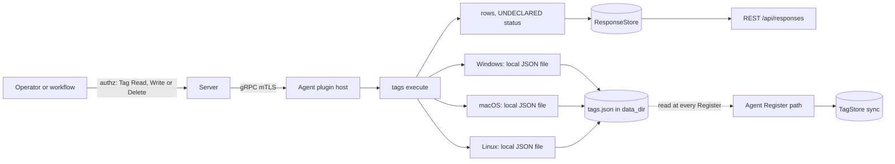
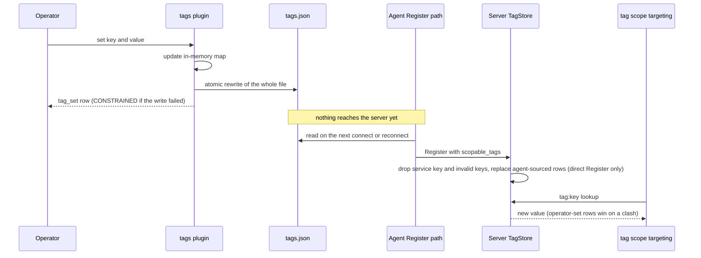

# tags

<!-- BEGIN GENERATED: plugin-doc-gen header -->
| | |
|---|---|
| **What it does** | Device tagging — set, get, delete, list tags for scope evaluation |
| **Version** | 0.1.0 |
| **Kind** | Action · mutating · gathered (device.tags.set, device.tags.get, device.tags.get_all, device.tags.delete, device.tags.check, device.tags.clear, device.tags.count) |
| **Platforms** | Windows ✅ · macOS ✅ · Linux ✅ |
| **Actions** | `check` (definition `device.tags.check`) · `clear` (definition `device.tags.clear`) · `count` (definition `device.tags.count`) · `delete` (definition `device.tags.delete`) · `get` (definition `device.tags.get`) · `get_all` (definition `device.tags.get_all`) · `set` (definition `device.tags.set`) |
| **Security** | `set`: securable `Tag` · operation Write · risk Medium · dispatch Mutating · approval gate None; `get`: securable `Tag` · operation Read · risk Low · dispatch ReadOnly · approval gate None; `get_all`: securable `Tag` · operation Read · risk Low · dispatch ReadOnly · approval gate None; `delete`: securable `Tag` · operation Delete · risk High · dispatch Mutating · approval gate None; `check`: securable `Tag` · operation Read · risk Low · dispatch ReadOnly · approval gate None; `clear`: securable `Tag` · operation Delete · risk High · dispatch Destructive · approval gate AdminOrApproval; `count`: securable `Tag` · operation Read · risk Low · dispatch ReadOnly · approval gate None |
| **Roles** | execute: `set`: endpoint-admin, endpoint-operator; `get`: endpoint-admin, endpoint-operator; `get_all`: endpoint-admin, endpoint-operator; `delete`: endpoint-admin, endpoint-operator; `check`: endpoint-admin, endpoint-operator; `clear`: endpoint-admin; `count`: endpoint-admin, endpoint-operator · author: content-author |
<!-- END GENERATED -->

## How it works

`tags` keeps a small set of free-form key/value labels on the device, in a flat JSON file named `tags.json` in the agent's data directory. The plugin loads that file into memory when it starts. `set`, `get`, `get_all`, `delete`, `check` and `count` then work on the in-memory copy, and `set`, `delete` and `clear` rewrite the whole file after each change. `set` checks the key length (64 bytes at most) and the value size (448 bytes at most) before it writes. `clear` removes every tag in one call; it is the only Destructive action here, the only one gated `AdminOrApproval`, and the only one restricted to `endpoint-admin`.

The plugin is deliberately not the channel that reaches the server. Separately from this plugin, the agent reads `tags.json` from disk each time it sends a Register request (when it connects or reconnects) and sends the contents as `AgentInfo.scopable_tags`. The server drops any `service` key, drops keys outside its own key rules, and, for an agent that registers directly with the server, replaces the agent-reported rows in its tag store with the rest. Those stored rows are what `tag:<key>` scope targeting reads first. An agent that registers through the gateway never has its tags written to the tag store (the server's registry notes "ProxyRegister has no TagStore call"); for it the server keeps the same filtered tags only in the in-memory session and falls back to them when the store has no row. Either way, a tag set here steers targeting only after the agent next registers. The structured four-category role, environment, location and service tags belong to the sibling `asset_tags` plugin.



### What you can decide with it

| Question | Action | What you learn |
|---|---|---|
| Does this device carry tag X, and with what value? | `check`, `get` | The agent's local copy of the tag. This is what the device itself holds, not what the server's scope targeting currently sees. |
| What does the device say about itself? | `get_all`, `count` | Every local tag and the total. The same on Windows, macOS and Linux; the plugin reads and writes only a file, so there is no per-OS difference and no OS-level failure to report. |
| Label a device so a later scope can find it | `set` | Writes the local file. The label becomes targetable by `tag:<key>` after the agent's next Register. |
| Remove one label, or all of them | `delete`, `clear` | Edits the local file. `clear` is Destructive and Irreversible, needs an explicit in-scope target (no fleet broadcast), and there is no undo other than setting the tags again. |

What it cannot tell you: whether the server has already picked up a change, and what the server holds for the device. To see what the server's tag store holds, read the `tags` array (key, value, source) on the server's device detail, `GET /api/v1/devices/{id}`, not this plugin; that array comes from the tag store only, so for a gateway-registered agent it does not show tags the agent reported itself. A clean `set` row proves the in-memory tag changed; only the absence of a `CONSTRAINED` status proves the file was replaced.

Safe workflow for a retag: `get_all` to record the current set, `set` or `delete` the keys, `get_all` again to confirm, then wait for the agent to reconnect (or restart it) before relying on `tag:` targeting. Tags set here are device-authored; a same-named tag set by an operator on the server wins over the agent-reported one.

### Diagrams



The diagram shows two separate paths. The plugin only changes the local file; the agent's Register path, which does not go through the plugin, carries the file to the server. Until the next Register, scope targeting on the server still sees the old tag set.

## OS capability

<!-- BEGIN GENERATED: plugin-doc-gen capability -->
| Action | Windows | macOS | Linux |
|---|---|---|---|
| `check` | ✅ supported · rung 1 · local_json_store | ✅ supported · rung 1 · local_json_store | ✅ supported · rung 1 · local_json_store |
| `clear` | ✅ supported · rung 1 · local_json_store | ✅ supported · rung 1 · local_json_store | ✅ supported · rung 1 · local_json_store |
| `count` | ✅ supported · rung 1 · local_json_store | ✅ supported · rung 1 · local_json_store | ✅ supported · rung 1 · local_json_store |
| `delete` | ✅ supported · rung 1 · local_json_store | ✅ supported · rung 1 · local_json_store | ✅ supported · rung 1 · local_json_store |
| `get` | ✅ supported · rung 1 · local_json_store | ✅ supported · rung 1 · local_json_store | ✅ supported · rung 1 · local_json_store |
| `get_all` | ✅ supported · rung 1 · local_json_store | ✅ supported · rung 1 · local_json_store | ✅ supported · rung 1 · local_json_store |
| `set` | ✅ supported · rung 1 · local_json_store | ✅ supported · rung 1 · local_json_store | ✅ supported · rung 1 · local_json_store |
<!-- END GENERATED -->

## Privileges and prerequisites

| OS | Runs as | Extra grant needed | Measured | If the read is refused |
|---|---|---|---|---|
| Windows | agent service account; LocalSystem today, not yet the intended `NT SERVICE\YuzuAgent` (see `docs/agent-privilege-model.md`) | None; plain file I/O under the data directory (the shared writer uses `ReplaceFileW`, which needs no extra privilege) | 2026-09-07 on bare metal as SYSTEM | No refusal path for reads. A failed write of `tags.json` is logged and declared `CONSTRAINED` / `tags:persist_failed` on `set`, `delete` and `clear` (see Result status) |
| macOS | agent daemon as root; the shipped LaunchDaemon has no `UserName` key (`docs/agent-privilege-model.md`) | None | 2026-09-07 on bare metal as an interactive non-root user, not the production root daemon | Same as Windows |
| Linux | dedicated unprivileged account (`yuzu-agent` on the packaged unit; `docs/agent-privilege-model.md`) | None | 2026-09-06 in a container as root, more privileged than the production account | Same as Windows |

No external binaries, no subprocesses, no network access; every action reads or writes a local JSON file in process.

## Data contract

### Inputs

<!-- BEGIN GENERATED: plugin-doc-gen inputs -->
| Definition | Parameter | Type | Required | Default | Constraints | Description |
|---|---|---|---|---|---|---|
| `device.tags.check` | `key` | string | yes | - | maxLength 64 | The tag key to check for existence. |
| `device.tags.delete` | `key` | string | yes | - | maxLength 64 | The tag key to delete. |
| `device.tags.get` | `key` | string | yes | - | maxLength 64 | The tag key to look up. |
| `device.tags.set` | `key` | string | yes | - | pattern: ^[a-zA-Z0-9_.:\-]+$ · maxLength 64 | The tag key. Max 64 characters, alphanumeric plus _-.: |
| `device.tags.set` | `value` | string | no | - | maxLength 448 | The tag value. Max 448 bytes. |
<!-- END GENERATED -->

### Outputs

Every action writes one or more pipe-delimited lines through the plugin's output call. There is no shared discriminator across actions: each uses its own literal first field (`tag_set`, `tag`, `tag_deleted`, `tag_exists`, `tags_cleared`, `count`) rather than the field names declared below. An unset value reports as an empty string (a trailing empty field), never a `-` placeholder; see the macOS sample's `get`. A validation failure returns `rc=1` and a single `error|<message>` line instead of the success row.

<!-- BEGIN GENERATED: plugin-doc-gen outputs -->
**`device.tags.check` — `key|exists`**

| Field | Type | Values | Available | Example | Description |
|---|---|---|---|---|---|
| `key` | string | - | Windows, Linux, macOS | `yuzu_capture_tmp` | The tag key that was checked, echoed back from the request. Values: free text. |
| `exists` | bool | - | Windows, Linux, macOS | `false` | Whether the key currently exists. Values: true, false. |

**`device.tags.clear` — `cleared_count`**

| Field | Type | Values | Available | Example | Description |
|---|---|---|---|---|---|
| `cleared_count` | int32 | - | Windows, Linux, macOS | `-` | Number of tags that were removed by this call — the store's size immediately before clearing. Values: integer >= 0. |

**`device.tags.count` — `count`**

| Field | Type | Values | Available | Example | Description |
|---|---|---|---|---|---|
| `count` | int32 | - | Windows, Linux, macOS | `0` | Total number of tags currently stored. Values: integer >= 0. |

**`device.tags.delete` — `key|found`**

| Field | Type | Values | Available | Example | Description |
|---|---|---|---|---|---|
| `key` | string | - | Windows, Linux, macOS | `yuzu_capture_tmp` | The tag key that was deleted, echoed back from the request. Values: free text. |
| `found` | bool | - | Windows, Linux, macOS | `false` | Whether the key existed before this call. Values: true, false. |

**`device.tags.get` — `key|value`**

| Field | Type | Values | Available | Example | Description |
|---|---|---|---|---|---|
| `key` | string | - | Windows, Linux, macOS | `yuzu_capture_tmp` | The tag key that was looked up, echoed back from the request. Values: free text. |
| `value` | string | - | Windows, Linux, macOS | - | The tag's current value, or an empty string when the key is not set. Values: free text, empty when unset. |

**`device.tags.get_all` — `key|value|count`**

| Field | Type | Values | Available | Example | Description |
|---|---|---|---|---|---|
| `key` | string | - | Windows, Linux, macOS | `yuzu_capture_tmp` | One stored tag's key. One row per tag currently in the store. Values: free text. |
| `value` | string | - | Windows, Linux, macOS | `1` | That tag's value. Values: free text. |
| `count` | int32 | - | Windows, Linux, macOS | `0` | Total number of tags currently stored, on a trailing line after the tag rows. Values: integer >= 0. |

**`device.tags.set` — `key|value`**

| Field | Type | Values | Available | Example | Description |
|---|---|---|---|---|---|
| `key` | string | - | Windows, Linux, macOS | `yuzu_capture_tmp` | The tag key that was written, echoed back from the request. Values: free text. |
| `value` | string | - | Windows, Linux, macOS | `1` | The tag value that was written, echoed back from the request. Values: free text. |
<!-- END GENERATED -->

### Result status

`set`, `delete` and `clear` declare a typed status only when the write of `tags.json` failed (`persist_after_mutation`): the return code stays `0` and the normal row is written, the in-memory tag has advanced, and the status says the file did not. `get`, `get_all`, `check` and `count` set none, so the agent records `UNDECLARED` for them, as every captured sample shows.

| Status | Completeness | Provenance | When |
|---|---|---|---|
| `CONSTRAINED` | partial | `tags:persist_failed` | `set` / `delete` / `clear`: the atomic write of `tags.json` failed (data directory not creatable or not a directory, disk error, fsync failure, or on Windows another process holding the file open without `FILE_SHARE_DELETE`); the reason is in the agent log and the change is lost on restart |

### Where the data goes

- **Persistence.** Writes stage through a randomly-named, exclusively-created sibling temp file and are renamed into place (`agents/shared/atomic_file_write.hpp`). On POSIX the temp file is fsync'd first (`F_FULLFSYNC`, then `fsync`, on macOS); the Windows leg writes through `std::ofstream` and does not fsync. A new file takes the ordinary `0666 & ~umask` mode and an existing regular file keeps its rwx bits on POSIX; owner, group, ACLs and hard links are not preserved because the rename replaces the file. A `tags.json` that is a symlink or hard link is replaced by a regular file rather than written through, and a pre-existing file at the temp path fails the write rather than being followed.
- **Instruction result** for row data: reaches the ResponseStore through the standard command-response path, queryable at `/api/responses/{id}`.
- **`tags.json` is also read independently of this plugin, at every agent Register.** The agent sends its contents as `AgentInfo.scopable_tags`; the server drops a self-reported `service` key and any key or value outside its limits, then, for a directly registered agent, replaces the device's agent-sourced rows in the Postgres-backed TagStore (operator-set rows are kept and win a clash); a gateway-registered agent's tags reach only the in-memory session fallback. This happens whether or not an operator ever dispatches a `tags.*` action.
- Every other key reaches `tag:<key>` scope evaluation through the store-first resolver and management-group targeting.
- `clear`'s dashboard dispatch is additionally subject to the Destructive-class targeting rule: no fleet broadcast, an explicit in-scope target is required.
- **Not consumed by** daily-sync inventory, the Echo warehouse, or DEX (Digital Employee Experience).
- **Sensitivity.** `key` and `value` rows are free-form text chosen entirely by the caller, bounded only by the length limits in Inputs. Whether a given tag identifies a device, a person, or installed software depends on what was set, not on anything the plugin constrains. The `count`, `found` and `exists` fields carry nothing beyond the device id.
- **Siblings:** `asset_tags` is the narrower, server-authoritative four-category (`role`, `environment`, `location`, `service`) tag sync, which reacts to a server-pushed `sync`. `tags` is the general-purpose, device-authored free-form key/value store.
- **MCP / REST.** Discover: `discover_plugins` (summary), `yuzu://plugin-docs` (this page as data), `discover_instructions` / `get_definition("device.tags.get_all")`. Run: `execute_instruction {definition_id, parameters}`. Read: `/api/responses/{id}`.

## Sample output

<!-- BEGIN GENERATED: plugin-doc-gen samples -->
**Windows** — captured: windows Microsoft Windows NT 10.0.26200.0 x64 · bare-metal · 2026-09-07 · SYSTEM · leg-hash d55c173b7ddd

```
== action=set key=yuzu_capture_tmp value=1
tag_set|yuzu_capture_tmp|1
[result_status] UNDECLARED / UNKNOWN

== action=get key=yuzu_capture_tmp
tag|yuzu_capture_tmp|
[result_status] UNDECLARED / UNKNOWN

== action=get_all
count|0
[result_status] UNDECLARED / UNKNOWN

== action=delete key=yuzu_capture_tmp
tag_deleted|yuzu_capture_tmp|false
[result_status] UNDECLARED / UNKNOWN

== action=check key=yuzu_capture_tmp
tag_exists|yuzu_capture_tmp|false
[result_status] UNDECLARED / UNKNOWN

== action=clear
[not captured] Destructive/Irreversible: not executed on a live host

== action=count
count|0
[result_status] UNDECLARED / UNKNOWN
```

**macOS** — captured: macos macOS 26.6.2 arm64 · bare-metal · 2026-09-07 · euid 501 (jsmith) · leg-hash d55c173b7ddd

```
== action=set key=yuzu_capture_tmp value=1
tag_set|yuzu_capture_tmp|1
[result_status] UNDECLARED / UNKNOWN

== action=get key=yuzu_capture_tmp
tag|yuzu_capture_tmp|
[result_status] UNDECLARED / UNKNOWN

== action=get_all
count|0
[result_status] UNDECLARED / UNKNOWN

== action=delete key=yuzu_capture_tmp
tag_deleted|yuzu_capture_tmp|false
[result_status] UNDECLARED / UNKNOWN

== action=check key=yuzu_capture_tmp
tag_exists|yuzu_capture_tmp|false
[result_status] UNDECLARED / UNKNOWN

== action=clear
[not captured] Destructive/Irreversible: not executed on a live host

== action=count
count|0
[result_status] UNDECLARED / UNKNOWN
```

**Linux** — captured: linux Debian GNU/Linux 13 (trixie) aarch64 · container · 2026-09-06 · euid 0 · leg-hash d55c173b7ddd

```
== action=set key=yuzu_capture_tmp value=1
tag_set|yuzu_capture_tmp|1
[result_status] UNDECLARED / UNKNOWN

== action=get key=yuzu_capture_tmp
tag|yuzu_capture_tmp|
[result_status] UNDECLARED / UNKNOWN

== action=get_all
count|0
[result_status] UNDECLARED / UNKNOWN

== action=delete key=yuzu_capture_tmp
tag_deleted|yuzu_capture_tmp|false
[result_status] UNDECLARED / UNKNOWN

== action=check key=yuzu_capture_tmp
tag_exists|yuzu_capture_tmp|false
[result_status] UNDECLARED / UNKNOWN

== action=clear
[not captured] Destructive/Irreversible: not executed on a live host

== action=count
count|0
[result_status] UNDECLARED / UNKNOWN
```
<!-- END GENERATED -->

## Caveats and known gaps

1. **A change reaches the server only at the next Register, and an emptied set may not reach it at all.** `set`, `delete` and `clear` change only the local file; `tag:` targeting reads the server's TagStore, which learns the file at a direct Register (a gateway-registered agent is covered by the in-memory session fallback instead). The server skips the tag sync when the Register carries no tags, so after `delete` or `clear` removes the last tag, the agent-sourced rows already stored for the device are not purged.
2. **Keys and values are checked for length, not content.** The plugin accepts any key up to 64 characters; the character rule (`[a-zA-Z0-9_.:-]`) lives in the definition and the server, which skips a key that breaks it at Register. The agent's Register-time reader of `tags.json` is a plain quote-scanner, so a value containing a double quote or backslash (stored escaped in the file) is truncated or mangled on its way to the server, while `get` still returns it intact.
3. **A persistence failure is declared, not fatal.** `set`, `delete` and `clear` return `rc=0` with their normal row but declare `CONSTRAINED` / `tags:persist_failed`, and `get`, `check`, `count` and `get_all` keep answering from memory while the file, which Register reads, is stale until the next successful write. A `tags.json` that cannot be opened or parsed loads as an empty store without a message, and the next mutation overwrites it.
4. **The samples do not show persistence, and `clear` is not captured.** The capture harness never calls the plugin's `init()`, which is what sets the file path, so each sample runs against a path-less store: `set` answers, but nothing lands on disk and the following `get` sees an empty store. This is a harness artefact, not evidence that `set` fails in production; `clear` is withheld by the capture policy for Destructive/Irreversible actions.
5. **`service` is the one key this plugin can set locally that the server never honours.** A `service` entry is dropped at Register ingest and again at TagStore sync, because the service tag is operator or API assigned only. Every other valid key reaches `tag:<key>` evaluation normally.

## Source and tests

<!-- BEGIN GENERATED: plugin-doc-gen source -->
- Plugin: `agents/plugins/tags/src/tags_plugin.cpp`
- Definitions: `content/definitions/tags.yaml`
- Capability rows: `server/core/src/capability_decls/plugin_action_catalogue_d.hpp`
- Tests: `tests/unit/test_tags_plugin.cpp`
- Privilege row: `docs/agent-privilege-model.md` (no row yet)
<!-- END GENERATED -->
