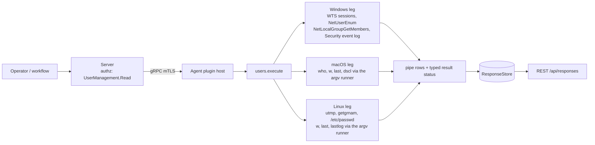
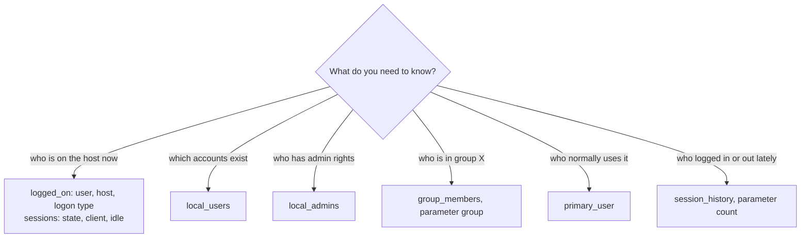
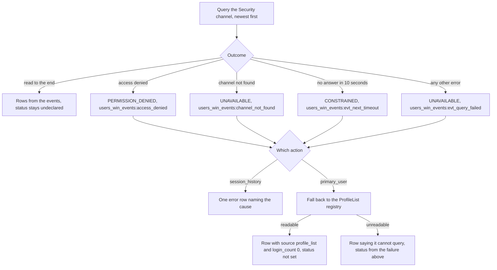

# users

<!-- BEGIN GENERATED: plugin-doc-gen header -->
| | |
|---|---|
| **What it does** | Reports logged-on users, sessions, local accounts, admin group members, group membership, primary user, and session history |
| **Version** | 1.0.0 |
| **Kind** | Collector · read-only · gathered (device.users.logged_on, device.users.sessions, device.users.local_users, device.users.local_admins, device.users.group_members, device.users.primary_user, device.users.session_history) |
| **Platforms** | Windows ✅ · macOS ✅ · Linux ✅ |
| **Actions** | `group_members` (definition `device.users.group_members`) · `local_admins` (definition `device.users.local_admins`) · `local_users` (definition `device.users.local_users`) · `logged_on` (definition `device.users.logged_on`) · `primary_user` (definition `device.users.primary_user`) · `session_history` (definition `device.users.session_history`) · `sessions` (definition `device.users.sessions`) |
| **Security** | securable `UserManagement` · operation Read · risk Low · dispatch ReadOnly · approval gate None |
| **Roles** | execute: endpoint-admin, endpoint-operator · author: content-author |
<!-- END GENERATED -->

## How it works

All seven actions are reads: nothing in this plugin creates, changes or deletes an account, session or group. `logged_on` and `sessions` answer "who is on this host right now" from the OS session table (Windows Terminal Services sessions, Linux `utmp`, macOS `who` and `w`). `local_users`, `local_admins` and `group_members` list accounts and group membership from the OS's own directory (the Windows NetAPI, `/etc/passwd` and `getgrnam` on Linux, `dscl` on macOS); `group_members` takes a group name, `local_admins` is a fixed lookup of the admin group. `primary_user` and `session_history` mine recent login history: the Security event log on Windows, `last` on Linux and macOS. `primary_user` reduces that window to the one account with the most login records; `session_history` returns the records themselves, newest first, up to `count`. On Linux and macOS every external tool (`w`, `last`, `lastlog`, `who`, `dscl`) runs through a bounded argv runner with no shell and a 10 second deadline, and a tool that cannot be started, times out or is killed is reported through the result status instead of reading as an empty list. Windows runs no subprocess. The plugin is deliberately not an authorisation view: it reports what the OS records, not who is entitled to what.



### What you can decide with it

| Question | Action | Windows | macOS | Linux |
|---|---|---|---|---|
| Who is signed in now, and from where? | `logged_on` | Active and disconnected sessions that have a user name; `RDP` when the session name says so | `who` lines; remote when the tty is `ttys*` | `utmp` user-process entries only, so a session that does not register in `utmp` is not seen; remote when the tty is `pts/*` |
| What state is each session in, and how long idle? | `sessions` | Every session with a user name, with its real state (Active, Connected, Disconnected, Idle, Listen); idle is always `0` | `w -h` lines, state always `Active`, idle as `w` prints it | Same as macOS |
| Which local accounts exist, are they enabled, when did they last log on? | `local_users` | Local accounts from `NetUserEnum`, enabled flag from the account-disabled bit | `dscl` accounts with uid 500 or above, plus `root`, not starting `_`; enabled means the shell is not `false` or `nologin` | `/etc/passwd` accounts with uid 1000 or above, plus `root`; enabled means the shell is not `nologin` or `false`. Directory-service accounts are not listed |
| Who holds administrator rights locally? | `local_admins` | Direct members of the group named `Administrators`; a nested group appears as one `group` row and is not expanded | Direct members of the `admin` group | Members listed on the `sudo` and `wheel` groups, plus the uid 0 account |
| Who is in a given group? | `group_members` | Direct members of the named local group | Members from `dscl` | Listed members, plus accounts in `/etc/passwd` whose primary group it is (`primary_group`) |
| Who normally uses this device? | `primary_user` | Most frequent account in the latest 200 logon events | Most frequent account in the latest 200 lines of `last` | Same as macOS |
| Who logged in or out recently? | `session_history` | Logon and logoff events (4624 and 4634) with logon type, source address and UTC time | Lines of `last`, newest first | Same as macOS |

What a clean result does and does not prove. An empty `logged_on` or `sessions` is a legitimate answer (nobody is signed in) and carries no status; only the typed result status tells a degraded read from a clean empty one. A `local_admins` or `group_members` list is the direct, local view only: it does not follow nested groups, directory-service groups or `sudoers` rules, so it is not the set of people who can become administrator. `primary_user` and `session_history` see only the latest window of the login records, so they say nothing about a long-quiet account, and a host with the Security log cleared, or without logon auditing, returns nothing useful on Windows. Nothing here proves an account is in use: `enabled` reflects the account-disabled flag on Windows and the login shell on Linux and macOS, not a password lock or expiry.

### Diagrams

#### Which action answers which question



The first two read the live session table, the next three read the account directory, and the last two read recorded history. Only `group_members` and `session_history` take a parameter.

#### How a Security-log read can fail on Windows



`session_history` fails loudly: the status and the error row both name the cause. `primary_user` prefers an answer, so when the Security log cannot be read it names a profile from the registry instead, and that answer carries no status; tell it apart by `source` `profile_list` and a login count of `0`. The fallback picks the last profile under `\Users\` in registry order, which says nothing about who actually uses the host.

## OS capability

<!-- BEGIN GENERATED: plugin-doc-gen capability -->
| Action | Windows | macOS | Linux |
|---|---|---|---|
| `group_members` | ✅ supported · rung 1 · NetLocalGroupGetMembers | ✅ supported · rung 2 · runner argv 'dscl . -read /Groups/<name> GroupMembership' | ✅ supported · rung 1 · getgrnam + /etc/passwd primary-group scan |
| `local_admins` | ✅ supported · rung 1 · NetLocalGroupGetMembers | ✅ supported · rung 2 · runner argv 'dscl . -read /Groups/admin GroupMembership' | ✅ supported · rung 1 · getgrnam(sudo/wheel) + getpwuid(0) |
| `local_users` | ✅ supported · rung 1 · NetUserEnum | ✅ supported · rung 2 · runner argv 'dscl . -list/-read UserShell/RealName' + 'last -y -1 <user>' per account | ✅ supported · rung 2 · /etc/passwd read + runner argv 'lastlog -u <user>' per account |
| `logged_on` | ✅ supported · rung 1 · WTSEnumerateSessionsW + WTSQuerySessionInformationW | ✅ supported · rung 2 · runner argv 'who' | ✅ supported · rung 1 · utmp (setutent/getutent) |
| `primary_user` | ✅ supported · rung 1 · wevtapi (EvtQuery/EvtRender, Security 4624) | ✅ supported · rung 2 · runner argv 'last' (max_lines=200 cap) | ✅ supported · rung 2 · runner argv 'last -F' (max_lines=200 cap) |
| `session_history` | 🟡 constrained · rung 1 · wevtapi (EvtQuery/EvtRender, Security 4624/4634) | ✅ supported · rung 2 · runner argv 'last -n <count>' | ✅ supported · rung 2 · runner argv 'last -F -n <count>' |
| `sessions` | ✅ supported · rung 1 · WTSEnumerateSessionsW + WTSQuerySessionInformationW | ✅ supported · rung 2 · runner argv 'w -h' | ✅ supported · rung 2 · runner argv 'w -h' |

**Declared limits per leg** (descriptor fallback text, verbatim):

- **`primary_user` / Windows** — falls back to a native ProfileList registry enumeration (no login count) when the Security channel is inaccessible
- **`session_history` / Windows** — requires an elevated token to read the Security channel; reports an error otherwise
<!-- END GENERATED -->

## Privileges and prerequisites

| OS | Runs as | Extra grant needed | Measured | If the read is refused |
|---|---|---|---|---|
| Windows | agent service account (LocalSystem today, #1442) | None for the five actions that use WTS and NetAPI calls. `session_history`, and the first path of `primary_user`, read the Security event log, which needs Security-log read access: LocalSystem has it. For the intended virtual account the privilege model lists `Event Log Readers` membership, and says the Security log additionally needs `SeSecurityPrivilege` (`docs/agent-privilege-model.md`; not measured under that account) | Sample captured as `SYSTEM` on bare metal | `session_history` reports `PERMISSION_DENIED` with `users_win_events:access_denied` and an `error` row; `primary_user` falls back to the ProfileList registry (see the diagram above) |
| macOS | agent daemon (root LaunchDaemon, see `docs/agent-privilege-model.md`) | None: every leg is a plain `dscl`, `who`, `w` or `last` call or the shared console-user read, with no privileged open | Sample captured as a normal interactive user (euid 501), not as the root daemon; all seven actions returned rows | A tool that cannot start, times out or is signalled is forwarded as `UNAVAILABLE` or `CONSTRAINED`; the action then writes its own `unknown` or `error` row text |
| Linux | agent daemon, dedicated unprivileged account (`yuzu-agent` on the packaged unit), never root by design; the privilege model has no row for this plugin | None for the native legs (`utmp`, `getgrnam`, `getpwuid`, `/etc/passwd`). `w`, `last` and `lastlog` must be installed; they read the login records the OS keeps (`utmp`, `wtmp`, `lastlog`) | Sample captured as `euid 0` in a minimal container with neither `last` nor `lastlog`; not measured as `yuzu-agent` | A missing or failed tool is forwarded as `UNAVAILABLE` or `CONSTRAINED`; `logged_on`, `local_admins` and `group_members` do not depend on a tool and are unaffected |

Subprocesses: Linux runs `w`, `lastlog` and `last`, located with `probe_tool_path` and started by direct argv with no shell. macOS runs `who`, `w`, `last`, `dscl` and `/usr/bin/env` (used only to pin `LC_ALL=C` ahead of `last -y`, still a plain exec). Windows runs none. A tool's exit code is not inspected: only a failure to start, a timeout, a cancellation or a signal is a failure, so an unreadable `wtmp` surfaces as an empty `last` result (caveat 5). No network use on any OS.

## Data contract

### Inputs

<!-- BEGIN GENERATED: plugin-doc-gen inputs -->
| Definition | Parameter | Type | Required | Default | Constraints | Description |
|---|---|---|---|---|---|---|
| `device.users.group_members` | `group` | string | yes | - | minLength 1 · maxLength 256 | Name of the local group to enumerate members for (e.g., "Administrators", "Remote Desktop Users", "sudo"). |
| `device.users.session_history` | `count` | string | no | 50 | pattern: ^[0-9]+$ | Maximum number of session records to return, as a digit string (e.g. "100"); values outside 1-500 are clamped back to the default of 50. |
<!-- END GENERATED -->

### Outputs

Rows are pipe-delimited, one per record, and start with a literal discriminator (`user`, `session`, `local_user`, `admin`, `group_member`, `primary_user` or `session_history`). `logged_on`, `sessions` and `group_members` write zero rows, not a placeholder, when there is nothing to report; only the typed result status separates a degraded read from a clean empty one. A query-level problem (missing or invalid parameter, group not found, tool not found) writes a single `<discriminator>|error|<message>` row (for example `group_member|error|Group not found: x` or `admin|error|query failed`; on Linux an unreadable `/etc/passwd` writes `local_user|error|false|Never|<message>`). `local_users` varies its field count by OS: Windows and Linux rows carry four data fields, macOS rows carry five (`console_state` is appended). On Linux, `last_logon` is the account's `lastlog` line verbatim, not the formatted timestamp the table below describes (caveat 4). On Linux and macOS `session_history` writes `last`'s columns into the declared fields in a different order (caveat 1), and `sessions` always reports state `Active` on those two systems.

<!-- BEGIN GENERATED: plugin-doc-gen outputs -->
**`device.users.group_members` — `member_name|group_name|member_type`**

| Field | Type | Values | Available | Example | Description |
|---|---|---|---|---|---|
| `member_name` | string | - | Windows, Linux, macOS | `jsmith` | The account (or nested group, on Windows) belonging to the queried group. Values: free text. |
| `group_name` | string | - | Windows, Linux, macOS | `Administrators` | The group name from the "group" parameter, echoed back on every row. Values: free text. |
| `member_type` | string | - | Windows, Linux, macOS | `user` | The kind of membership. Values: user, primary_group (Linux only); Windows: user, group, well_known_group, alias. |

**`device.users.local_admins` — `member_name|member_type|domain_or_group`**

| Field | Type | Values | Available | Example | Description |
|---|---|---|---|---|---|
| `member_name` | string | - | Windows, Linux, macOS | `jsmith` | The name of an account or group belonging to the local admin membership. Values: free text. |
| `member_type` | string | - | Windows, Linux, macOS | `user` | The kind of member. Values: user (always on Linux/macOS); Windows: user, group, well_known_group, alias, unknown. |
| `domain_or_group` | string | - | Windows, Linux, macOS | `DESKTOP-04DNSIG` | The domain owning the member (Windows), or the source group/account name (Linux "sudo"/"wheel"/"root", macOS literal "admin"). Values: free text. |

**`device.users.local_users` — `username|enabled|last_logon|description|console_state`**

| Field | Type | Values | Available | Example | Description |
|---|---|---|---|---|---|
| `username` | string | - | Windows, Linux, macOS | `jsmith` | The local account's username. Values: free text. |
| `enabled` | bool | - | Windows, Linux, macOS | `true` | Whether the account is enabled. Values: true, false. |
| `last_logon` | string | - | Windows, Linux, macOS | `2026-09-07 11:08:37` | The account's most recent login timestamp, or a sentinel when unknown or never logged in. Values: "YYYY-MM-DD HH:MM:SS", "Never", "unknown". |
| `description` | string | - | Windows, Linux, macOS | `Built-in account for administering the computer/domain` | The account's comment/description text (Windows comment, macOS RealName, Linux GECOS field), or "-" when empty. Values: free text or "-". |
| `console_state` | string | - | macOS | `true` | Tri-state flag for whether this account is the current GUI/console-login user; the field is entirely absent (not empty) on Linux and Windows. Values: true, false, unknown. |

**`device.users.logged_on` — `username|domain|logon_type|session_id`**

| Field | Type | Values | Available | Example | Description |
|---|---|---|---|---|---|
| `username` | string | - | Windows, Linux, macOS | `jsmith` | The account name of a currently logged-on user. Values: free text. |
| `domain` | string | - | Windows, Linux, macOS | `local` | The host or domain the session belongs to, or the literal "local" when it has none. Values: hostname/domain or the literal "local". |
| `logon_type` | string | - | Windows, Linux, macOS | `console` | How the session was established. Values: console, remote, RDP (Windows only). |
| `session_id` | string | - | Windows, Linux, macOS | `console` | The session's terminal identifier — a utmp line name (Linux), a tty (macOS), or a numeric WTS session ID (Windows). Values: free text. |

**`device.users.primary_user` — `username|login_count|source`**

| Field | Type | Values | Available | Example | Description |
|---|---|---|---|---|---|
| `username` | string | - | Windows, Linux, macOS | `jsmith` | The account with the most login events in the examined history, or "unknown" when none could be determined. Values: free text or "unknown". |
| `login_count` | int32 | - | Windows, Linux, macOS | `118` | The number of login events counted for this user; "0" for the Windows ProfileList fallback, which carries no count. Values: integer. |
| `source` | string | - | Windows, Linux, macOS | `event_log_4624` | How the answer was derived. Values: last (Linux/macOS); event_log_4624, profile_list (Windows); free text on a query failure. |

**`device.users.session_history` — `username|event_type|logon_type|source|timestamp|detail`**

| Field | Type | Values | Available | Example | Description |
|---|---|---|---|---|---|
| `username` | string | - | Windows, Linux, macOS | `jsmith` | The account named in the record. Values: free text. |
| `event_type` | string | - | Windows, Linux, macOS | `logoff` | Windows: "logon" or "logoff". Linux/macOS: actually the session's tty, not an event-type label — see the plugin README's Caveats. Values: logon, logoff (Windows); a tty name (Linux/macOS). |
| `logon_type` | string | - | Windows, Linux, macOS | `network` | Windows: the mapped LogonType name or raw numeric code, empty when absent. Linux/macOS: actually last's host/source token, usually empty for a local session. Values: interactive, network, batch, service, unlock, network_cleartext, new_credentials, remote_interactive, cached_interactive, or a raw numeric code (Windows); free text, often empty (Linux/macOS). |
| `source` | string | - | Windows, Linux, macOS | `-` | Windows: the event's IpAddress, or "-". Linux/macOS: actually the derived console/remote/system classification, not a network source. Values: an IP address or "-" (Windows); console, remote, system (Linux/macOS). |
| `timestamp` | string | - | Windows, Linux, macOS | `2026-09-07T10:08:37.8345208Z` | Windows: the event's TimeCreated, full-precision UTC. Linux/macOS: actually the completed/active/crash status word, not a timestamp — the real date/time is embedded in "detail". Values: ISO-8601 UTC (Windows); completed, active, crash (Linux/macOS). |
| `detail` | string | - | Windows, Linux, macOS | `4634` | Windows: the raw EventID text. Linux/macOS: the remainder of the 'last' line verbatim (weekday, date, time, and logout/duration or "still logged in"). Values: free text. |

**`device.users.sessions` — `session_id|username|state|client|idle`**

| Field | Type | Values | Available | Example | Description |
|---|---|---|---|---|---|
| `session_id` | string | - | Windows, Linux, macOS | `console` | The session's controlling tty (Linux/macOS) or numeric WTS session ID (Windows). Values: free text. |
| `username` | string | - | Windows, Linux, macOS | `jsmith` | The account that owns this session. Values: free text. |
| `state` | string | - | Windows, Linux, macOS | `Active` | The session's connection state. Values: Active (Linux/macOS, always); Windows: Active, Connected, Disconnected, Idle, Listen, Other. |
| `client` | string | - | Windows, Linux, macOS | `-` | The remote host the session connects from ('w' FROM column) or the RDP client name on Windows; "-" when none. Values: free text or "-". |
| `idle` | string | - | Windows, Linux, macOS | `13:35` | Idle time as reported by 'w' on Linux/macOS; always the literal "0" on Windows, where idle-time decoding is unimplemented. Values: free text (Linux/macOS) or the literal "0" (Windows). |
<!-- END GENERATED -->

### Result status

Windows sets the status explicitly when the Security-channel query fails. On Linux and macOS every external tool call is checked, and the first non-normal termination of a call latches the status for the whole action, so a later per-account call cannot overwrite an earlier `UNAVAILABLE`. A tool that exits normally, with any exit code, sets nothing.

| Status | Completeness | Provenance | When |
|---|---|---|---|
| `UNDECLARED` (no call made) | UNKNOWN | - | default; every OS tool or native call finished normally. This is the status of every clean or intentionally empty read, such as an empty `logged_on` |
| `OK` | PARTIAL | `subprocess_runner:line_limit` | `primary_user` stopped `last` at its 200-line bound while it was still producing output. This is deliberate truncation, not a failure, and is the normal case on any host with a longer history |
| `CONSTRAINED` | PARTIAL | `subprocess_runner:deadline` / `subprocess_runner:cancelled` / `subprocess_runner:signaled` | a POSIX tool ran past the 10 second deadline, was cancelled, or was killed by a signal |
| `UNAVAILABLE` | PARTIAL | `subprocess_runner:spawn_error` | no binary was found at the probed paths, or the spawn failed (the Linux container sample, which has no `last` or `lastlog`) |
| `PERMISSION_DENIED` | PARTIAL | `users_win_events:access_denied` | Windows Security channel query denied; for `primary_user` only when the ProfileList fallback also failed |
| `UNAVAILABLE` | PARTIAL | `users_win_events:channel_not_found` | Windows Security channel missing or unavailable |
| `CONSTRAINED` | PARTIAL | `users_win_events:evt_next_timeout` | the Windows event read made no progress for 10 seconds |
| `UNAVAILABLE` | PARTIAL | `users_win_events:evt_query_failed` | any other Windows event query or read error |

### Where the data goes

- **Instruction result only.** Rows travel the agent's mTLS gRPC channel as the command response and land in the `ResponseStore` (default 90-day retention), readable at `/api/responses/{id}`.
- **Not consumed by** daily-sync inventory, the Echo warehouse, DEX or metrics. Nothing in this plugin runs on a schedule; each definition's `gather.ttlSeconds` (60 to 300 seconds) is a repeat-query cache lifetime, not a cron trigger.
- **Sensitivity.** Every action's rows name specific accounts: `username` and `member_name` (local and logged-on accounts, including administrators), `domain` or `domain_or_group` (a Windows domain or host name), and Windows `session_history` carries the source IP address of each logon. On Linux and macOS `session_history` and `sessions` can carry the remote host or client name a user connected from, and `local_users` carries the account's display name or comment. No column carries installed-software data.
- **Siblings.** The `core.crossplatform.users` instruction set (`content/definitions/users_set.yaml`, "User Account Management") bundles the `logged_on`, `sessions`, `local_users` and `local_admins` definitions of this same plugin; this plugin has no action that creates, disables or reassigns an account.
- **MCP / REST.** Discover with `discover_plugins` (summary) then `yuzu://plugin-docs` (this page as data) and `get_definition("device.users.session_history")`; run with `execute_instruction {definition_id, parameters}`; read results at `/api/responses/{id}`.

## Sample output

<!-- BEGIN GENERATED: plugin-doc-gen samples -->
**Windows** — captured: windows Microsoft Windows NT 10.0.26200.0 x64 · bare-metal · 2026-09-07 · SYSTEM (account name redacted to jsmith; account SID replaced with a placeholder) · leg-hash 5734018da5be

```
== action=logged_on
[result_status] UNDECLARED / UNKNOWN

== action=sessions
[result_status] UNDECLARED / UNKNOWN

== action=local_users
local_user|Administrator|false|2021-10-14 11:15:58|Built-in account for administering the computer/domain
local_user|jsmith|true|2026-09-07 11:08:37|-
local_user|CodexSandboxOffline|true|Never|-
local_user|CodexSandboxOnline|true|Never|-
local_user|DefaultAccount|false|Never|A user account managed by the system.
local_user|Guest|false|Never|Built-in account for guest access to the computer/domain
local_user|WDAGUtilityAccount|false|Never|A user account managed and used by the system for Windows Defender Application Guard scenarios.
[result_status] UNDECLARED / UNKNOWN

== action=local_admins
admin|Administrator|user|DESKTOP-04DNSIG
admin|jsmith|user|DESKTOP-04DNSIG
[result_status] UNDECLARED / UNKNOWN

== action=group_members group=Administrators
group_member|Administrator|Administrators|user
group_member|jsmith|Administrators|user
[result_status] UNDECLARED / UNKNOWN

== action=primary_user
primary_user|jsmith|118|event_log_4624
[result_status] UNDECLARED / UNKNOWN

== action=session_history
session_history|jsmith|logoff|network|-|2026-09-07T10:08:37.8345208Z|4634
session_history|sshd_6888|logoff|service|-|2026-09-07T10:08:37.8345130Z|4634
session_history|jsmith|logon|network|-|2026-09-07T10:08:37.5888936Z|4624
session_history|jsmith|logoff|network|-|2026-09-07T10:08:37.5439466Z|4634
session_history|jsmith|logon|network|-|2026-09-07T10:08:37.5436517Z|4624
session_history|sshd_6888|logon|service|-|2026-09-07T10:08:37.4636668Z|4624
session_history|jsmith|logoff|network|-|2026-09-07T10:08:06.3059890Z|4634
session_history|sshd_4452|logoff|service|-|2026-09-07T10:08:06.3059802Z|4634
session_history|jsmith|logon|network|-|2026-09-07T10:08:06.0444630Z|4624
session_history|jsmith|logoff|network|-|2026-09-07T10:08:05.9047716Z|4634
session_history|jsmith|logon|network|-|2026-09-07T10:08:05.9044759Z|4624
session_history|sshd_4452|logon|service|-|2026-09-07T10:08:05.8249284Z|4624
… 12 of 50 rows shown
[result_status] UNDECLARED / UNKNOWN
```

**macOS** — captured: macos macOS 26.6.2 arm64 · bare-metal · 2026-09-07 · euid 501 (jsmith) · leg-hash 5734018da5be

```
== action=logged_on
user|jsmith|local|console|console
[result_status] UNDECLARED / UNKNOWN

== action=sessions
session|console|jsmith|Active|-|13:35
[result_status] UNDECLARED / UNKNOWN

== action=local_users
local_user|jsmith|true|2026-09-06 21:20:00|Jordan Smith|true
local_user|root|true|2026-09-06 21:15:00|System Administrator|false
[result_status] UNDECLARED / UNKNOWN

== action=local_admins
admin|root|user|admin
admin|jsmith|user|admin
admin|_mbsetupuser|user|admin
[result_status] UNDECLARED / UNKNOWN

== action=group_members group=admin
group_member|root|admin|user
group_member|jsmith|admin|user
group_member|_mbsetupuser|admin|user
[result_status] UNDECLARED / UNKNOWN

== action=primary_user
primary_user|jsmith|35|last
[result_status] UNDECLARED / UNKNOWN

== action=session_history
session_history|jsmith|console|Sun|console|active|Sep  6 21:20   still logged in
session_history|reboot|time|Sun|system|completed|Sep  6 21:19
session_history|shutdown|time|Sun|system|completed|Sep  6 21:15
session_history|root|console|Sun|console|completed|Sep  6 21:15 - shutdown  (00:00)
session_history|jsmith|ttys000|Sun|remote|completed|Sep  6 18:53 - 18:53  (00:00)
session_history|jsmith|ttys000|Sun|remote|completed|Sep  6 18:53 - 18:53  (00:00)
session_history|jsmith|ttys000|Mon|remote|completed|Aug 31 09:30 - 09:30  (00:00)
session_history|jsmith|console|Mon|console|completed|Aug 31 09:30 - 21:14 (6+11:44)
session_history|reboot|time|Mon|system|completed|Aug 31 09:29
session_history|jsmith|ttys000|Fri|remote|completed|Aug 28 09:51 - 09:51  (00:00)
session_history|jsmith|console|Fri|console|completed|Aug 28 09:51 - 22:26  (12:35)
session_history|reboot|time|Fri|system|completed|Aug 28 09:50
… 12 of 50 rows shown
[result_status] UNDECLARED / UNKNOWN
```

**Linux** — captured: linux Debian GNU/Linux 13 (trixie) aarch64 · container · 2026-09-06 · euid 0 · leg-hash 5734018da5be

```
== action=logged_on
[result_status] UNDECLARED / UNKNOWN

== action=sessions
[result_status] UNDECLARED / UNKNOWN

== action=local_users
local_user|root|true|unknown|root
local_user|nobody|false|unknown|nobody
[result_status] UNAVAILABLE / PARTIAL / subprocess_runner:spawn_error

== action=local_admins
admin|root|user|root
[result_status] UNDECLARED / UNKNOWN

== action=group_members group=sudo
[result_status] UNDECLARED / UNKNOWN

== action=primary_user
primary_user|unknown|0|last command failed
[result_status] UNAVAILABLE / PARTIAL / subprocess_runner:spawn_error

== action=session_history
session_history|error|last command failed
[result_status] UNAVAILABLE / PARTIAL / subprocess_runner:spawn_error
```
<!-- END GENERATED -->

## Caveats and known gaps

1. **`session_history` columns on Linux and macOS do not match the declared schema.** The Windows leg fills `event_type|logon_type|source|timestamp|detail` as named, but the Linux and macOS leg splits `last`'s first three tokens and writes the tty, the host token, a derived `console`/`remote`/`system` class, a `completed`/`active`/`crash` word and the rest of the line into those same slots. The real date and duration exist only as free text in `detail`, so do not consume those two OSes' output as if it matched the Windows or YAML meaning. The window is the latest `count` records (1 to 500, default 50 on an out-of-range value) and includes `reboot` lines.
2. **`primary_user` is a recent-activity heuristic, not a usage measurement.** It counts account names in the latest 200 Windows 4624 events (every logon type, so network and service logons count, and machine accounts and `SYSTEM` are dropped) or the latest 200 lines of `last` (boilerplate lines dropped); a tie goes to the alphabetically first name. When the Windows Security log cannot be read it falls back to the last profile under `\Users\` in registry order with `login_count` `0`, and sets no status.
3. **The admin and group answers are narrow.** Windows `local_admins` looks up the group literally named `Administrators` and, if that lookup fails (for example on a localised Windows), writes no rows, no error row and no status, which reads like a host with no administrators. `group_members` accepts only the characters `A-Z a-z 0-9 . _ -` and no leading `-` or `.`, so a group with a space in its name, such as `Remote Desktop Users`, is rejected with an `Invalid group name` row on every OS. Linux `group_members` finds primary-group members by scanning `/etc/passwd` only.
4. **`local_users` is a best-effort account list.** Linux and macOS leave out system accounts (uid below 1000 and 500, and `_` names on macOS), and on Linux `last_logon` is the raw `lastlog` line, `unknown` for a name outside the safe character set, and `Never` when `lastlog` says so. `enabled` on Linux and macOS means a usable login shell, not an unlocked password, and the Windows `last_logon` is this machine's own record shown in the agent's local time.
5. **A minimal or locked-down host can look empty.** An image without `last` or `lastlog` degrades `local_users`, `primary_user` and `session_history` to `UNAVAILABLE`, while `logged_on` (`utmp`), `local_admins` and `group_members` (`getgrnam`) are unaffected. Because a tool's exit code is ignored, an unreadable `wtmp` gives the same `last command failed` row as a missing tool but with no status, and `group_members` returning zero rows with no `error` row means the group exists with no members.

## Source and tests

<!-- BEGIN GENERATED: plugin-doc-gen source -->
- Plugin: `agents/plugins/users/src/users_macos_last.hpp` · `agents/plugins/users/src/users_plugin.cpp` · `agents/plugins/users/src/users_win_events.hpp`
- Definitions: `content/definitions/users.yaml`
- Capability rows: `server/core/src/capability_decls/plugin_action_catalogue_b.hpp`
- Tests: `tests/unit/test_users_macos_last.cpp` · `tests/unit/test_users_posix_actions.cpp` · `tests/unit/test_users_win_events.cpp`
- Privilege row: `docs/agent-privilege-model.md` (no row yet)
- Changelog: `changelog.d/5872-integrations-directory-users-total.fixed.md`
<!-- END GENERATED -->
