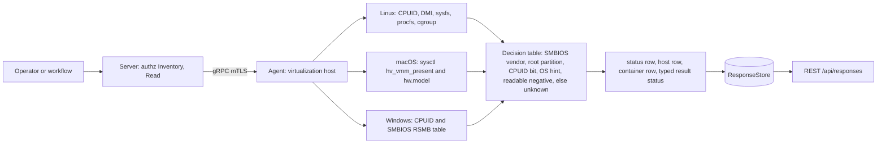
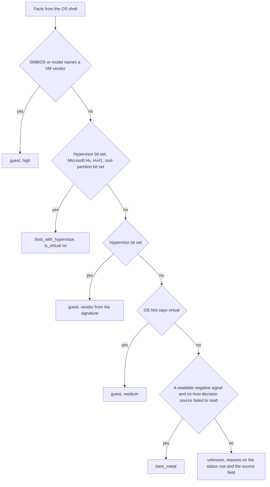

# virtualization

<!-- BEGIN GENERATED: plugin-doc-gen header -->
| | |
|---|---|
| **What it does** | Virtualization facts: VM or not, which hypervisor, container membership |
| **Version** | 1.0.0 |
| **Kind** | Collector · read-only · gathered (crossplatform.virtualization.host) |
| **Platforms** | Windows 🟡 constrained · macOS ✅ · Linux ✅ |
| **Actions** | `host` (definition `crossplatform.virtualization.host`) |
| **Security** | securable `Inventory` · operation Read · risk Low · dispatch ReadOnly · approval gate None |
| **Roles** | execute: endpoint-admin, endpoint-operator · author: content-author |
<!-- END GENERATED -->

## How it works

`host` reports whether this device is a virtual machine, which hypervisor it runs under, and whether the agent itself runs in a container, as facts only. It changes nothing and spawns nothing. The first row is always a `status` row saying whether the read was complete, then one `host` row (`is_virtual`, `kind`, `vendor`, `product`, `source`, `confidence`) and one `container` row. `kind` is `guest`, `host_with_hypervisor`, `bare_metal` or `unknown`; a container on a VM reports both facts, because `container` is its own row and not a `kind` value.

The decision is one table in `virtualization_parsers.hpp`, fed by what each OS shell reads. Linux reads CPUID (x86), the DMI `sys_vendor` and `product_name` attributes, `/sys/hypervisor/type`, the marker files `/.dockerenv` and `/run/.containerenv`, the container type systemd records in `/run/systemd/container` (how an LXD, Incus or systemd-nspawn system container is told from a host, because its cgroup path looks the same), and the agent's own `/proc/self/cgroup` (not PID 1's, which answers a different question when the PID namespace is shared). The `/run/systemd/container` content is never emitted, only the fact that it named a container; `wsl` and an empty file are ignored, so a WSL2 agent is not turned into a container. macOS reads `kern.hv_vmm_present` and `hw.model`. Windows reads CPUID and the SMBIOS System Information table. A Windows machine running Hyper-V, VBS or WSL2 sets the CPUID hypervisor bit yet is the host, not a guest: when the hypervisor signature is `Microsoft Hv`, the interface signature is `Hv#1` and the maximum leaf reaches `0x40000003`, the Hyper-V root-partition bit (leaf `0x40000003` EBX bit 0, CreatePartitions) separates a host (`host_with_hypervisor`, `is_virtual` no) from a guest. Without that discovery contract the bit is never read.

Precedence: positive identification always beats negative evidence. SMBIOS or the hardware model naming a VM vendor decides first (so VBS nested inside another hypervisor, which sets the root-partition bit, still reads `guest`); then the root-partition bit; then the CPUID hypervisor bit; then a positive OS hint. `bare_metal` is reachable only when no consulted source identifies virtualization, at least one readable source says "not virtual", and no host-decision source (SMBIOS, CPUID, OS hint) failed to read; a failed container read makes the status `constrained` but does not block `bare_metal`. `bare_metal` means no virtualization signal was seen, not proof of physical hardware. Anything else is `unknown`, with the reasons on the status row and in the host row's `source` field.



### What you can decide with it

| Question | Linux | macOS | Windows |
|---|---|---|---|
| Is this device a VM? | Yes: `is_virtual` yes, no or unknown, with the evidence source and a confidence. | Yes, from `kern.hv_vmm_present` and the model name. | Yes, from CPUID and SMBIOS. |
| Which hypervisor? | The CPUID signature, a DMI vendor or `/sys/hypervisor/type`. | `apple` for a `VirtualMac*` model, `vmware` for a VMware model string, otherwise `other`. | The CPUID signature or the SMBIOS vendor. |
| Is the agent in a container? | `yes` on a marker file, a container type in `/run/systemd/container` or a container cgroup path; `no` only when all of those are readable and absent and the cgroup names a real path (a container without a marker file or systemd record can also read `no` when its readable, non-root cgroup path has no recognised runtime signature, caveat 3); otherwise `unknown`. | Always `no`. | Not read: always `unknown`. |
| Is this a Hyper-V, VBS or WSL2 host? | A WSL2 guest reads `guest` `hyperv`. | n/a | Yes on x86: `host_with_hypervisor`, `is_virtual` no. Not detected on ARM64, which has no CPUID. |

### Diagrams

#### How the kind is decided



The order matters: a positive identification is never outranked by a negative or missing signal, and an unreadable host-decision source (SMBIOS, CPUID, OS hint) can never be read as "not virtual".

## OS capability

<!-- BEGIN GENERATED: plugin-doc-gen capability -->
| Action | Windows | macOS | Linux |
|---|---|---|---|
| `host` | 🟡 constrained · rung 1 · CPUID leaves 1 and 0x40000000-0x40000003 (__cpuid, x86) and the SMBIOS System Information table via GetSystemFirmwareTable('RSMB') | ✅ supported · rung 1 · sysctlbyname kern.hv_vmm_present and hw.model | ✅ supported · rung 1 · CPUID leaves 1 and 0x40000000-0x40000003 (x86), /sys/class/dmi/id/{sys_vendor,product_name}, /sys/hypervisor/type, /.dockerenv, /run/.containerenv, /run/systemd/container and /proc/self/cgroup (bounded reads, no subprocess) |

**Declared limits per leg** (descriptor fallback text, verbatim):

- **`host` / Windows** — container not read: always unknown, windows:virtualization:container:not_read; ARM64 has no CPUID: a Windows-on-ARM device reads unknown (windows:virtualization:cpuid:unavailable) unless SMBIOS names a VM vendor, and a Hyper-V or VBS host is not detected on ARM64
- **`host` / macOS** — no CPUID on arm64: the sysctl is the readable negative; container is always no
- **`host` / Linux** — ARM has no CPUID: SMBIOS and OS hints alone decide, and a host with neither reads unknown, never bare_metal; a KVM host reads bare_metal (its own CPUID is not virtualised) but a Xen dom0 reads guest/xen; a cgroup-v2 namespace-obscured root reads container unknown; a container without a marker file or systemd record can read container no when its readable, non-root cgroup path has no recognised runtime signature
<!-- END GENERATED -->

## Privileges and prerequisites

| OS | Runs as | Extra grant needed | Measured | If the read is refused |
|---|---|---|---|---|
| Windows | agent daemon (LocalSystem today, `docs/agent-privilege-model.md`) | None: CPUID is an unprivileged instruction and the SMBIOS table is read through `GetSystemFirmwareTable` | Measured 2026-11-07 on a Windows 11 host with Hyper-V, VBS and WSL2 enabled, from an elevated interactive session (not LocalSystem): CPUID and the firmware table both answered; whether an unelevated caller gets the table was not measured | `CONSTRAINED` / partial with `windows:virtualization:smbios:<cause>`; the kind is `unknown` unless CPUID or a decoded Type 1 already identifies the machine |
| macOS | agent daemon (root under the shipped LaunchDaemon today, `docs/agent-privilege-model.md`) | None: both sysctls answer an unprivileged caller | The sample was captured as an unprivileged user, not under the LaunchDaemon account | `CONSTRAINED` / partial with `macos:virtualization:hv_vmm_present:unreadable` or `macos:virtualization:hw_model:unreadable`; the kind is `unknown` |
| Linux | agent daemon, dedicated unprivileged account (`yuzu-agent` on the packaged unit), never root by design (`docs/agent-privilege-model.md`) | None: the DMI attributes and `/run/systemd/container` read are world-readable; the root-only `product_serial` and `product_uuid` are never read | Measured 2026-11-07 inside a WSL2 distribution as root (not the packaged `yuzu-agent` account): `/run/systemd/container` is mode 0644 root:root under a 0755 `/run/systemd`; that kernel exposes no `/sys/class/dmi/id` or `/sys/hypervisor`, so the DMI modes were not measured and the host answer came from CPUID alone | `CONSTRAINED` / partial; a refused host-decision source (SMBIOS, CPUID, OS hint) reports `linux:virtualization:<source>:<cause>` and the kind `unknown` (or the kind another source already established), never `bare_metal`; a refused container read reports `linux:virtualization:container:<cause>`, constrains the status and does not block `bare_metal` |

No subprocess, no shell and no network use: every leg is an in-process read (CPUID, sysctl, bounded file reads, `access(2)`, the Windows firmware table). The Linux file reads are size-bounded but have no deadline of their own, like every `posix_secure_read` consumer (#4875): a hung procfs or sysfs read would hold one agent pool worker until it returns.

## Data contract

### Inputs

<!-- BEGIN GENERATED: plugin-doc-gen inputs -->
The action takes no parameters.
<!-- END GENERATED -->

### Outputs

Every row is pipe-delimited and field 0 is the row kind; `-` is an absent value. The first row is always `status|host|<supported\|constrained\|unsupported>|<reason or ->`. The `host` row has seven fields: `host|<yes\|no\|unknown>|<guest\|host_with_hypervisor\|bare_metal\|unknown>|<vendor>|<product>|<source>|<high\|medium\|low>`. `vendor` is the virtualization platform (`kvm`, `hyperv`, `vmware`, `xen`, `virtualbox`, `parallels`, `bhyve`, `qemu`, `acrn`, `aws`, `gce`, `alibaba`, `openstack`, `nutanix`, `apple` or `other`) for a guest or host, and the hardware manufacturer for `bare_metal` and `unknown`. `source` is the evidence that decided the kind (`cpuid`, `smbios`, `sysctl` or `sys_hypervisor`); when the kind is `unknown` it carries the joined host-decision reason tokens instead (container read failures stay on the container row), so the row an operator reads explains itself. The `container` row is `container|<yes\|no\|unknown>|<evidence or reason>`. Every OS-supplied value (DMI and SMBIOS strings, the hardware model) is scrubbed (NUL and malformed UTF-8 become `?`) and escaped for the server's pipe grammar.

<!-- BEGIN GENERATED: plugin-doc-gen outputs -->
**`crossplatform.virtualization.host` — `row_kind|field_1|field_2|field_3|field_4|field_5|field_6`**

| Field | Type | Values | Available | Example | Description |
|---|---|---|---|---|---|
| `row_kind` | string | `status` `host` `container` | Windows, Linux, macOS | `host` | Row shape discriminator (field 0). Values: status, host, container. |
| `field_1` | string | - | Windows, Linux, macOS | `no` | status: the literal "host". host: is_virtual, yes (a guest), no (bare metal or a host running a hypervisor) or unknown. container: yes, no or unknown (is the agent itself in a container). |
| `field_2` | string | - | Windows, Linux, macOS | `bare_metal` | status: supported, constrained or unsupported (a leg that threw). host: kind, guest, host_with_hypervisor (a Windows host running Hyper-V, VBS or WSL2), bare_metal (no virtualization signal seen, not proof of physical hardware) or unknown. container: the evidence (/.dockerenv, /run/.containerenv, /run/systemd/container, cgroup:<runtime>, linux:no_container_marker, macos:no_container_runtime) or, for unknown, the reason (linux:virtualization:container:cgroup_root_opaque for a cgroup-v2 namespace that hides the answer, windows:virtualization:container:not_read on Windows). A container no is best effort: a container without a marker file or systemd record can read no when its readable, non-root cgroup path has no recognised runtime signature. |
| `field_3` | string | - | Windows, Linux, macOS | `Apple Inc.` | status: reason token(s) for a non-supported read, "-" when complete; tokens look like linux:virtualization:dmi:permission_denied, linux:virtualization:cpuid:unavailable, windows:virtualization:smbios:truncated, macos:virtualization:hw_model:unreadable, linux:leg:exception. host: the virtualization platform (kvm, hyperv, vmware, xen, virtualbox, parallels, bhyve, qemu, acrn, aws, gce, alibaba, openstack, nutanix, apple or other) for a guest or host_with_hypervisor, the hardware manufacturer for bare_metal and unknown, "-" when not read. |
| `field_4` | string | - | Windows, Linux, macOS | `Mac16,10` | host: the SMBIOS product name or macOS hw.model, "-" when not read. Not used by the other kinds. |
| `field_5` | string | - | Windows, Linux, macOS | `sysctl` | host: the evidence source that decided the kind (cpuid, smbios, sysctl or sys_hypervisor); when the kind is unknown, the joined reason tokens instead. Not used by the other kinds. |
| `field_6` | string | `high` `medium` `low` | Windows, Linux, macOS | `high` | host: confidence, high, medium or low (an unknown is low). Not used by the other kinds. |
<!-- END GENERATED -->

### Result status

`host` sets `OK`/`FULL` when every consulted source was read (including a clean `bare_metal` or `guest`). A source that failed to read, or the absence of any negative signal on a machine with no CPUID, makes the result `CONSTRAINED`/`PARTIAL`, with the same tokens, comma-joined, in the leading `status` row. The status reason lists plugin constraint tokens only; the container row's evidence strings (`/.dockerenv`, `/run/.containerenv`, `/run/systemd/container`, `cgroup:<runtime>`, `macos:no_container_runtime`, `linux:no_container_marker`) are not tokens. No exception crosses the plugin boundary: a leg that throws is reported as an `unsupported` status row and `UNAVAILABLE` (the last status row wins if the leg had already written one).

A refusal is reported as `CONSTRAINED` with a `permission_denied` token, not as the `PERMISSION_DENIED` result status that `mgmt_posture` and `shares` use. This is deliberate: in those plugins a refusal marks a read the agent could complete with a grant (a root-only file, a capability), whereas every source here is unprivileged by design (world-readable DMI attributes, `/sys/hypervisor/type`, `/run/systemd/container`, the agent's own `/proc/self/cgroup`, `access(2)` on two root-owned paths, two sysctls, the in-memory firmware table), so a refusal means a security policy or a masked mount, and there is no grant a status could point an operator at.

| Status | Completeness | Provenance | When |
|---|---|---|---|
| `OK` | full | (empty) | every consulted source was read and the kind is established, or the container row is `unknown` by declaration (Windows: `windows:virtualization:container:not_read`) or by classification (`linux:virtualization:container:cgroup_root_opaque`); both appear on the container row only, never in the status provenance |
| `CONSTRAINED` | partial | `linux:virtualization:dmi:<cause>`, `linux:virtualization:sys_hypervisor:<cause>` | Linux: a DMI attribute or `/sys/hypervisor/type` could not be read. `<cause>` is `permission_denied`, `eio`, `eloop`, `enotdir`, `einval`, `not_regular`, `oversized` or `errno_<n>`; a missing file (ENOENT) is a definitive absence, not a failure |
| `CONSTRAINED` | partial | `linux:virtualization:cpuid:unavailable`, `macos:virtualization:cpuid:unavailable`, `windows:virtualization:cpuid:unavailable` | No CPUID on this architecture (ARM) and nothing else supplied a readable "not virtual" answer, so the kind is `unknown`; not added when SMBIOS or a hint identifies the machine, nor on macOS when the sysctl answers |
| `CONSTRAINED` | partial | `linux:virtualization:container:markers_<cause>`, `linux:virtualization:container:systemd_container_<cause>`, `linux:virtualization:container:cgroup_<cause>`, `linux:virtualization:container:cgroup_not_read` | Linux: a container marker probe, `/run/systemd/container` or `/proc/self/cgroup` could not be read; the container row is `unknown` unless a marker, the systemd record or a cgroup runtime already answered. A missing `/run/systemd/container` is the normal host case, not a failure |
| `CONSTRAINED` | partial | `linux:virtualization:smbios:unreadable`, `macos:virtualization:smbios:unreadable`, `windows:virtualization:smbios:unreadable` | SMBIOS was reported unreadable with no cause token; a defensive fallback so an unknown is never unexplained (no shipped leg produces it today) |
| `CONSTRAINED` | partial | `macos:virtualization:hv_vmm_present:unreadable`, `macos:virtualization:hw_model:unreadable` | macOS: a sysctl could not be read; the kind is `unknown` |
| `CONSTRAINED` | partial | `windows:virtualization:smbios:truncated`, `windows:virtualization:smbios:malformed`, `windows:virtualization:smbios:call_failed`, `windows:virtualization:smbios:oversized`, `windows:virtualization:smbios:size_race` | Windows: the SMBIOS table walk stopped at a framing fault, the Type 1 structure was malformed, or the firmware-table read failed. A Type 1 decoded before a later fault still identifies a VM vendor |
| `UNAVAILABLE` | unknown | `windows:leg:exception` / `linux:leg:exception` / `macos:leg:exception` | a leg threw: an `unsupported` status row, reported instead of unwinding across the plugin boundary |

### Where the data goes

- **Instruction result.** Rows travel over the agent's mTLS gRPC channel as the command response and land in the ResponseStore, queryable at `/api/responses/{id}`. `host` is also a gathered definition (`crossplatform.virtualization.host`, 3600s TTL).
- **Not consumed by** daily-sync, Echo, DEX, or metrics.
- **Sensitivity.** The rows describe the device, not a person: no account, hostname, serial number, UUID or MAC address is emitted. The Linux leg never reads the root-only `product_serial` and `product_uuid`; on Windows the shared SMBIOS walker decodes the Type 1 serial number and UUID in memory, and the plugin never keeps or emits them. The SMBIOS manufacturer and product (or the macOS model) and the virtualization platform can identify the hardware or cloud provider of a device. The container evidence is a marker path or a runtime name, never a container or pod identifier.
- **Siblings:** `hardware` (manufacturer, model and serials of the machine) and `device_identity`; this plugin only says whether that machine is virtual.

## Sample output

<!-- BEGIN GENERATED: plugin-doc-gen samples -->
**Windows** — captured: windows Windows 10.0.26200 x86_64 · bare-metal · 2026-11-07 · interactive user (elevated) · leg-hash d3f729438b24

```
== action=host
status|host|supported|-
host|no|host_with_hypervisor|hyperv|EliteMini Series|cpuid|high
container|unknown|windows:virtualization:container:not_read
[result_status] OK / FULL
```

**macOS** — captured: macos macOS 26.6.2 arm64 · bare-metal · 2026-11-06 · euid 501 · leg-hash d3f729438b24

```
== action=host
status|host|supported|-
host|no|bare_metal|Apple Inc.|Mac16,10|sysctl|high
container|no|macos:no_container_runtime
[result_status] OK / FULL
```

**Linux** — captured: linux Ubuntu 26.04.1 LTS x86_64 · vm · 2026-11-06 · euid 0 · leg-hash d3f729438b24

```
== action=host
status|host|supported|-
host|yes|guest|hyperv|-|cpuid|high
container|no|linux:no_container_marker
[result_status] OK / FULL
```
<!-- END GENERATED -->

## Caveats and known gaps

1. **Unreadable is never bare metal.** A host-decision source (SMBIOS, CPUID or OS hint) that fails to read, or a machine with no CPUID (ARM) and no other readable "not virtual" answer, reads `unknown` with the reason, not `bare_metal`. The cost is that some real bare-metal ARM hosts read `unknown`; the benefit is that a refused host-decision read can never be reported as a physical machine. Even a clean `bare_metal` means only that no virtualization signal was seen: a hypervisor that masks both CPUID and SMBIOS reads `bare_metal` (caveat 4).
2. **A KVM host reads `bare_metal`; a Xen dom0 reads `guest`/`xen`.** The kind describes what the OS the agent runs on is running under. A Linux KVM host's own CPUID is not virtualised, so it is not detected as a hypervisor host. A Xen dom0 is itself a Xen guest: the hypervisor bit is set, the signature is `XenVMMXenVMM` and `/sys/hypervisor/type` says `xen`, so it reads `guest` with vendor `xen`. Only the Windows Hyper-V root partition is reported as `host_with_hypervisor`.
3. **Container membership is best effort.** An LXD, Incus or systemd-nspawn system container shows the same cgroup path as a host, so the plugin also reads the type systemd records in `/run/systemd/container`. On cgroup v2 an agent inside a cgroup namespace sees `0::/` whatever it runs in, and a host whose init places the agent at the cgroup root reads the same; both are `unknown` (`linux:virtualization:container:cgroup_root_opaque`) unless a marker file or the systemd record answers, never `no`. A container without a marker file or systemd record (a serverless or hand-rolled runtime) can read `no` when its readable, non-root cgroup path has no recognised runtime signature. Windows containers are not read: the row is always `unknown` with `windows:virtualization:container:not_read`. macOS always reports `no`.
4. **A customised Hyper-V guest can read as a host.** SMBIOS beats the root-partition bit, so a Hyper-V guest whose SMBIOS strings were changed to a non-VM vendor and which is granted CreatePartitions reads `host_with_hypervisor`. Nested virtualization with a custom SMBIOS is the only known case. In the same way a hypervisor operator who masks both the CPUID hypervisor bit and the SMBIOS strings makes a guest read `bare_metal`; the rows are facts as the machine presents them, not attestation.
5. **Cloud-metadata and runtime detection are out of scope.** The plugin does not query a cloud metadata service, and WSL2 and runtime-posture facts are a separate action. `vendor` is the virtualization platform the CPUID signature or SMBIOS string names, never the cloud account or instance: where SMBIOS names `aws`, `gce`, `alibaba`, `openstack` or `nutanix` that token is the answer; otherwise it is the token the CPUID signature or the macOS model names (`hyperv`, `kvm` and so on), or `other` where the table has none. A product name containing `.metal` (an AWS bare-metal instance type) reads as hardware.

## Source and tests

<!-- BEGIN GENERATED: plugin-doc-gen source -->
- Plugin: `agents/plugins/virtualization/src/virtualization_legs.hpp` · `agents/plugins/virtualization/src/virtualization_linux.cpp` · `agents/plugins/virtualization/src/virtualization_macos.cpp` · `agents/plugins/virtualization/src/virtualization_parsers.hpp` · `agents/plugins/virtualization/src/virtualization_plugin.cpp` · `agents/plugins/virtualization/src/virtualization_win.cpp`
- Definitions: `content/definitions/virtualization.yaml`
- Capability rows: `server/core/src/capability_decls/plugin_action_catalogue_virtualization.hpp`
- Tests: `tests/test_virtualization_definition.py` · `tests/unit/test_virtualization_local_dispatcher.cpp` · `tests/unit/test_virtualization_parsers.cpp`
- Privilege row: `docs/agent-privilege-model.md`
- Changelog: `changelog.d/pr12-1a-virtualization-host.added.md`
<!-- END GENERATED -->
