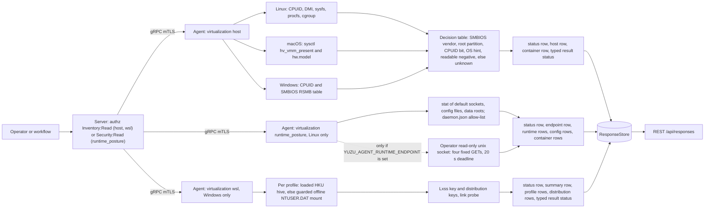
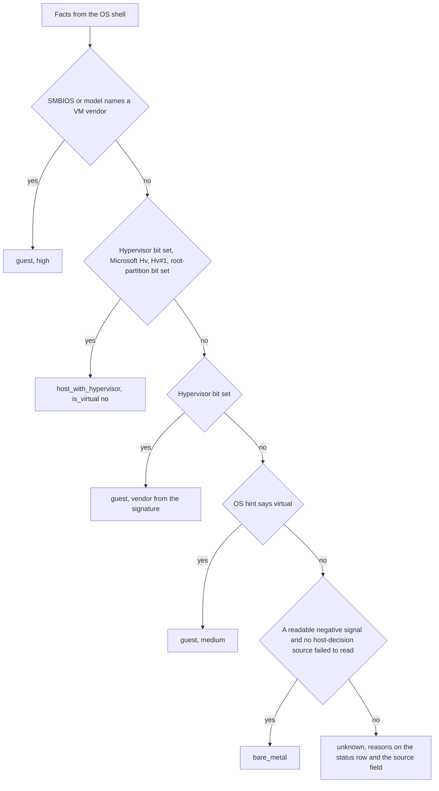

# virtualization

<!-- BEGIN GENERATED: plugin-doc-gen header -->
| | |
|---|---|
| **What it does** | Virtualization facts: VM or not, which hypervisor, container membership, WSL distributions |
| **Version** | 1.1.0 |
| **Kind** | Collector · read-only · gathered (crossplatform.virtualization.host, windows.virtualization.wsl) |
| **Platforms** | Windows 🟡 constrained · macOS ✅ · Linux ✅ |
| **Actions** | `host` (definition `crossplatform.virtualization.host`) · `wsl` (definition `windows.virtualization.wsl`) |
| **Security** | `host`: securable `Inventory` · operation Read · risk Low · dispatch ReadOnly · approval gate None; `wsl`: securable `Inventory` · operation Read · risk Low · dispatch ReadOnly · approval gate AdminOrApproval |
| **Roles** | execute: endpoint-admin, endpoint-operator · author: content-author |
<!-- END GENERATED -->

## How it works

`host` reports whether this device is a virtual machine, which hypervisor it runs under, and whether the agent itself runs in a container, as facts only. It changes nothing and spawns nothing. The first row is always a `status` row saying whether the read was complete, then one `host` row (`is_virtual`, `kind`, `vendor`, `product`, `source`, `confidence`) and one `container` row. `kind` is `guest`, `host_with_hypervisor`, `bare_metal` or `unknown`; a container on a VM reports both facts, because `container` is its own row and not a `kind` value.

The decision is one table in `virtualization_parsers.hpp`, fed by what each OS shell reads. Linux reads CPUID (x86), the DMI `sys_vendor` and `product_name` attributes, `/sys/hypervisor/type`, the marker files `/.dockerenv` and `/run/.containerenv`, the container type systemd records in `/run/systemd/container` (how an LXD, Incus or systemd-nspawn system container is told from a host, because its cgroup path looks the same), and the agent's own `/proc/self/cgroup` (not PID 1's, which answers a different question when the PID namespace is shared). The `/run/systemd/container` content is never emitted, only the fact that it named a container; `wsl` and an empty file are ignored, so a WSL2 agent is not turned into a container. macOS reads `kern.hv_vmm_present` and `hw.model`. Windows reads CPUID and the SMBIOS System Information table. A Windows machine running Hyper-V, VBS or WSL2 sets the CPUID hypervisor bit yet is the host, not a guest: when the hypervisor signature is `Microsoft Hv`, the interface signature is `Hv#1` and the maximum leaf reaches `0x40000003`, the Hyper-V root-partition bit (leaf `0x40000003` EBX bit 0, CreatePartitions) separates a host (`host_with_hypervisor`, `is_virtual` no) from a guest. Without that discovery contract the bit is never read.

Precedence: positive identification always beats negative evidence. SMBIOS or the hardware model naming a VM vendor decides first (so VBS nested inside another hypervisor, which sets the root-partition bit, still reads `guest`); then the root-partition bit; then the CPUID hypervisor bit; then a positive OS hint. `bare_metal` is reachable only when no consulted source identifies virtualization, at least one readable source says "not virtual", and no host-decision source (SMBIOS, CPUID, OS hint) failed to read; a failed container read makes the status `constrained` but does not block `bare_metal`. `bare_metal` means no virtualization signal was seen, not proof of physical hardware. Anything else is `unknown`, with the reasons on the status row and in the host row's `source` field.

`wsl` (Windows only) lists the WSL distributions of every local user profile. For each real profile (system accounts are skipped) it reads `Software\Microsoft\Windows\CurrentVersion\Lxss` through the shared `with_user_hive` ladder: the loaded `HKU\<SID>` hive first, else the profile's `NTUSER.DAT` mounted offline under the process-wide offline-hive lock with the default-on hive-file guard, the same span `installed_apps.list_per_user` uses. The profile list itself (SIDs and folder paths) comes from `HKLM\...\ProfileList`. Each child key named by a GUID is one distribution (WSL's own non-GUID children such as `InstallStatus` are skipped); only `DistributionName`, `Version`, `State` and `Flavor` are read, plus the per-user `DefaultDistribution` and the machine-wide WSL package `Version` under `HKLM\...\Lxss\MSI`. Every key under the hive root is opened with `REG_OPTION_OPEN_LINK`, and the `Lxss` key and each distribution key are probed once for the `SymbolicLinkValue` marker of a registry link, so a link planted at either is reported (`lxss_link`) and never read through; the machine-wide `...\Lxss\MSI` key is opened the same way but not probed (only an administrator can plant a link there, and it reads as a package version of `-`). The rows are a `status` row, one `summary` row, one `profile` row for each profile that was not reached or whose mount could not be released, and one `distribution` row per distribution, sorted by account then name. Linux and macOS answer one `unsupported` status row. The walk is bounded in work, not in time: one budget per dispatch caps the registry enumeration and value-read calls (4096, the link probes included; opening a key is not counted), a value (4 KiB), rows (1024, which includes the two reserved status and summary rows) and output (256 KiB) across all hives, and each hive is also held to 512 of those calls, 128 rows and 32 KiB so that one hostile hive ends alone. The number of hives mounted is bounded by the profile cap alone, not by the call budget: a dispatch visits at most 512 profiles, so the worst case is 512 serial mount and unload cycles, and a hive with no Lxss key costs no counted call. The lock wait, `RegLoadKeyW` and `RegUnLoadKeyW` have no deadline, exactly as for `installed_apps.list_per_user`. If an unload fails, that profile's `NTUSER.DAT` stays locked and the mount `HKU\YUZU_HIVE_<SID>_...` is left behind: list `HKU` with `reg query HKU`, find the `YUZU_HIVE_*` key (its exact name is in the agent log) and release it with `reg unload HKU\<mount>`. Until then that user's next logon gets a temporary profile, and a repeat `wsl` dispatch reports the profile as `mount_failed`. The only automatic cleanup is the Echo plugin's start-up sweep of `YUZU_HIVE_*` mounts, so an agent without Echo loaded needs the manual step. The decision, the bounds and the fake-registry tests are in `virtualization_wsl_parsers.hpp`.

`runtime_posture` (Linux only) reports which container runtimes are on this device and how they are set up, as read-only facts. With no endpoint configured, which is the default, the agent never opens a socket: it `stat`s the standard docker, podman and containerd sockets, config files and data roots (no subprocess, no `PATH` walk), reads `/etc/docker/daemon.json` through a fixed key allow-list and only notes the presence of the podman and containerd TOML files. A runtime reads `not_detected` when none of its standard-path artefacts exists, which is a statement about those paths and not proof of absence: a stopped, rootless or custom-root runtime can read `not_detected`. A data root that sits on, under or above a network mount is not `stat`ed (`<runtime>:network_fs_skipped`), because a `stat` on a dead mount has no deadline. If a default socket is group-connectable by a group the agent holds, or other-writable, the agent reports `<runtime>:overprivileged` by comparing modes and groups; it never probes by connecting.

An operator opts in per host by setting `YUZU_AGENT_RUNTIME_ENDPOINT` (or `--runtime-endpoint`) to ONE read-only unix socket they provide in front of the runtime, in `/etc/yuzu-agent/yuzu-agent.env` or a unit drop-in; the packaged unit is not changed and the agent is never added to the `docker` group. Over that endpoint the agent sends four fixed `GET` requests built from a verb table (`/version`, `/info`, `/containers/json?all=1`, `/containers/{id}/json`), each with `Connection: close`, under one 20 s action deadline. The four runtime default sockets are refused as an endpoint, by normalised path and by inode while they are present (`endpoint_refused`), and the endpoint object must be a socket owned by uid 0, group the agent's effective group, mode `0660`, under root-owned directories that group and other cannot write; the agent connects through the descriptor it checked. That refusal is a structural guard, not the enforcement: the socket's permission bits and the operator's proxy are. The proxy must admit only those four requests, matched exactly on every request, and it does not filter response bodies; the contract, the bounds and the security review are in `docs/virtualization-runtime-posture-design.md`.

Container rows carry the name, image, state, a privileged flag, the network mode and whether a default runtime socket (or a directory that contains one) is mounted into the container. The agent reads no environment, command line, label, port or other mount. containerd is detected by presence only: its control plane is gRPC, which no plugin links. Only one `runtime_posture` dispatch runs per agent at a time; a concurrent one returns one `constrained` status row with `busy`.



### What you can decide with it

| Question | Linux | macOS | Windows |
|---|---|---|---|
| Is this device a VM? | Yes: `is_virtual` yes, no or unknown, with the evidence source and a confidence. | Yes, from `kern.hv_vmm_present` and the model name. | Yes, from CPUID and SMBIOS. |
| Which hypervisor? | The CPUID signature, a DMI vendor or `/sys/hypervisor/type`. | `apple` for a `VirtualMac*` model, `vmware` for a VMware model string, otherwise `other`. | The CPUID signature or the SMBIOS vendor. |
| Is the agent in a container? | `yes` on a marker file, a container type in `/run/systemd/container` or a container cgroup path; `no` only when all of those are readable and absent and the cgroup names a real path (a container without a marker file or systemd record can also read `no` when its readable, non-root cgroup path has no recognised runtime signature, caveat 3); otherwise `unknown`. | Always `no`. | Not read: always `unknown`. |
| Is this a Hyper-V, VBS or WSL2 host? | A WSL2 guest reads `guest` `hyperv`. | n/a | Yes on x86: `host_with_hypervisor`, `is_virtual` no. Not detected on ARM64, which has no CPUID. |
| Which WSL distributions does each user have? | `wsl`: one `unsupported` row. | `wsl`: one `unsupported` row. | `wsl`: per local profile, the distribution name, WSL version, state, default and flavor, including profiles that are logged off. |
| Which container runtimes are here, and are any containers risky? | `runtime_posture`: runtime presence and posture from `stat` and `daemon.json`; containers (name, image, state, privileged, network mode, runtime-socket mount) only through an operator-provided read-only endpoint. | `runtime_posture`: one `unsupported` row. | `runtime_posture`: one `unsupported` row. |

### Diagrams

#### How the kind is decided



The order matters: a positive identification is never outranked by a negative or missing signal, and an unreadable host-decision source (SMBIOS, CPUID, OS hint) can never be read as "not virtual".

## OS capability

<!-- BEGIN GENERATED: plugin-doc-gen capability -->
| Action | Windows | macOS | Linux |
|---|---|---|---|
| `host` | 🟡 constrained · rung 1 · CPUID leaves 1 and 0x40000000-0x40000003 (__cpuid, x86) and the SMBIOS System Information table via GetSystemFirmwareTable('RSMB') | ✅ supported · rung 1 · sysctlbyname kern.hv_vmm_present and hw.model | ✅ supported · rung 1 · CPUID leaves 1 and 0x40000000-0x40000003 (x86), /sys/class/dmi/id/{sys_vendor,product_name}, /sys/hypervisor/type, /.dockerenv, /run/.containerenv, /run/systemd/container and /proc/self/cgroup (bounded reads, no subprocess) |
| `wsl` | 🟡 constrained · rung 1 · Reg*W reads of HKLM\\SOFTWARE\\Microsoft\\Windows\\CurrentVersion\\Lxss\\MSI, the HKLM ProfileList (profile SIDs and folder paths; no privilege) and each local profile's Software\\Microsoft\\Windows\\CurrentVersion\\Lxss key through the shared with_user_hive ladder (loaded HKU hive first, else a guarded offline NTUSER.DAT mount under SeBackup/SeRestore and the process-wide offline-hive lock); no subprocess | ⛔ unsupported | ⛔ unsupported |

**Declared limits per leg** (descriptor fallback text, verbatim):

- **`host` / Windows** — container not read: always unknown, windows:virtualization:container:not_read; an ARM64 build has no CPUID and reads unknown (windows:virtualization:cpuid:unavailable) unless SMBIOS names a VM vendor, and does not detect a Hyper-V or VBS host; no ARM64 build ships, and the x64 agent on a Windows-on-ARM device reads whatever CPUID the emulation presents (not measured)
- **`host` / macOS** — no CPUID on arm64: the sysctl is the readable negative; container is always no
- **`host` / Linux** — ARM has no CPUID: SMBIOS and OS hints alone decide, and a host with neither reads unknown, never bare_metal; a KVM host reads bare_metal (its own CPUID is not virtualised) but a Xen dom0 reads guest/xen; a cgroup-v2 namespace-obscured root reads container unknown; a container without a marker file or systemd record can read container no when its readable, non-root cgroup path has no recognised runtime signature
- **`wsl` / Windows** — a profile whose hive was reached by neither arm is counted and reported on its own profile row, never read as having no distributions; a registry link planted at the Lxss key or at a distribution key is detected and reported (windows:virtualization:wsl:lxss_link), never followed; wsl2 counts version-2 distributions and is not a VM count (the utility VM's running state is not read); base, VHD and shortcut paths, SIDs, uids and hive mount names are never emitted; package version - means unavailable; the offline mount calls have no deadline (the walk is bounded in work, not in time: at most 512 profiles are mounted per dispatch)
- **`wsl` / macOS** — Windows-only: WSL distributions are a Windows feature
- **`wsl` / Linux** — Windows-only: WSL distributions are a Windows feature
<!-- END GENERATED -->

## Privileges and prerequisites

| OS | Runs as | Extra grant needed | Measured | If the read is refused |
|---|---|---|---|---|
| Windows | agent daemon (LocalSystem today, `docs/agent-privilege-model.md`) | `host`: None: CPUID is an unprivileged instruction and the SMBIOS table is read through `GetSystemFirmwareTable`. `wsl`: None beyond what the agent account already holds: the action uses the same `with_user_hive` span `installed_apps.list_per_user` already uses. The `HKLM` ProfileList (profile SIDs and folder paths) and the WSL package `Version` need no privilege, nor does a loaded `HKU\<SID>` hive; a logged-off profile's `NTUSER.DAT` is mounted offline with `SeBackupPrivilege` and `SeRestorePrivilege`, already held by the agent account and enabled only inside the offline arm, under the process-wide offline-hive lock and the default-on hive-file guard | `host`: Measured 2026-11-07 on a Windows 11 host with Hyper-V, VBS and WSL2 enabled, from an elevated interactive session (not LocalSystem): CPUID and the firmware table both answered; whether an unelevated caller gets the table was not measured. `wsl`: Measured 2026-11-08 on the same host as `host`, as LocalSystem (a scheduled task, the agent's own identity), with the native MSVC build. The loaded `HKU` hive of the logged-on profile was read live (the sample); no real account on that host was logged off with a Lxss key, so the offline arm was measured on a disposable local account that had never logged on and was logged off: its `NTUSER.DAT` was mounted and read through `SeBackupPrivilege` and `SeRestorePrivilege`, a registry link planted at the `Lxss` key or at a distribution key was reported as `lxss_link` and never read through (no decoy row appeared), a mount that could not be unloaded gave `hive_unload_failed` with the mount name only in the agent log, and a leftover `YUZU_HIVE_*` mount gave `hive_mount_failed` on the next run; a planted link was not followed by the kernel across hives from a user hive either. The account was removed afterwards | `host`: `CONSTRAINED` / partial with `windows:virtualization:smbios:<cause>`; the kind is `unknown` unless CPUID or a decoded Type 1 already identifies the machine. `wsl`: a hardened install that strips the two privileges still reads every logged-on profile; a logged-off one is a `profile` row with outcome `privilege_missing` and the token `windows:virtualization:wsl:hive_privilege_missing`. A refused hive file is `file_refused` with the guard's reason, a refused live root `access_denied`; none is read as having no distributions |
| macOS | agent daemon (root under the shipped LaunchDaemon today, `docs/agent-privilege-model.md`) | None: both sysctls answer an unprivileged caller | The sample was captured as an unprivileged user, not under the LaunchDaemon account | `CONSTRAINED` / partial with `macos:virtualization:hv_vmm_present:unreadable` or `macos:virtualization:hw_model:unreadable`; the kind is `unknown` unless the other sysctl still identifies a guest |
| Linux | agent daemon, dedicated unprivileged account (`yuzu-agent` on the packaged unit), never root by design (`docs/agent-privilege-model.md`) | None: the DMI attributes and `/run/systemd/container` read are world-readable; the root-only `product_serial` and `product_uuid` are never read | Measured 2026-11-07 inside a WSL2 distribution as root (not the packaged `yuzu-agent` account): `/run/systemd/container` is mode 0644 root:root under a 0755 `/run/systemd`; that kernel exposes no `/sys/class/dmi/id` or `/sys/hypervisor`, so the DMI modes were not measured and the host answer came from CPUID alone | `CONSTRAINED` / partial; a refused host-decision source (SMBIOS, CPUID, OS hint) reports `linux:virtualization:<source>:<cause>` and the kind `unknown` (or the kind another source already established), never `bare_metal`; a refused container read reports `linux:virtualization:container:<cause>`, constrains the status and does not block `bare_metal` |
| Linux (`runtime_posture`) | agent daemon, dedicated unprivileged account, never root and never in the `docker` group (`docs/agent-privilege-model.md`) | None for the default read: `stat` of the sockets, config files and data roots and a bounded read of `/etc/docker/daemon.json`. Opt-in only: an operator-provided read-only unix socket (root-owned, the agent's group, `0660`) set through `YUZU_AGENT_RUNTIME_ENDPOINT`; `connect(2)` needs that socket's write bit, which the packaged unit's `CAP_DAC_READ_SEARCH` does not grant | Pending the Linux capture: `connect(2)` to a default runtime socket as an account holding only `CAP_DAC_READ_SEARCH` (expected `EACCES`), and `connect(2)` through `/proc/self/fd/<N>` of an `O_PATH` socket descriptor, are measured on a Linux host before release | A refused `stat` or `daemon.json` read is `CONSTRAINED` / partial with `linux:virtualization:runtime_posture:<source>:<cause>`; a refused connect is the endpoint row `permission_denied` plus the token `version:permission_denied` (`CONSTRAINED`) and changes no runtime row |

No subprocess, no shell and no TCP: every leg is an in-process read (CPUID, sysctl, bounded file reads, `access(2)`, the Windows firmware table, and for `wsl` the registry; `runtime_posture` alone adds, only when an endpoint is configured, a local unix-socket client (cpp-httplib over `AF_UNIX`, one connection per request). The `wsl` offline mount calls (the lock wait, `RegLoadKeyW`, `RegUnLoadKeyW`) have no deadline: the budget bounds the number of registry calls made under the lock, not how long each takes. Each offline mount changes that hive's sequence number and hash (#4977); a dispatch mounts at most one hive per local profile and visits at most 512 profiles (the profile cap, not the 4096-call budget, is what bounds the mounts). The Linux file reads are size-bounded but have no deadline of their own, like every `posix_secure_read` consumer (#4875): a hung procfs or sysfs read would hold one agent pool worker until it returns. The `runtime_posture` socket work is bounded by a 20 s monotonic action deadline checked before every request (the remaining budget is passed to the client as its per-request total timeout, never zero), a 2 s connect and 5 s read timeout capped by that budget, a 1 MiB body cap, at most 67 requests (three fixed plus at most 64 inspections), 256 container rows and 256-byte fields, so a worst case holds one agent worker for about 20 s plus the unguarded `stat` calls; a `stat` of a data root on a network mount is skipped rather than risked.

## Data contract

### Inputs

<!-- BEGIN GENERATED: plugin-doc-gen inputs -->
Neither action takes parameters.
<!-- END GENERATED -->

### Outputs

Every row is pipe-delimited and field 0 is the row kind; `-` is an absent value. The first row of a `host` dispatch is always `status|host|<supported\|constrained\|unsupported>|<reason or ->`. The `host` row has seven fields: `host|<yes\|no\|unknown>|<guest\|host_with_hypervisor\|bare_metal\|unknown>|<vendor>|<product>|<source>|<high\|medium\|low>`. `vendor` is the virtualization platform (`kvm`, `hyperv`, `vmware`, `xen`, `virtualbox`, `parallels`, `bhyve`, `qemu`, `acrn`, `aws`, `gce`, `alibaba`, `openstack`, `nutanix`, `apple` or `other`) for a guest or host, and the hardware manufacturer for `bare_metal` and `unknown`. `source` is the evidence that decided the kind (`cpuid`, `smbios`, `sysctl` or `sys_hypervisor`); when the kind is `unknown` it carries the joined host-decision reason tokens instead (container read failures stay on the container row), so the row an operator reads explains itself. The `container` row is `container|<yes\|no\|unknown>|<evidence or reason>`. Every OS-supplied value (DMI and SMBIOS strings, the hardware model) is scrubbed (NUL and malformed UTF-8 become `?`) and escaped for the server's pipe grammar.

`wsl` rows (Windows). The first row is `status|wsl|<supported\|constrained\|unsupported>|<reason or ->`, then `summary|<distributions>|<wsl2>|<profiles_read>|<profiles_not_loaded>|<package_version or ->`. `distributions` is the number of `distribution` rows emitted. `wsl2` counts version-2 distributions and is NOT a VM count: every WSL 2 distribution shares one utility VM whose running state is readable only through `wsl.exe` or the WSL service, which this plugin does not call. `profiles_read` counts the hives whose Lxss key was read or found absent (an absent key counts: that profile has no WSL); a cap that stops the read inside the key still counts it and is reported by its token. `profiles_not_loaded` counts the profiles whose hive was reached by neither the loaded hive nor the offline mount, including `.bak` entries and invalid SIDs, and the profiles never reached because a dispatch-wide limit stopped the walk (those get no `profile` row: the output budget was spent). `profiles_read` + `profiles_not_loaded` need not equal the profile count: a hive that was reached but whose Lxss key could not be opened, or is a registry link, is in neither, and is reported only by its `hive_access_denied`, `hive_open_failed` or `lxss_link` token (a token carries no account). `package_version` is `-` when unavailable or over 64 bytes. A `profile` row, `profile|<account or ->|<outcome>|<detail or ->`, is emitted only for a profile that was not reached or whose mount could not be released; `outcome` is one of `not_found`, `privilege_missing`, `mount_failed`, `access_denied`, `file_refused`, `unload_failed`, `backup_skipped` or `sid_invalid`, and `detail` is the hive-file guard's reason verbatim for `file_refused` (`hive_path_unc`, `hive_identity_changed` and the others in `agents/shared/win_hive_file_guard.hpp`) and `-` otherwise. An `unload_failed` row means the offline mount was left behind and keeps `NTUSER.DAT` locked until `reg unload HKU\<mount>` succeeds (find the `YUZU_HIVE_*` key with `reg query HKU`; until then that user's next logon gets a temporary profile and a repeat dispatch reports the profile as `mount_failed`, and only the Echo plugin's start-up sweep cleans up on its own, see How it works); the mount name embeds the SID, so it is written to the agent log only and never to a row. A `distribution` row is `distribution|<account or ->|<name>|<1\|2\|unknown>|<installed\|installing\|uninstalling\|converting\|exporting\|compacting\|state_<n>\|unknown>|<yes\|no>|<flavor or ->`; `account` is the profile folder name, never the SID, and `yes` marks that account's default distribution. The state names follow the WSL service's own state enum (the public WSL source, `_LxssDistributionState`): `installed` is 1, `installing` 3, `uninstalling` 4, `converting` 5, `exporting` 6 and `compacting` 7; 0 (invalid), 2 (running, a session state) and anything past 7 print as `state_<n>`, and only `installed` has been seen on a measured host. A distribution whose key could not be opened, or is a registry link, is a row with `-` for the name, `unknown` for version and state, and its default flag. Account, distribution name and flavor are e-mail redacted by value (`[redacted-email]`) and every field is scrubbed and escaped for the pipe grammar.

`runtime_posture` rows (Linux). The first row is `status|runtime_posture|<supported\|constrained\|unsupported>|<reason or ->`, then exactly one `endpoint|<unset\|endpoint_refused\|permission_denied\|unreachable\|not_http\|ok>|<reason or ->|<dialect or ->` row, which owns the endpoint outcome (`unset` means no endpoint is configured and no socket was opened; `endpoint_refused` carries one reason: `relative`, `dotdot`, `too_long`, `default_socket`, `same_inode`, `not_socket`, `symlink`, `owner`, `group`, `mode`, `insecure_ancestor` or `stat_error`; `not_http` means connected but `/version` was not a JSON HTTP reply, as a containerd socket is). Then three `runtime|<docker\|podman\|containerd>|<not_detected\|detected\|served>|<present:<mode>:<uid>:<gid>\|absent\|unreadable>|<present\|absent\|unreadable>|<version or ->|<api_version or ->` rows that carry detection facts only (`served` means the endpoint's `/version` identified that runtime, and only that row carries the versions; an endpoint failure never changes a runtime row), then `config|<runtime or ->|<key>|<value>` rows (the allow-listed `daemon.json` keys, with `hosts_tcp yes\|no` and counts for `hosts`, `insecure-registries` and `registry-mirrors`, and up to three `/info` rows: `rootless`, `cgroup_driver`, `security_options_count`; the runtime of an `/info` row is `-` when `/version` did not identify one, and `daemon.json` rows are always `docker`) and `container|<runtime or ->|<id12>|<name>|<image>|<state>|<privileged yes\|no\|unknown>|<network_mode or unknown>|<host_runtime_socket_mounted yes\|no\|unknown>` rows. `unknown` means the container was never inspected (the 64-inspection cap, the deadline) or its inspection failed, and is never rendered as `no`; `host_runtime_socket_mounted` covers the four default socket paths only. Every free-text field is admitted only if every byte is in its character set (otherwise it reads `invalid`) before it is truncated to 256 bytes and escaped; `state` is the closed docker set (`created`, `running`, `paused`, `restarting`, `removing`, `exited`, `dead`), so a podman state outside it reads `invalid` until the real podman answers are recorded.

<!-- BEGIN GENERATED: plugin-doc-gen outputs -->
**`crossplatform.virtualization.host` — `row_kind|field_1|field_2|field_3|field_4|field_5|field_6`**

| Field | Type | Values | Available | Example | Description |
|---|---|---|---|---|---|
| `row_kind` | string | `status` `host` `container` | Windows, Linux, macOS | `host` | Row shape discriminator (field 0). Values: status, host, container. |
| `field_1` | string | - | Windows, Linux, macOS | `no` | status: the literal "host". host: is_virtual, yes (a guest), no (bare metal or a host running a hypervisor) or unknown. container: yes, no or unknown (is the agent itself in a container). |
| `field_2` | string | - | Windows, Linux, macOS | `bare_metal` | status: supported, constrained or unsupported (a leg that threw). host: kind, guest, host_with_hypervisor (a Windows host running Hyper-V, VBS or WSL2), bare_metal (no virtualization signal seen, not proof of physical hardware) or unknown. container: the evidence (/.dockerenv, /run/.containerenv, /run/systemd/container, cgroup:<runtime>, linux:no_container_marker, macos:no_container_runtime) or, for unknown, the reason (linux:virtualization:container:cgroup_root_opaque for a cgroup-v2 namespace that hides the answer, windows:virtualization:container:not_read on Windows). A container no is best effort: a container without a marker file or systemd record can read no when its readable, non-root cgroup path has no recognised runtime signature. |
| `field_3` | string | - | Windows, Linux, macOS | `Apple Inc.` | status: reason token(s) for a non-supported read, "-" when complete; tokens look like linux:virtualization:dmi:permission_denied, linux:virtualization:cpuid:unavailable, windows:virtualization:smbios:truncated, macos:virtualization:hw_model:unreadable, linux:leg:exception. host: the virtualization platform (kvm, hyperv, vmware, xen, virtualbox, parallels, bhyve, qemu, acrn, aws, gce, alibaba, openstack, nutanix, apple or other) for a guest or host_with_hypervisor, the hardware manufacturer for bare_metal and unknown, "-" when not read. |
| `field_4` | string | - | Windows, Linux, macOS | `Mac16,10` | host: the SMBIOS product name or macOS hw.model, "-" when not read. Not used by the other kinds. |
| `field_5` | string | - | Windows, Linux, macOS | `sysctl` | host: the evidence source that decided the kind (cpuid, smbios, sysctl or sys_hypervisor); when the kind is unknown, the joined reason tokens instead. Not used by the other kinds. |
| `field_6` | string | `high` `medium` `low` | Windows, Linux, macOS | `high` | host: confidence, high, medium or low (an unknown is low). Not used by the other kinds. |

**`windows.virtualization.wsl` — `row_kind|field_1|field_2|field_3|field_4|field_5|field_6`**

| Field | Type | Values | Available | Example | Description |
|---|---|---|---|---|---|
| `row_kind` | string | `status` `summary` `profile` `distribution` | Windows | `distribution` | Row shape discriminator (field 0). Values: status, summary, profile, distribution. |
| `field_1` | string | - | Windows | `alice` | status: the literal "wsl". summary: the number of distributions listed. profile and distribution: the account, the profile folder name ("-" when it cannot be resolved), never the SID. |
| `field_2` | string | - | Windows | `Ubuntu-26.04` | status: supported, constrained or unsupported (a leg that threw). summary: the number of WSL 2 distributions (not a VM count). profile: the outcome, not_found, privilege_missing, mount_failed, access_denied, file_refused, unload_failed, backup_skipped or sid_invalid. distribution: the distribution name as WSL records it (an e-mail-shaped name is replaced by [redacted-email]). |
| `field_3` | string | - | Windows | `2` | status: reason token(s) for a non-supported read, "-" when complete; tokens look like windows:virtualization:wsl:hive_mount_failed, windows:virtualization:wsl:lxss_link, windows:virtualization:wsl:row_cap, windows:leg:exception. summary: the number of profiles whose Lxss key was read or found absent (it need not add up with field 4 to the profile count: a reached hive whose Lxss key could not be opened, or is a registry link, appears only as a status token). profile: a detail, the hive-file guard refusal for file_refused (hive_path_unc and similar), otherwise "-". distribution: the WSL version, 1, 2 or unknown. |
| `field_4` | string | - | Windows | `installed` | summary: the number of profiles whose hive was reached by neither the loaded hive nor the offline mount (a .bak entry or an invalid SID counts, and so does a profile never reached because a dispatch-wide limit stopped the walk). distribution: the install state, installed, installing, uninstalling, converting, exporting, compacting, state_<n> for an unrecognised value or unknown. |
| `field_5` | string | - | Windows | `yes` | summary: the WSL package version, "-" when unavailable. distribution: whether this is the account's default distribution, yes or no. |
| `field_6` | string | - | Windows | `ubuntu` | distribution: the flavor WSL records (for example ubuntu), "-" when absent; an e-mail-shaped value is replaced by [redacted-email]. Not used by the other kinds. |
<!-- END GENERATED -->

### Result status

`host` sets `OK`/`FULL` when every consulted source was read (including a clean `bare_metal` or `guest`). A source that failed to read, or the absence of any negative signal on a machine with no CPUID, makes the result `CONSTRAINED`/`PARTIAL`, with the same tokens, comma-joined, in the leading `status` row. The status reason lists plugin constraint tokens only; the container row's evidence strings (`/.dockerenv`, `/run/.containerenv`, `/run/systemd/container`, `cgroup:<runtime>`, `macos:no_container_runtime`, `linux:no_container_marker`) are not tokens. No exception crosses the plugin boundary: a leg that throws is reported as an `unsupported` status row and `UNAVAILABLE` (the last status row wins if the leg had already written one).

`wsl` sets `OK`/`FULL` when every profile was read and nothing was cut; any token below makes it `CONSTRAINED`/`PARTIAL`, with the tokens comma-joined in the `status` row. Every `wsl` token is `windows:virtualization:wsl:<suffix>`; the suffixes are listed in the table, and a partial result is never a failed command (the action returns 0). Rows already read are kept when a limit stops the walk.

`runtime_posture` sets `OK`/`FULL` unless a read failed, in which case it is `CONSTRAINED`/`PARTIAL` with the tokens comma-joined in the `status` row. An endpoint that is merely unset is not a constraint. A configured endpoint that was refused, absent, denied, unreachable or not a runtime API is a failed read: it is reported on the `endpoint` row and as a status token (`endpoint:<reason>`, or `version:<cause>` when the first request failed), so the result is `CONSTRAINED`, never a clean `OK` with no containers. Every token is `linux:virtualization:runtime_posture:<source>:<cause>`; an HTTP status inside a token is emitted only when numeric and in 100-599, otherwise the cause is `http_other`. Wrong-typed means a key the parser reads is present with a value, or an element it reads, of another type; a missing key is never wrong-typed and only omits its row. A non-200, malformed or wrong-typed `/version`, `/info` or list reply keeps the earlier rows, leaves that verb's fields unknown and lets the later verbs run while budget remains (a `/version` that failed at the transport, or answered 200 with a body that is not JSON, is `permission_denied`, `unreachable` or `not_http` on the endpoint row and stops the action); an inspection that fails (a transport or HTTP failure, or a wrong-typed `HostConfig.Privileged`, `HostConfig.NetworkMode`, `Mounts` or `Mounts[].Source`) keeps the list-derived row with its three inspect fields `unknown`, and an HTTP 404 between list and inspect is expected churn (those fields read `unknown`, with no token and no constraint).

A refusal is reported as `CONSTRAINED` with a `permission_denied` token, not as the `PERMISSION_DENIED` result status that `mgmt_posture` and `shares` use. This is deliberate: in those plugins a refusal marks a read the agent could complete with a grant (a root-only file, a capability), whereas every source here is unprivileged by design (world-readable DMI attributes, `/sys/hypervisor/type`, `/run/systemd/container`, the agent's own `/proc/self/cgroup`, `access(2)` on two root-owned paths, two sysctls, the in-memory firmware table), so a refusal means a security policy or a masked mount, and there is no grant a status could point an operator at.

| Status | Completeness | Provenance | When |
|---|---|---|---|
| `OK` | full | (empty) | every consulted source was read and the kind is established, or the container row is `unknown` by declaration (Windows: `windows:virtualization:container:not_read`) or by classification (`linux:virtualization:container:cgroup_root_opaque`); both appear on the container row only, never in the status provenance |
| `CONSTRAINED` | partial | `linux:virtualization:dmi:<cause>`, `linux:virtualization:sys_hypervisor:<cause>` | Linux: a DMI attribute or `/sys/hypervisor/type` could not be read. `<cause>` is `permission_denied`, `eio`, `eloop`, `enotdir`, `einval`, `not_regular`, `oversized` or `errno_<n>`; a missing file (ENOENT) is a definitive absence, not a failure |
| `CONSTRAINED` | partial | `linux:virtualization:cpuid:unavailable`, `macos:virtualization:cpuid:unavailable`, `windows:virtualization:cpuid:unavailable` | No CPUID on this architecture (ARM) and nothing else supplied a readable "not virtual" answer, so the kind is `unknown`; not added when SMBIOS or a hint identifies the machine, nor on macOS when the sysctl answers |
| `CONSTRAINED` | partial | `linux:virtualization:container:markers_<cause>`, `linux:virtualization:container:systemd_container_<cause>`, `linux:virtualization:container:cgroup_<cause>`, `linux:virtualization:container:cgroup_not_read` | Linux: a container marker probe, `/run/systemd/container` or `/proc/self/cgroup` could not be read; the container row is `unknown` unless a marker, the systemd record or a cgroup runtime already answered. A missing `/run/systemd/container` is the normal host case, not a failure |
| `CONSTRAINED` | partial | `linux:virtualization:smbios:unreadable`, `macos:virtualization:smbios:unreadable`, `windows:virtualization:smbios:unreadable` | SMBIOS was reported unreadable with no cause token; a defensive fallback so an unknown is never unexplained (no shipped leg produces it today) |
| `CONSTRAINED` | partial | `macos:virtualization:hv_vmm_present:unreadable`, `macos:virtualization:hw_model:unreadable` | macOS: a sysctl could not be read; the kind is `unknown` unless the other sysctl still identifies a guest |
| `CONSTRAINED` | partial | `windows:virtualization:smbios:truncated`, `windows:virtualization:smbios:malformed`, `windows:virtualization:smbios:call_failed`, `windows:virtualization:smbios:oversized`, `windows:virtualization:smbios:size_race` | Windows: the SMBIOS table walk stopped at a framing fault, the Type 1 structure was malformed, or the firmware-table read failed. A Type 1 decoded before a later fault still identifies a VM vendor |
| `CONSTRAINED` | partial | `windows:virtualization:wsl:hive_not_found`, `windows:virtualization:wsl:hive_privilege_missing`, `windows:virtualization:wsl:hive_mount_failed`, `windows:virtualization:wsl:hive_access_denied`, `windows:virtualization:wsl:hive_file_refused`, `windows:virtualization:wsl:profile_backup_skipped`, `windows:virtualization:wsl:profile_sid_invalid` | Windows `wsl`: a profile's hive was reached by neither arm (no loaded hive and no profile path; SeBackup/SeRestore could not both be enabled; the offline load or the root re-open failed; a refused live root or Lxss read; the hive-file guard refused the file; a `.bak` ProfileList entry, never mounted; an invalid SID, never accessed). Each is also a `profile` row and counts in `profiles_not_loaded`, except `hive_access_denied` raised by a denied read of the Lxss key itself, which has no row and no count (that profile is in neither summary count) |
| `CONSTRAINED` | partial | `windows:virtualization:wsl:hive_unload_failed` | Windows `wsl`: an offline mount was left behind, whatever else happened to that profile. The distributions already read are kept; the mount name is in the agent log only |
| `CONSTRAINED` | partial | `windows:virtualization:wsl:hive_open_failed`, `windows:virtualization:wsl:hive_enum_failed`, `windows:virtualization:wsl:distro_open_failed` | Windows `wsl`: the Lxss key could not be opened (other than absent or access denied, which is `hive_access_denied`), its children could not be enumerated (rows read so far are kept), or one distribution key could not be opened (its row carries `-` for the name and `unknown` for version and state) |
| `CONSTRAINED` | partial | `windows:virtualization:wsl:lxss_link` | Windows `wsl`: the Lxss key, or one distribution key, carries a `SymbolicLinkValue` value, which is what a registry link looks like when it is opened as itself (`REG_OPTION_OPEN_LINK`). The link is reported and never read through. A link at Lxss leaves that profile unread, in neither summary count; a link at a distribution key is a row with `-` for the name and `unknown` for version and state. A plain key that holds a decoy value of that name (a REG_SZ, say) reads the same way: constrained, never a clean result |
| `CONSTRAINED` | partial | `windows:virtualization:wsl:value_unreadable`, `windows:virtualization:wsl:value_malformed`, `windows:virtualization:wsl:value_oversized` | Windows `wsl`: a value could not be read (denied, or it changed between the size probe and the read), had the wrong type or size, or exceeded 4 KiB (never allocated); the field reads `-` or `unknown`. The link-marker probe of a key that failed to answer is also `value_unreadable`: the key is then read as a plain one |
| `CONSTRAINED` | partial | `windows:virtualization:wsl:package_malformed`, `windows:virtualization:wsl:package_access_denied`, `windows:virtualization:wsl:package_win32_<n>` | Windows `wsl`: the WSL package `Version` was over 64 bytes or the wrong type, or its key or value could not be read; `package_version` is `-`. A missing key is not a failure |
| `CONSTRAINED` | partial | `windows:virtualization:wsl:profile_list_access_denied`, `windows:virtualization:wsl:profile_list_win32_<n>`, `windows:virtualization:wsl:profile_list_enum_failed`, `windows:virtualization:wsl:profile_cap`, `windows:virtualization:wsl:profile_unreadable` | Windows `wsl`: the ProfileList could not be opened or enumerated to the end, stopped at 512 profiles with more present, or a profile's record could not be read or its path was present but unusable; the profiles that were enumerated are still read |
| `CONSTRAINED` | partial | `windows:virtualization:wsl:row_cap`, `windows:virtualization:wsl:entry_cap` | Windows `wsl`: the dispatch budget (1024 rows, which include the reserved status and summary rows, or 256 KiB of output; 4096 enumeration and value-read calls) stopped the walk; rows and counts cover what was read before it, and profiles after the stop were not accessed (they count in `profiles_not_loaded`, with no row) |
| `CONSTRAINED` | partial | `windows:virtualization:wsl:hive_row_cap`, `windows:virtualization:wsl:hive_entry_cap` | Windows `wsl`: one profile's hive reached its own allowance (128 distributions or 32 KiB of rows, or 512 registry calls); the distributions of that hive read before the limit are kept, the rest of it was not read, and the remaining profiles were still read |
| `CONSTRAINED` | partial | `linux:virtualization:runtime_posture:daemon_json:<cause>`, `linux:virtualization:runtime_posture:<runtime>:socket:<cause>`, `linux:virtualization:runtime_posture:<runtime>:config:<cause>`, `linux:virtualization:runtime_posture:<runtime>:data_root:<cause>` | Linux `runtime_posture`: a `stat` or the `daemon.json` read was refused or failed (`<cause>` is `permission_denied`, `eio`, `eloop`, `oversized`, `not_regular`, `malformed` for `daemon_json` (not JSON, or an allow-listed key of the wrong type: the well-typed keys still report beside a `config\|docker\|daemon_json\|malformed` row), or `errno_<n>`); the runtime row's field reads `unreadable`, never `absent` |
| `CONSTRAINED` | partial | `linux:virtualization:runtime_posture:<runtime>:overprivileged`, `linux:virtualization:runtime_posture:<runtime>:network_fs_skipped`, `linux:virtualization:runtime_posture:mountinfo:unreadable`, `linux:virtualization:runtime_posture:busy` | Linux `runtime_posture`: a default socket the agent could connect to (a held group with the write bit, or other-write), a data root skipped because it is on a network mount, an unreadable mount table, or a dispatch refused because another one is running |
| `CONSTRAINED` | partial | `linux:virtualization:runtime_posture:endpoint:<reason>` | Linux `runtime_posture`: a configured endpoint was refused (`<reason>` is the `endpoint_refused` reason on the endpoint row, for example `default_socket`, `symlink`, `stat_error`) or is not there (`unreachable`); no request was sent |
| `CONSTRAINED` | partial | `linux:virtualization:runtime_posture:version:<cause>`, `linux:virtualization:runtime_posture:info:<cause>`, `linux:virtualization:runtime_posture:list:<cause>`, `linux:virtualization:runtime_posture:inspect:failed:<n>` | Linux `runtime_posture`: a reply was non-200 (`http_<status>`), malformed (a key the reader reads is present with another type: `/version` `Version`, `ApiVersion`, `Components`, a `Components` element or its `Name`; `/info` `SecurityOptions`, one of its elements, or `CgroupDriver`; a list entry's `Names`, its first element, `Image` or `State`, where the row is kept; the well-typed keys still report and a missing key only omits its row; nested past 32 levels counts), oversized (`response_oversized`) or the request failed (`timeout`, `unreachable`, `permission_denied`, `not_http`); a `/version` that failed or was not JSON also sets the `endpoint` row; `list:entries_skipped` counts list entries that carried no valid id |
| `CONSTRAINED` | partial | `linux:virtualization:runtime_posture:rows_capped`, `linux:virtualization:runtime_posture:inspect_capped`, `linux:virtualization:runtime_posture:deadline_exhausted` | Linux `runtime_posture`: more than 256 containers (rows kept to 256), more than 64 inspections wanted (the rest `unknown`), or the 20 s action deadline ran out (no further request is sent, every completed row is kept) |
| `UNAVAILABLE` | unknown | `linux:virtualization:wsl:unsupported`, `macos:virtualization:wsl:unsupported`, `macos:virtualization:runtime_posture:unsupported`, `windows:virtualization:runtime_posture:unsupported` | `wsl` on Linux or macOS, or `runtime_posture` on macOS or Windows: the action does not run on that OS and reads nothing; one `unsupported` status row |
| `UNAVAILABLE` | unknown | `windows:leg:exception` / `linux:leg:exception` / `macos:leg:exception` | a leg threw: an `unsupported` status row, reported instead of unwinding across the plugin boundary |

### Where the data goes

- **Instruction result.** Rows travel over the agent's mTLS gRPC channel as the command response and land in the ResponseStore, queryable at `/api/responses/{id}`. `host` is also a gathered definition (`crossplatform.virtualization.host`, 3600s TTL); `wsl` is the role-gated definition `windows.virtualization.wsl` (3600s response window; how often it runs is the operator's scheduling).
- **Not consumed by** daily-sync, Echo, DEX, or metrics.
- **Sensitivity (`host`).** The `host` rows describe the device, not a person: no account, hostname, serial number, UUID or MAC address is emitted. The Linux leg never reads the root-only `product_serial` and `product_uuid`; on Windows the shared SMBIOS walker decodes the Type 1 serial number and UUID in memory, and the plugin never keeps or emits them. The SMBIOS manufacturer and product (or the macOS model) and the virtualization platform can identify the hardware or cloud provider of a device. The container evidence is a marker path or a runtime name, never a container or pod identifier.
- **Sensitivity (`wsl`).** The `wsl` rows are per-user data: the account (the profile folder name) and each distribution name are emitted, which can identify a person; an e-mail-shaped account, distribution name or flavor is replaced by `[redacted-email]`, and any other text is emitted after the pipe-grammar scrub (NUL, CR and LF are scrubbed and the field separator is escaped; a personal name that is not an e-mail address is not redacted). Never emitted: install and disk-image paths (`BasePath`, `VhdFileName`, shortcut and terminal-profile paths), the package family name, default user ids, kernel command lines, NAT addresses, the distribution GUID, any SID, and the offline mount name (it embeds the SID; it goes to the agent log only). The action is gated behind `AdminOrApproval` (definition `approval.mode: role-gated`), on by default, and mounting a logged-off profile's hive changes that hive's sequence number and hash (#4977).
- **Sensitivity (`runtime_posture`).** Container names and image references are emitted as device-scope rows. They are stored responses, readable by every holder of `Response:Read` (which includes the `Viewer` role); the action's `Security:Read` grant governs who may dispatch it, not who may read the stored rows. The honest agent emits no environment, command line, label, port or non-socket mount, but the endpoint filters requests and not responses: an admitted inspect reply carries a container's whole inspect document, which commonly holds credentials in its environment, so a compromised agent holding the endpoint could be handed them. Under the packaged unit that is not new reach (`CAP_DAC_READ_SEARCH` already reads the same documents from the runtime's data root); on a host that took the capability opt-out it is new credential access. The `Security` securable and `ExecuteGate::None` mirror `system_hardening`. Design and review record: `docs/virtualization-runtime-posture-design.md`.
- **Siblings:** `hardware` (manufacturer, model and serials of the machine) and `device_identity`; this plugin only says whether that machine is virtual.

## Sample output

<!-- BEGIN GENERATED: plugin-doc-gen samples -->
**Windows** — captured: windows Windows 10.0.26200 x86_64 · bare-metal · 2026-11-08 · LocalSystem (elevated; account names replaced with jsmith) · leg-hash 2a955b994291

```
== action=host
status|host|supported|-
host|no|host_with_hypervisor|hyperv|EliteMini Series|cpuid|high
container|unknown|windows:virtualization:container:not_read
[result_status] OK / FULL

== action=wsl
status|wsl|supported|-
summary|1|1|6|0|3.0.3.0
distribution|jsmith|Ubuntu-26.04|2|installed|yes|ubuntu
[result_status] OK / FULL
```

**macOS** — captured: macos macOS 26.6.2 arm64 · bare-metal · 2026-11-08 · euid 501 · leg-hash 2a955b994291

```
== action=host
status|host|supported|-
host|no|bare_metal|Apple Inc.|Mac16,10|sysctl|high
container|no|macos:no_container_runtime
[result_status] OK / FULL

== action=wsl
status|wsl|unsupported|macos:virtualization:wsl:unsupported
[result_status] UNAVAILABLE / UNKNOWN / macos:virtualization:wsl:unsupported
```

**Linux** — captured: linux Ubuntu 26.04.1 LTS x86_64 · vm · 2026-11-08 · euid 0 · leg-hash 2a955b994291

```
== action=host
status|host|supported|-
host|yes|guest|hyperv|-|cpuid|high
container|no|linux:no_container_marker
[result_status] OK / FULL

== action=wsl
status|wsl|unsupported|linux:virtualization:wsl:unsupported
[result_status] UNAVAILABLE / UNKNOWN / linux:virtualization:wsl:unsupported
```
<!-- END GENERATED -->

## Caveats and known gaps

1. **Unreadable is never bare metal.** A host-decision source (SMBIOS, CPUID or OS hint) that fails to read, or a machine with no CPUID (ARM) and no other readable "not virtual" answer, reads `unknown` with the reason, not `bare_metal`. The cost is that some real bare-metal ARM hosts read `unknown`; the benefit is that a refused host-decision read can never be reported as a physical machine. Even a clean `bare_metal` means only that no virtualization signal was seen: a hypervisor that masks both CPUID and SMBIOS reads `bare_metal` (caveat 4).
2. **A KVM host reads `bare_metal`; a Xen dom0 reads `guest`/`xen`.** The kind describes what the OS the agent runs on is running under. A Linux KVM host's own CPUID is not virtualised, so it is not detected as a hypervisor host. A Xen dom0 is itself a Xen guest: the hypervisor bit is set, the signature is `XenVMMXenVMM` and `/sys/hypervisor/type` says `xen`, so it reads `guest` with vendor `xen`. Only the Windows Hyper-V root partition is reported as `host_with_hypervisor`.
3. **Container membership is best effort.** An LXD, Incus or systemd-nspawn system container shows the same cgroup path as a host, so the plugin also reads the type systemd records in `/run/systemd/container`. On cgroup v2 an agent inside a cgroup namespace sees `0::/` whatever it runs in, and a host whose init places the agent at the cgroup root reads the same; both are `unknown` (`linux:virtualization:container:cgroup_root_opaque`) unless a marker file or the systemd record answers, never `no`. A container without a marker file or systemd record (a serverless or hand-rolled runtime) can read `no` when its readable, non-root cgroup path has no recognised runtime signature. Windows containers are not read: the row is always `unknown` with `windows:virtualization:container:not_read`. macOS always reports `no`.
4. **A customised Hyper-V guest can read as a host.** SMBIOS beats the root-partition bit, so a Hyper-V guest whose SMBIOS strings were changed to a non-VM vendor and which is granted CreatePartitions reads `host_with_hypervisor`. Nested virtualization with a custom SMBIOS is the only known case. In the same way a hypervisor operator who masks both the CPUID hypervisor bit and the SMBIOS strings makes a guest read `bare_metal`; the rows are facts as the machine presents them, not attestation. The `wsl` rows are weaker still, because they are what each user's own hive asserts: the `Lxss` subtree is writable by the user it belongs to, so a `distribution` row is that user's claim, not evidence of what is installed and not tamper evidence, and `DistributionName` and `Flavor` are free text that can carry a personal name (only an e-mail shape is redacted). The keys are opened with `REG_OPTION_OPEN_LINK`, so a registry link planted as `Lxss` or as a `{GUID}` child opens as the link object and is never followed; one probe of each opened key for the `SymbolicLinkValue` marker then detects it and reports `lxss_link` (a link at `Lxss` leaves the profile unread, a link at a `{GUID}` child is an `unknown` row), so a planted link is never a clean result. A plain key that holds a decoy value of that name reads the same way: constrained, never fail-open. The flag and the probe cover the last key of each open only, so a link planted at an ancestor (`Software` through `CurrentVersion`, which the user must delete and recreate in their own hive, breaking their own profile) is still followed within whatever the kernel's hive trust rule allows, exposing at most the five value names this walk reads (`DefaultDistribution` under `Lxss`, and `DistributionName`, `Version`, `State` and `Flavor` under the GUID-shaped children).
5. **Cloud metadata and running state are out of scope, and `runtime_posture` is thin by design.** The plugin does not query a cloud metadata service, and the running state of the WSL utility VM and of its distributions is not read (`wsl` lists what is installed for each user, not what is running). `vendor` is the virtualization platform the SMBIOS table, the CPUID signature or the macOS model names, never the cloud account or instance: it is `aws`, `gce`, `alibaba`, `openstack` or `nutanix` where SMBIOS names one of those platforms, otherwise the hypervisor token (`qemu`, `hyperv`, `kvm` and so on), or `other` where none of them names a listed platform. A product name containing `.metal` (an AWS bare-metal instance type) reads as hardware. **`runtime_posture`:** `not_detected` is about the standard paths only (a stopped, rootless or custom-root runtime reads it). Podman's and containerd's TOML configs are presence only, so their own posture contributes little; containerd has no container rows (gRPC is not linked). The read-only guarantee at the endpoint is the operator's proxy and the socket's permissions: the agent refuses the four default sockets by path and by inode, but only sees default sockets that exist when the action runs, so a runtime socket at another path (a second listener, a rootless socket under `/run/user/<uid>/`, a TCP listener) is not known to it, and the agent connects only through the checked `O_PATH` descriptor, so the check-to-connect window is closed; on a host where `connect(2)` does not accept that form the request reads `unreachable` (it never falls back to connecting by path). A permissive proxy lets a compromised agent reach whatever it permits. `host_runtime_socket_mounted` is `no` for the four default paths only. The action holds one agent worker for up to about 20 s.

## Source and tests

<!-- BEGIN GENERATED: plugin-doc-gen source -->
- Plugin: `agents/plugins/virtualization/src/virtualization_legs.hpp` · `agents/plugins/virtualization/src/virtualization_linux.cpp` · `agents/plugins/virtualization/src/virtualization_macos.cpp` · `agents/plugins/virtualization/src/virtualization_parsers.hpp` · `agents/plugins/virtualization/src/virtualization_plugin.cpp` · `agents/plugins/virtualization/src/virtualization_win.cpp` · `agents/plugins/virtualization/src/virtualization_wsl_parsers.hpp`
- Definitions: `content/definitions/virtualization.yaml`
- Capability rows: `server/core/src/capability_decls/plugin_action_catalogue_virtualization.hpp`
- Tests: `tests/test_virtualization_definition.py` · `tests/test_virtualization_wsl_pin_lexical.py` · `tests/unit/test_virtualization_local_dispatcher.cpp` · `tests/unit/test_virtualization_parsers.cpp` · `tests/unit/test_virtualization_wsl_parsers.cpp`
- Privilege row: `docs/agent-privilege-model.md`
- Changelog: `changelog.d/2026-11-08-virtualization-wsl.added.md` · `changelog.d/pr12-1a-virtualization-host.added.md`
<!-- END GENERATED -->
