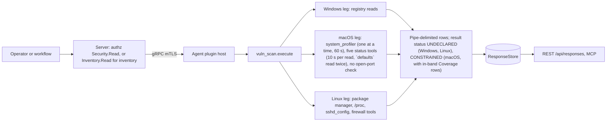
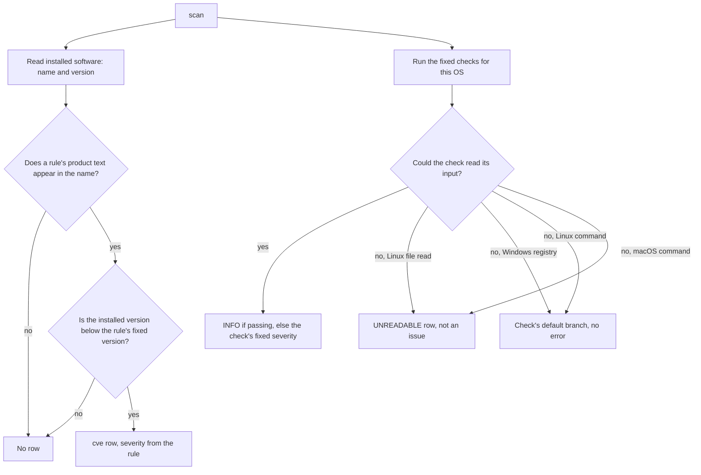
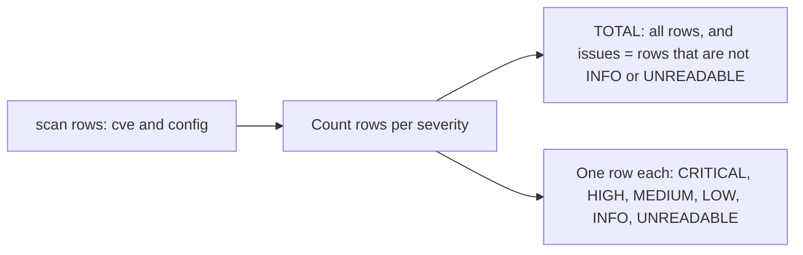

# vuln_scan

<!-- BEGIN GENERATED: plugin-doc-gen header -->
| | |
|---|---|
| **What it does** | Host vulnerability scanning — CVE matching and configuration compliance checks |
| **Version** | 1.0.0 |
| **Kind** | Collector · read-only · gathered (security.vuln_scan.scan, security.vuln_scan.cve_scan, security.vuln_scan.config_scan, security.vuln_scan.summary, security.vuln_scan.inventory) |
| **Platforms** | Windows ✅ · macOS 🟡 constrained · Linux ✅ |
| **Actions** | `config_scan` (definition `security.vuln_scan.config_scan`) · `cve_scan` (definition `security.vuln_scan.cve_scan`) · `inventory` (definition `security.vuln_scan.inventory`) · `scan` (definition `security.vuln_scan.scan`) · `summary` (definition `security.vuln_scan.summary`) |
| **Security** | `scan`: securable `Security` · operation Read · risk Low · dispatch ReadOnly · approval gate None; `cve_scan`: securable `Security` · operation Read · risk Low · dispatch ReadOnly · approval gate None; `config_scan`: securable `Security` · operation Read · risk Low · dispatch ReadOnly · approval gate None; `summary`: securable `Security` · operation Read · risk Low · dispatch ReadOnly · approval gate None; `inventory`: securable `Inventory` · operation Read · risk Low · dispatch ReadOnly · approval gate None |
| **Roles** | execute: endpoint-admin, endpoint-operator, security-admin · author: content-author |
<!-- END GENERATED -->

## How it works

Every action is a read; nothing on the host is changed. `scan` first reads the installed-software list and matches it against a fixed table of 41 built-in CVE rules, then runs the fixed list of configuration checks for the operating system, and returns the CVE rows followed by the configuration rows (progress is reported at 0, 50, 90 and 100). `cve_scan` and `config_scan` are those two halves on their own. `summary` runs the same combined scan, throws the individual rows away and returns only a count per severity. `inventory` runs neither scan: it returns the raw installed-software `name|version` pairs and nothing else.

The CVE half is deliberately small and local. It is not a vulnerability feed: the rule table ships inside the plugin, each rule names a product by a short text (for example `openssl` or `git`), and a rule fires when an installed product's name contains that text, ignoring case, and its version compares lower than the rule's fixed version. The configuration half reads a handful of well-known hardening settings (registry values on Windows, command output and a few files on macOS and Linux) and reports every check it ran, passing ones as `INFO`. `inventory` exists so a caller can hand the raw software list to the server for a fuller match instead of relying on the built-in table.



### What you can decide with it

| Question | Action | What you get |
|---|---|---|
| Which known-bad versions of a short list of common products are installed? | `cve_scan` | Windows: from the registry Uninstall lists (machine-wide, 32-bit, and the agent account's own). macOS: apps from `system_profiler` only; Homebrew formulae and casks are not scanned (see `pkg_inventory.packages`). Linux: packages from the first package manager found (`dpkg-query`, else `rpm`, else `pacman`, else `apk`). |
| Is this host's basic hardening in place? | `config_scan` | A fixed per-OS list of checks, listed below. Every check that ran is reported, passing ones as `INFO`. |
| Both of the above in one call | `scan` | CVE rows, then configuration rows. |
| How bad is it at a glance? | `summary` | `TOTAL` first, then a count for each of `CRITICAL`, `HIGH`, `MEDIUM`, `LOW`, `INFO`, `UNREADABLE`. `UNREADABLE` and `INFO` are not issues. On macOS the output ends with one `summary\|COVERAGE\|<text>` row per coverage cause (see Result status), and `summary\|UNREADABLE\|1` is the baseline on a healthy Mac because of the standing `Open Ports` row. Monitor the `summary\|COVERAGE\|` rows other than the standing Homebrew text (every healthy Mac emits that one), not the `UNREADABLE` count. |
| What software is installed, for matching elsewhere? | `inventory` | Raw `name\|version` pairs. No CVE or configuration logic. |

**What a clean result means.** A scan with no `cve` rows says only that none of the 41 built-in rules matched the installed software. It does not say the host is patched. The table covers 21 product names (OpenSSL, curl, sudo, polkit, Log4j, Apache, OpenSSH, Python, Node.js, Chrome, Firefox, .NET, OpenJDK, Windows, nginx, PostgreSQL, Git, 7-Zip, WinRAR, PuTTY, PHP) with one to four rules each, and no rule is for a CVE newer than 2024. Software that is not in the software list the leg reads (per-user installs of other accounts on Windows, anything on Linux when none of the four package managers is present) is never examined. Operating-system patch level, kernel, firmware and distribution back-ports are not assessed at all. For a real patch-compliance answer use a patch-state source, not this plugin.

**What a `cve` row means.** It is a lead to check, not a confirmed exposure. Matching is by substring of the product name and by a simple dotted-number version comparison, so some rows are false positives (see Caveat 2). The two Windows Print Spooler rules in particular compare an application's own version against a Windows build number and never read the real OS build or installed hotfixes, so they cannot tell you whether PrintNightmare is fixed; in the Windows sample every Print Spooler row names a .NET runtime, a Windows update package or a Windows utility, not the spooler itself.

**Configuration checks by OS** (severity is fixed per check; a passing check is `INFO`):

| OS | Checks that always report | Checks that report only in some cases | Known ways the answer can be wrong |
|---|---|---|---|
| Windows | UAC (`EnableLUA`), SMBv1 (`SMB1`), Auto-Logon, Defender real-time flag (`DisableRealtimeMonitoring`), Firewall for the Domain, Private and Public profiles | RDP Network Level Authentication, only when Remote Desktop is enabled | A missing SMBv1 value is read as enabled (`CRITICAL`); a missing Defender flag is read as enabled protection; the Defender row is one registry flag, not the live service state; an unreadable UAC or firewall value reads as disabled. |
| macOS | Gatekeeper (`spctl`), FileVault (`fdesetup`), SIP (`csrutil`), Application Firewall (`socketfilterfw`), Remote Login (`systemsetup`), Automatic update check (`defaults`), and Open Ports (always one `UNREADABLE` row, detail `open-port check is not available on macOS`) | none | A GOOD verdict needs the tool to have exited 0 and its whole output to be exactly one non-empty line equal to the expected text (`FileVault is On.`, `assessments enabled`, `System Integrity Protection status: enabled.`, `Firewall is enabled. (State = 1)` or `2`, `Remote Login: Off`, `1`). A BAD line (`assessments disabled`, `FileVault is Off.`, `Firewall is disabled. (State = 0)`, `Remote Login: On`, `0`) is reported from any completed run and wins over any other line, whatever the exit code. Anything else (a missing tool, a refused call, a localized message, `enabled (Custom Configuration).`, a mismatched Firewall `State` digit, extra output lines) is an `UNREADABLE` row with detail `Unknown (read failed)`, not a finding and not a pass. Measured on ONE macOS 27.0.1 host: `spctl --status` printed `assessments enabled` (exit 0); `fdesetup status` printed `FileVault is On.` (exit 0); `csrutil status` printed `System Integrity Protection status: enabled.` (exit 0); `socketfilterfw --getglobalstate` printed `Firewall is disabled. (State = 0)` (exit 0; the DISABLED state, so the enabled line and its digit are unmeasured); `systemsetup -getremotelogin` printed `Remote Login: Off` (exit 0, run via `sudo`); the path-form `defaults read /Library/Preferences/com.apple.SoftwareUpdate AutomaticCheckEnabled` printed the key-absent line (exit 1), and the bare-domain read printed its key-absent text (the sample's `INFO` `Automatic update check: not set` row needs both reads absent and in agreement), all measured on macOS 27.0.1 as euid 501 only. UNMEASURED (a read whose text differs is `UNREADABLE`): a bare-domain value of 0 or 1, a system plist at 0, 1, absent or shadowed by a per-user or managed value as the LaunchDaemon account, each tool's exit code in its bad state, the enabled Firewall `State` digit, `systemsetup` as a launchd daemon, whether Full Disk Access or a PPPC grant is needed, and `system_profiler` under a non-English language. The bare `Firewall is enabled.` line (no `State` suffix) is accepted as good. The update-check row covers the update CHECK only and says nothing about installation. It is read TWICE, through the bare domain `com.apple.SoftwareUpdate` (CFPreferences, which may see a managed or per-user value) and through the `/Library/Preferences` path form (the system plist), and the worse answer wins: a bad `0` from either read is reported; `INFO` needs both reads good-or-absent and in agreement (a good read beside an absent read is a disagreement and reads `UNREADABLE`). With the key absent in both (the default install) it reports `INFO` "Automatic update check: not set (macOS default applies)"; `0` is the disabled value. |
| Linux | ASLR (`randomize_va_space`), SUID core dumps (`suid_dumpable`), SSH Root Login, Firewall | SSH Password Authentication, only if `sshd_config` sets it (it also reports `INFO` "not applicable" when the file is absent and `UNREADABLE` when it cannot be read); `/tmp noexec`, only if `/tmp` is a separate mount; World-Writable PATH, only if the agent's own `PATH` has such a directory; Open Port rows for FTP 21, Telnet 23, SMB 445, RDP 3389, VNC 5900 bound on all interfaces | Only `/etc/ssh/sshd_config` is read (no `Include`d files, no `Match` blocks, no effective-config query); a plain `PermitRootLogin prohibit-password` reads as "not explicitly set". The firewall check reads `iptables`, `nft` and `ufw` output, which normally need root, so an unprivileged agent reports `No firewall rules detected` (`HIGH`) even on a protected host. |

A Linux file the agent cannot read (SSH config, ASLR, `suid_dumpable`, the mount table) is reported as `UNREADABLE`, never as a weak setting. An absent `sshd_config` is `INFO`, "not applicable".

### Diagrams



The CVE branch and the configuration branch are independent: neither can suppress the other, and `scan` simply concatenates them. A software entry with no version is skipped, so it can never match (on macOS such an entry that matches a rule is reported by an `UNREADABLE` Coverage row). The last two configuration branches are the important difference: a failed Linux file read is surfaced as `UNREADABLE`, while a failed Windows registry read or Linux command silently falls through to that check's default result. On macOS a failed or unrecognised tool read is `UNREADABLE` too. That holds for the macOS configuration checks only, and has exceptions: the standing `Open Ports` row is `UNREADABLE` with no Coverage row and no status (the check does not exist on macOS); `inventory` emits no Coverage row; a macOS `config_scan` that reads every status tool declares no status; and Windows and Linux are as Caveat 3 says.



`summary` counts rows, not distinct problems. One installed product that matches two rules, or several installed products that match one rule, each add to the issue count, so the number is an upper bound on real exposures and is inflated by false-positive `cve` rows.

## OS capability

<!-- BEGIN GENERATED: plugin-doc-gen capability -->
| Action | Windows | macOS | Linux |
|---|---|---|---|
| `config_scan` | ✅ supported · rung 1 · win32_registry | 🟡 constrained · rung 2 · argv(spctl/fdesetup/csrutil/socketfilterfw/systemsetup/defaults) | ✅ supported · rung 3 · popen(iptables/nft/ufw)+procfs |
| `cve_scan` | ✅ supported · rung 1 · win32_registry | 🟡 constrained · rung 2 · argv(system_profiler) | ✅ supported · rung 3 · popen(dpkg-query/rpm/pacman/apk) |
| `inventory` | ✅ supported · rung 1 · win32_registry | 🟡 constrained · rung 2 · argv(system_profiler) | ✅ supported · rung 3 · popen(dpkg-query/rpm/pacman/apk) |
| `scan` | ✅ supported · rung 1 · win32_registry | 🟡 constrained · rung 2 · argv(system_profiler+security-checks) | ✅ supported · rung 3 · popen(pkg-manager+iptables/nft/ufw) |
| `summary` | ✅ supported · rung 1 · win32_registry | 🟡 constrained · rung 2 · argv(system_profiler+security-checks) | ✅ supported · rung 3 · popen(pkg-manager+iptables/nft/ufw) |

**Declared limits per leg** (descriptor fallback text, verbatim):

- **`config_scan` / macOS** — output parsing unverified on macOS 13-15; unreadable tools report Unknown/UNREADABLE
- **`cve_scan` / macOS** — Homebrew formulae and casks are not scanned
- **`inventory` / macOS** — Homebrew formulae and casks are not scanned
- **`scan` / macOS** — Homebrew formulae and casks are not scanned
- **`summary` / macOS** — Homebrew formulae and casks are not scanned
<!-- END GENERATED -->

## Privileges and prerequisites

| OS | Runs as | Extra grant needed | Measured | If the read is refused |
|---|---|---|---|---|
| Windows | agent daemon identity (captured as `SYSTEM`) | None established; the plugin reads `HKLM` Uninstall and policy values and the agent account's own `HKCU` Uninstall list | 2026-09-07, bare metal, as SYSTEM | not observed; a denied `RegOpenKeyExW` or `RegQueryValueExW` returns an empty string or the check's default, so a blocked read shows up as that check's default result, not an error |
| macOS | agent daemon; the shipped LaunchDaemon runs as root today (`docs/agent-privilege-model.md`) | `systemsetup -getremotelogin` needs administrator rights (root has them). Whether any of the tools needs Full Disk Access or a PPPC grant as the daemon is not measured | 2026-11-18, bare metal, macOS 27.0.1 arm64, euid 501 (interactive user), not as the root LaunchDaemon | observed as euid 501: `systemsetup -getremotelogin` is refused and the row is `UNREADABLE\|config\|Remote Login (SSH)\|Unknown (read failed)`, raising `config_unreadable`; as root the read is unmeasured through the agent. A refused or failed tool is an `UNREADABLE` row with detail `Unknown (read failed)`, not a finding; a tool that completes and prints a bad line is reported even with a non-zero exit |
| Linux | agent daemon, dedicated unprivileged account by design (`docs/agent-privilege-model.md`) | None for the package list, `/proc` or world-readable files. `iptables`, `nft` and `ufw status` normally need root or `CAP_NET_ADMIN`; a mode-0600 `sshd_config` (the RHEL-family default) needs read access | 2026-09-06, container, euid 0 | a failed file read is `UNREADABLE` (both SSH checks on a 0600 `sshd_config`); a failed firewall command returns empty output, read as "no firewall rules detected" |

Windows uses no subprocess: software enumeration and every Windows check are in-process registry calls. Linux runs shell command strings through `popen` and `system()`; macOS runs pre-split argvs with absolute-path executables through the agent's bounded subprocess runner (no shell, no `PATH` search, an 8 MB output cap, a 60 s deadline for `system_profiler` and 10 s for the status tools), so no macOS leg uses `popen`. All are fixed commands with no caller input: Linux `dpkg-query`, `rpm`, `pacman`, `apk` (the first one present), `iptables`, `nft`, `ufw`, `ss` or `netstat`; macOS `system_profiler`, `spctl`, `fdesetup`, `csrutil`, `socketfilterfw`, `systemsetup`, `defaults`. There is no network access; the firewall and listener commands read local state only. A macOS action holds one agent worker (pool of 4 to 32) for up to 60 s of `system_profiler` plus seven 10 s status reads (five tools, the update-check `defaults` read twice) = 130 s nominal, about 146 s counting the 2 s subprocess drain grace per command. The profiler runs one at a time and its result is reused for 45 s, but the status-tool reads are NOT single-flighted, so concurrent actions each run them; a caller waiting behind an overdue profiler run waits at most 75 s and then reads unreadable.

## Data contract

### Inputs

<!-- BEGIN GENERATED: plugin-doc-gen inputs -->
No action takes parameters.
<!-- END GENERATED -->

### Outputs

Pipe-delimited rows, one per finding (or per installed package for `inventory`). `scan`, `cve_scan` and `config_scan` share the 4-field row shape `severity|category|title|detail`. An action that finds nothing still emits one placeholder row, `INFO|scan|No vulnerabilities|No issues detected`; in practice only `cve_scan` reaches it, because `config_scan` and `scan` always report at least one configuration check. `summary` emits a different, 3-field shape: a literal `summary` discriminator, then a severity name (or the literal `TOTAL`), then a count, which is one field more than the two result columns (`severity`, `count`) the definition declares. `inventory` emits raw `name|version` pairs with no discriminator, and `version` is empty when the source gives none.

A Linux config check whose file read fails (EACCES, EIO, ...) emits `UNREADABLE|config|<title>|<path>: <cause>` (for example `eacces`) rather than a finding about an empty value. `UNREADABLE` means the check could not run; it is not an issue, so `summary` leaves it out of the `TOTAL` row's issue count and reports it on its own `summary|UNREADABLE|<n>` row after `summary|INFO|<n>`. An absent `/etc/ssh/sshd_config` is not a weak setting: both SSH checks emit `INFO` with "/etc/ssh/sshd_config not present; check not applicable".

<!-- BEGIN GENERATED: plugin-doc-gen outputs -->
**`security.vuln_scan.config_scan` — `severity|category|title|detail`**

| Field | Type | Values | Available | Example | Description |
|---|---|---|---|---|---|
| `severity` | string | `CRITICAL` `HIGH` `MEDIUM` `LOW` `INFO` `UNREADABLE` | Windows, Linux, macOS | `HIGH` | Finding severity assigned by the compliance check that produced this row. UNREADABLE means the check could not run, or on macOS that a configuration check row's read failed or a Coverage row says part of the host could not be read; not an issue. |
| `category` | string | `config` `scan` | Windows, Linux, macOS | `config` | Always "config" for a check; "scan" on the placeholder row emitted when there is nothing to report and on the macOS Coverage row. |
| `title` | string | - | Windows, Linux, macOS | `SMBv1 Protocol` | The name of the compliance check, e.g. the setting it inspects, or "Coverage" on the macOS Coverage row. Values: free text. |
| `detail` | string | - | Windows, Linux, macOS | `Enabled - vulnerable to EternalBlue/WannaCry (MS17-010)` | The check's human-readable result text, including why a failing check failed. Values: free text. |

**`security.vuln_scan.cve_scan` — `severity|category|title|detail`**

| Field | Type | Values | Available | Example | Description |
|---|---|---|---|---|---|
| `severity` | string | `CRITICAL` `HIGH` `MEDIUM` `LOW` `INFO` `UNREADABLE` | Windows, Linux, macOS | `HIGH` | Finding severity assigned by the CVE rule that matched; INFO on the macOS Homebrew Coverage row and UNREADABLE on a macOS Coverage row saying the software list could not be read completely, a profiler line was not recognised, or an application matching a built-in rule had no usable version (not an issue, not a clean result). |
| `category` | string | `cve` `scan` | Windows, Linux, macOS | `cve` | Always "cve" for a match; "scan" on the placeholder row emitted when nothing matches and on the macOS Coverage row. |
| `title` | string | - | Windows, Linux, macOS | `CVE-2023-24329: urllib.parse URL parsing bypass via leading whitespace` | "<CVE-ID>: <description>" from the matched rule, "No vulnerabilities" on the placeholder row, or "Coverage" on the macOS coverage row. Values: free text. |
| `detail` | string | - | Windows, Linux, macOS | `Python 3.9.6 (fixed in 3.11.4)` | <installed product> <version> (fixed in <fixed_ver>). Values: free text. |

**`security.vuln_scan.inventory` — `name|version`**

| Field | Type | Values | Available | Example | Description |
|---|---|---|---|---|---|
| `name` | string | - | Windows, Linux, macOS | `curl` | Installed application or package name, as reported by the OS's own inventory source. Values: free text. |
| `version` | string | - | Windows, Linux, macOS | `8.14.1-2+deb13u4` | Installed version string, or empty when the source reports none (e.g. a Windows uninstall entry with no DisplayVersion). Values: free text, or empty. |

**`security.vuln_scan.scan` — `severity|category|title|detail`**

| Field | Type | Values | Available | Example | Description |
|---|---|---|---|---|---|
| `severity` | string | `CRITICAL` `HIGH` `MEDIUM` `LOW` `INFO` `UNREADABLE` | Windows, Linux, macOS | `CRITICAL` | Finding severity assigned by the check that produced this row. UNREADABLE means the check could not run, or on macOS that a configuration check row's read failed or a Coverage row says part of the host could not be read; not an issue. |
| `category` | string | `cve` `config` `scan` | Windows, Linux, macOS | `cve` | Which half of the scan produced this row; "scan" marks the placeholder and Coverage rows. |
| `title` | string | - | Windows, Linux, macOS | `CVE-2021-34527: PrintNightmare: RCE via Windows Print Spooler` | For a cve row, "<CVE-ID>: <description>" from the matched rule; for a config row, the name of the compliance check; "No vulnerabilities" on the single placeholder row emitted when a run finds nothing; "Coverage" on the INFO or UNREADABLE row a macOS run adds when part of the host was not scanned or could not be read. Values: free text. |
| `detail` | string | - | Windows, Linux, macOS | `Microsoft Windows Desktop Runtime - 6.0.11 (x64) 6.0.11.31823 (fixed in KB5004945)` | For a cve row, "<installed product> <version> (fixed in <fixed_ver>)"; for a config row, the check's human-readable result text. Values: free text. |

**`security.vuln_scan.summary` — `severity|count`**

| Field | Type | Values | Available | Example | Description |
|---|---|---|---|---|---|
| `severity` | string | `TOTAL` `CRITICAL` `HIGH` `MEDIUM` `LOW` `INFO` `UNREADABLE` `COVERAGE` | Windows, Linux, macOS | `CRITICAL` | The severity this row counts, the literal "TOTAL" for the first row emitted by every run, or "COVERAGE" on the final rows a macOS run adds, one per coverage cause (its count cell holds text). |
| `count` | int32 | - | Windows, Linux, macOS | `17` | The number of findings at this severity. The TOTAL row is an exception: despite the declared int32 type, that row's cell holds the formatted string "<n> findings (<n> issues)", not an integer. Values: integer, except a formatted string on the TOTAL row. |
<!-- END GENERATED -->

### Result status

| Status | Completeness | Provenance | When |
|---|---|---|---|
| `UNDECLARED` | `UNKNOWN` | (empty) | every action on Windows and Linux, and macOS `config_scan` when every status tool read cleanly (the standing `Open Ports` row does not count): the plugin does not set a typed result status, so a consumer must read the rows. A failed read is therefore never visible in the status; it shows only as an `UNREADABLE` row (Linux file checks) or as a default-branch finding |
| `CONSTRAINED` | `PARTIAL` | `macos:vuln_scan:homebrew_not_scanned` | macOS `cve_scan`, `scan`, `summary` and `inventory` when `system_profiler` returned applications. `cve_scan` and `scan` also emit `INFO\|scan\|Coverage\|Homebrew formulae and casks are not scanned`, and `summary` emits `summary\|COVERAGE\|<same text>`; `inventory` emits no such row. Homebrew formulae and casks are never read, so a result with no CVE rows means only that no built-in rule matched the applications `system_profiler` listed |
| `CONSTRAINED` | `PARTIAL` | `macos:vuln_scan:system_profiler_unreadable` | the same four macOS actions when the `system_profiler` command failed to run, exited non-zero, or returned no applications. No application is returned to CVE matching or `inventory` from a run that did not finish cleanly (a partial list could read a truncated version as vulnerable or hide a real one). `cve_scan` and `scan` suppress the "No vulnerabilities" placeholder and end with `UNREADABLE\|scan\|Coverage\|<text>`, `summary` with `summary\|COVERAGE\|<text>`, and `inventory` is empty. The text reads "The macOS software list could not be read completely (system_profiler failed, timed out, exceeded the output cap, returned no applications, or most applications had no recognised Version line); not a clean result". `system_profiler` runs with a 60 s deadline and an 8 MB output cap (the process group is killed at the deadline), one at a time with its result (failures included) reused for 45 s, and a caller that waits behind an overdue run reads unreadable instead of blocking; a missed deadline or cap counts as unreadable. The parser understands the English `Version:` label only: when MORE THAN HALF of the listed applications have no recognised version (counting every unrecognised line, see `software_list_unrecognised`, as one more unusable application) the read is unreadable. Up to half may be unversioned and the read stays readable, in which case an unversioned application that matches a CVE rule is reported by the `cve_input_incomplete` row instead. Application names are capped at 1 KiB and versions at 256 bytes, NUL bytes become `?`, and a leading byte-order mark is skipped. This is a detection rule, not localization support |
| `CONSTRAINED` | `PARTIAL` | `macos:vuln_scan:cve_input_incomplete` | macOS `cve_scan`, `scan` and `summary` when one or more applications whose name matches a built-in CVE rule product had a version that cannot be compared (empty, not starting with an ASCII digit (`Unknown`, `v100.0.1`, an NBSP-prefixed value), or containing a numeric segment of more than 18 digits). Those applications are skipped, not string-compared, and the run is not clean: the "No vulnerabilities" row is not printed, and it ends with `UNREADABLE\|scan\|Coverage\|<n> application(s) matching a built-in CVE rule had no usable version; not a clean result` (`summary\|COVERAGE\|...` for `summary`). Precedence is software list, then this token, then `software_list_unrecognised`, then config, then Homebrew; the in-band rows list every cause. Windows and Linux are not affected |
| `CONSTRAINED` | `PARTIAL` | `macos:vuln_scan:software_list_unrecognised` | macOS `cve_scan`, `scan` and `summary` (and the status of `inventory`, which emits no row) when `system_profiler` ran cleanly but one or more of its lines did not fit the report shape the parser understands: a line ending in `:` at a three- or five-space indent, a four-space line that does not end in `:`, a name line starting `Version:`, a `Version:` line at a three-space indent, a tab after the indent, a second `Version:` line in one block, a `Version:` line before any name or not directly after its name line, a line at indent 0 (other than the `Applications:` header), 1 or 2, or an indented property line after a blank that does not follow a name. Each such line may be a dropped application, so the run is not clean: the "No vulnerabilities" row is not printed and it ends with `UNREADABLE\|scan\|Coverage\|<n> line(s) of the software list were not recognised; applications may be missing; not a clean result` (`summary\|COVERAGE\|...` for `summary`). The "first `Version:` directly after its name line" rule rests on the measured 27.0.1 shape only; a Mac whose real output puts another property first would raise this token. Precedence is software list, then `cve_input_incomplete`, then this token, then config, then Homebrew. A NUL byte inside a name or version is replaced with `?` and is not detected as a dropped line |
| `CONSTRAINED` | `PARTIAL` | `macos:vuln_scan:config_unreadable` | macOS `config_scan`, `scan` and `summary` when a configuration check's system tool could not be read (missing, non-zero exit, no output, permission message, or text that is not the tool's expected line, such as a localized message). That check emits `UNREADABLE\|config\|<check>\|Unknown (read failed)` instead of a finding, counted in `summary`'s `UNREADABLE` bucket, and `config_scan`, `scan` and `summary` add `UNREADABLE\|scan\|Coverage\|One or more macOS configuration checks could not be read; each is reported as an UNREADABLE row, not as a finding` (`summary\|COVERAGE\|...` for `summary`). The provenance is one token: the software-list token outranks `cve_input_incomplete`, which outranks `software_list_unrecognised`, which outranks this one, which outranks `homebrew_not_scanned`; the in-band rows list every cause |

### Where the data goes

- **Instruction result only.** Rows travel over the agent's mTLS gRPC channel as the command response and land in the ResponseStore, rendered by the dashboard and REST with the plugin's default column schema (`Agent, Severity, Category, Title, Detail`) or, when the request carries a definition id, that definition's own result-column schema.
- **Server-side NVD matching.** The `inventory` definition says its rows are for server-side NVD matching and centralized correlation; this README does not describe that server feature. The server's version comparison notes that it duplicates the algorithm in `cve_rules.hpp`; the server copy does not have the saturation guard against an oversized numeric segment, #8313.
- **Not consumed by** daily-sync inventory, Echo, DEX or metrics; nothing runs on a schedule and every action is on-demand.
- **Sensitivity.** `cve` rows embed installed application names and versions in `detail`, and `inventory` returns that list directly: an installed-software inventory by another route. Configuration rows reveal the host's security posture (for example a disabled firewall or SMBv1 enabled), which is useful to an attacker as well as an administrator. Nothing in either row shape names a person.
- **Siblings:** `installed_apps` is a separate installed-software collector with overlapping data (it shares the "installed, held" package-presence convention on Linux); a caller working from software identity may have two plugins to reconcile.
- **MCP / REST.** Discover: `discover_plugins` (summary) then `yuzu://plugin-docs` (this page as data) then `discover_instructions` or `get_definition("security.vuln_scan.scan")`. Run: `execute_instruction {definition_id, parameters}`. Read: `/api/responses/{id}`.

## Sample output

The Linux and Windows samples carry the current leg hash but were captured on 2026-09-06 and 2026-09-07 and not recaptured. The macOS sample was captured on 2026-11-18 as an interactive user (euid 501), not as the root LaunchDaemon.

<!-- BEGIN GENERATED: plugin-doc-gen samples -->
**Windows** — captured: windows Microsoft Windows NT 10.0.26200.0 x64 · bare-metal · 2026-09-07 · SYSTEM · leg-hash e452c8f620c9

```
== action=scan
CRITICAL|cve|CVE-2021-34527: PrintNightmare: RCE via Windows Print Spooler|Microsoft Windows Desktop Runtime - 6.0.11 (x64) 6.0.11.31823 (fixed in KB5004945)
CRITICAL|cve|CVE-2021-34527: PrintNightmare: RCE via Windows Print Spooler|Microsoft Windows Desktop Runtime - 6.0.20 (x86) 6.0.20.32621 (fixed in KB5004945)
CRITICAL|cve|CVE-2021-34527: PrintNightmare: RCE via Windows Print Spooler|Microsoft Windows Desktop Runtime - 8.0.28 (x64) 8.0.28.36119 (fixed in KB5004945)
CRITICAL|cve|CVE-2021-34527: PrintNightmare: RCE via Windows Print Spooler|Microsoft Windows Desktop Runtime - 8.0.28 (x86) 8.0.28.36119 (fixed in KB5004945)
CRITICAL|cve|CVE-2021-34527: PrintNightmare: RCE via Windows Print Spooler|Update for x64-based Windows Systems (KB5001716) 8.94.0.0 (fixed in KB5004945)
CRITICAL|cve|CVE-2021-34527: PrintNightmare: RCE via Windows Print Spooler|Windows 11 Installation Assistant 1.4.19041.5003 (fixed in KB5004945)
CRITICAL|cve|CVE-2021-34527: PrintNightmare: RCE via Windows Print Spooler|Windows PC Health Check 3.6.2204.08001 (fixed in KB5004945)
CRITICAL|cve|CVE-2021-34527: PrintNightmare: RCE via Windows Print Spooler|Windows Subsystem for Linux 2.6.3.0 (fixed in KB5004945)
CRITICAL|cve|CVE-2021-1675: Print Spooler privilege escalation|Microsoft Windows Desktop Runtime - 6.0.11 (x64) 6.0.11.31823 (fixed in KB5003637)
CRITICAL|cve|CVE-2021-1675: Print Spooler privilege escalation|Microsoft Windows Desktop Runtime - 6.0.20 (x86) 6.0.20.32621 (fixed in KB5003637)
CRITICAL|cve|CVE-2021-1675: Print Spooler privilege escalation|Microsoft Windows Desktop Runtime - 8.0.28 (x64) 8.0.28.36119 (fixed in KB5003637)
CRITICAL|cve|CVE-2021-1675: Print Spooler privilege escalation|Microsoft Windows Desktop Runtime - 8.0.28 (x86) 8.0.28.36119 (fixed in KB5003637)
… 12 of 24 rows shown
[result_status] UNDECLARED / UNKNOWN

== action=cve_scan
CRITICAL|cve|CVE-2021-34527: PrintNightmare: RCE via Windows Print Spooler|Microsoft Windows Desktop Runtime - 6.0.11 (x64) 6.0.11.31823 (fixed in KB5004945)
CRITICAL|cve|CVE-2021-34527: PrintNightmare: RCE via Windows Print Spooler|Microsoft Windows Desktop Runtime - 6.0.20 (x86) 6.0.20.32621 (fixed in KB5004945)
CRITICAL|cve|CVE-2021-34527: PrintNightmare: RCE via Windows Print Spooler|Microsoft Windows Desktop Runtime - 8.0.28 (x64) 8.0.28.36119 (fixed in KB5004945)
CRITICAL|cve|CVE-2021-34527: PrintNightmare: RCE via Windows Print Spooler|Microsoft Windows Desktop Runtime - 8.0.28 (x86) 8.0.28.36119 (fixed in KB5004945)
CRITICAL|cve|CVE-2021-34527: PrintNightmare: RCE via Windows Print Spooler|Update for x64-based Windows Systems (KB5001716) 8.94.0.0 (fixed in KB5004945)
CRITICAL|cve|CVE-2021-34527: PrintNightmare: RCE via Windows Print Spooler|Windows 11 Installation Assistant 1.4.19041.5003 (fixed in KB5004945)
CRITICAL|cve|CVE-2021-34527: PrintNightmare: RCE via Windows Print Spooler|Windows PC Health Check 3.6.2204.08001 (fixed in KB5004945)
CRITICAL|cve|CVE-2021-34527: PrintNightmare: RCE via Windows Print Spooler|Windows Subsystem for Linux 2.6.3.0 (fixed in KB5004945)
CRITICAL|cve|CVE-2021-1675: Print Spooler privilege escalation|Microsoft Windows Desktop Runtime - 6.0.11 (x64) 6.0.11.31823 (fixed in KB5003637)
CRITICAL|cve|CVE-2021-1675: Print Spooler privilege escalation|Microsoft Windows Desktop Runtime - 6.0.20 (x86) 6.0.20.32621 (fixed in KB5003637)
CRITICAL|cve|CVE-2021-1675: Print Spooler privilege escalation|Microsoft Windows Desktop Runtime - 8.0.28 (x64) 8.0.28.36119 (fixed in KB5003637)
CRITICAL|cve|CVE-2021-1675: Print Spooler privilege escalation|Microsoft Windows Desktop Runtime - 8.0.28 (x86) 8.0.28.36119 (fixed in KB5003637)
… 12 of 16 rows shown
[result_status] UNDECLARED / UNKNOWN

== action=config_scan
INFO|config|UAC (User Account Control)|Enabled
CRITICAL|config|SMBv1 Protocol|Enabled - vulnerable to EternalBlue/WannaCry (MS17-010)
INFO|config|Auto-Logon|Disabled
INFO|config|RDP Network Level Authentication|Enabled
INFO|config|Windows Defender Real-Time Protection|Enabled
INFO|config|Windows Firewall|Domain profile: Enabled
INFO|config|Windows Firewall|Private profile: Enabled
INFO|config|Windows Firewall|Public profile: Enabled
[result_status] UNDECLARED / UNKNOWN

== action=summary
summary|TOTAL|24 findings (17 issues)
summary|CRITICAL|17
summary|HIGH|0
summary|MEDIUM|0
summary|LOW|0
summary|INFO|7
[result_status] UNDECLARED / UNKNOWN

== action=inventory
7-Zip 26.02 (x64)|26.02
Age of Empires II: Definitive Edition|
Application Verifier x64 External Package (DesktopEditions)|10.1.26100.7705
Application Verifier x64 External Package (OnecoreUAP)|10.1.26100.7705
Baldur's Gate 3|
Battle.net|
CCleaner 7|7.10.1464.1889
CMake|4.3.3
Cities: Skylines II|
Crusader Kings III|
DayZ|
Defraggler|2.22
… 12 of 226 rows shown
[result_status] UNDECLARED / UNKNOWN
```

**macOS** — captured: macos macOS 27.0.1 arm64 · bare-metal · 2026-11-18 · euid 501 (interactive user) · leg-hash e452c8f620c9

```
== action=config_scan
INFO|config|Gatekeeper|Enabled - only verified apps can run
INFO|config|FileVault Disk Encryption|Enabled
INFO|config|System Integrity Protection (SIP)|Enabled
MEDIUM|config|Application Firewall|Disabled
UNREADABLE|config|Remote Login (SSH)|Unknown (read failed)
INFO|config|Automatic update check|Automatic update check: not set (macOS default applies)
UNREADABLE|config|Open Ports|open-port check is not available on macOS
UNREADABLE|scan|Coverage|One or more macOS configuration checks could not be read; each is reported as an UNREADABLE row, not as a finding
[result_status] CONSTRAINED / PARTIAL / macos:vuln_scan:config_unreadable

== action=cve_scan
HIGH|cve|CVE-2023-24329: urllib.parse URL parsing bypass via leading whitespace|Python 3.9.6 (fixed in 3.11.4)
MEDIUM|cve|CVE-2024-0450: zipfile quoted-overlap zipbomb protection bypass|Python 3.9.6 (fixed in 3.12.2)
HIGH|cve|CVE-2023-44487: HTTP/2 Rapid Reset denial of service|NodeMCU PyFlasher 5.0.0 (fixed in 20.8.1)
HIGH|cve|CVE-2024-22019: Reading unprocessed HTTP request with unbounded chunk extension|NodeMCU PyFlasher 5.0.0 (fixed in 20.11.1)
CRITICAL|cve|CVE-2024-29944: Privileged JavaScript execution via event handler|Firefox 106.0.5 (fixed in 124.0.1)
CRITICAL|cve|CVE-2024-9680: Animation timeline use-after-free|Firefox 106.0.5 (fixed in 131.0.2)
INFO|scan|Coverage|Homebrew formulae and casks are not scanned
UNREADABLE|scan|Coverage|4 line(s) of the software list were not recognised; applications may be missing; not a clean result
[result_status] CONSTRAINED / PARTIAL / macos:vuln_scan:software_list_unrecognised

== action=inventory
App Store|3.0
Apps|1.0
Automator|2.10
Books|9.0
Calculator|12.0
Calendar|27.0
Chess|3.18
Clock|1.1
Contacts|14.0
Dictionary|2.3.0
FaceTime|36
Find My|5.0
… 12 of 529 rows shown
[result_status] CONSTRAINED / PARTIAL / macos:vuln_scan:software_list_unrecognised

== action=scan
HIGH|cve|CVE-2023-24329: urllib.parse URL parsing bypass via leading whitespace|Python 3.9.6 (fixed in 3.11.4)
MEDIUM|cve|CVE-2024-0450: zipfile quoted-overlap zipbomb protection bypass|Python 3.9.6 (fixed in 3.12.2)
HIGH|cve|CVE-2023-44487: HTTP/2 Rapid Reset denial of service|NodeMCU PyFlasher 5.0.0 (fixed in 20.8.1)
HIGH|cve|CVE-2024-22019: Reading unprocessed HTTP request with unbounded chunk extension|NodeMCU PyFlasher 5.0.0 (fixed in 20.11.1)
CRITICAL|cve|CVE-2024-29944: Privileged JavaScript execution via event handler|Firefox 106.0.5 (fixed in 124.0.1)
CRITICAL|cve|CVE-2024-9680: Animation timeline use-after-free|Firefox 106.0.5 (fixed in 131.0.2)
INFO|config|Gatekeeper|Enabled - only verified apps can run
INFO|config|FileVault Disk Encryption|Enabled
INFO|config|System Integrity Protection (SIP)|Enabled
MEDIUM|config|Application Firewall|Disabled
UNREADABLE|config|Remote Login (SSH)|Unknown (read failed)
INFO|config|Automatic update check|Automatic update check: not set (macOS default applies)
… 12 of 16 rows shown
[result_status] CONSTRAINED / PARTIAL / macos:vuln_scan:software_list_unrecognised

== action=summary
summary|TOTAL|13 findings (7 issues)
summary|CRITICAL|2
summary|HIGH|3
summary|MEDIUM|2
summary|LOW|0
summary|INFO|4
summary|UNREADABLE|2
summary|COVERAGE|Homebrew formulae and casks are not scanned
summary|COVERAGE|4 line(s) of the software list were not recognised; applications may be missing; not a clean result
summary|COVERAGE|One or more macOS configuration checks could not be read; each is reported as an UNREADABLE row, not as a finding
[result_status] CONSTRAINED / PARTIAL / macos:vuln_scan:software_list_unrecognised
```

**Linux** — captured: linux Debian GNU/Linux 13 (trixie) aarch64 · container · 2026-09-06 · euid 0 · leg-hash e452c8f620c9

```
== action=scan
HIGH|cve|CVE-2023-24329: urllib.parse URL parsing bypass via leading whitespace|python3-wheel 0.46.1-2 (fixed in 3.11.4)
MEDIUM|cve|CVE-2024-0450: zipfile quoted-overlap zipbomb protection bypass|python3-wheel 0.46.1-2 (fixed in 3.12.2)
CRITICAL|cve|CVE-2024-32002: RCE via crafted repositories with submodules|git 1:2.47.3-0+deb13u1 (fixed in 2.45.1)
CRITICAL|cve|CVE-2024-32002: RCE via crafted repositories with submodules|git-man 1:2.47.3-0+deb13u1 (fixed in 2.45.1)
HIGH|cve|CVE-2023-25652: git apply --reject writes outside worktree|git 1:2.47.3-0+deb13u1 (fixed in 2.40.1)
HIGH|cve|CVE-2023-25652: git apply --reject writes outside worktree|git-man 1:2.47.3-0+deb13u1 (fixed in 2.40.1)
MEDIUM|config|SSH Root Login|PermitRootLogin not explicitly set - may default to prohibit-password
INFO|config|ASLR (Address Space Layout Randomization)|Full randomization enabled (value=2)
INFO|config|SUID Core Dumps|Restricted (suid_dumpable=0)
HIGH|config|Firewall|No firewall rules detected - host may be unprotected
[result_status] UNDECLARED / UNKNOWN

== action=cve_scan
HIGH|cve|CVE-2023-24329: urllib.parse URL parsing bypass via leading whitespace|python3-wheel 0.46.1-2 (fixed in 3.11.4)
MEDIUM|cve|CVE-2024-0450: zipfile quoted-overlap zipbomb protection bypass|python3-wheel 0.46.1-2 (fixed in 3.12.2)
CRITICAL|cve|CVE-2024-32002: RCE via crafted repositories with submodules|git 1:2.47.3-0+deb13u1 (fixed in 2.45.1)
CRITICAL|cve|CVE-2024-32002: RCE via crafted repositories with submodules|git-man 1:2.47.3-0+deb13u1 (fixed in 2.45.1)
HIGH|cve|CVE-2023-25652: git apply --reject writes outside worktree|git 1:2.47.3-0+deb13u1 (fixed in 2.40.1)
HIGH|cve|CVE-2023-25652: git apply --reject writes outside worktree|git-man 1:2.47.3-0+deb13u1 (fixed in 2.40.1)
[result_status] UNDECLARED / UNKNOWN

== action=config_scan
MEDIUM|config|SSH Root Login|PermitRootLogin not explicitly set - may default to prohibit-password
INFO|config|ASLR (Address Space Layout Randomization)|Full randomization enabled (value=2)
INFO|config|SUID Core Dumps|Restricted (suid_dumpable=0)
HIGH|config|Firewall|No firewall rules detected - host may be unprotected
[result_status] UNDECLARED / UNKNOWN

== action=summary
summary|TOTAL|10 findings (8 issues)
summary|CRITICAL|2
summary|HIGH|4
summary|MEDIUM|2
summary|LOW|0
summary|INFO|2
[result_status] UNDECLARED / UNKNOWN

== action=inventory
apt|3.0.3
autoconf|2.72-3.1
automake|1:1.17-4
autotools-dev|20240727.1
base-files|13.8+deb13u6
base-passwd|3.6.7
bash|5.2.37-2+b9
binutils|2.44-3
binutils-aarch64-linux-gnu|2.44-3
binutils-common|2.44-3
bison|2:3.8.2+dfsg-1+b2
bsdutils|1:2.41.5-0+deb13u1
… 12 of 206 rows shown
[result_status] UNDECLARED / UNKNOWN
```
<!-- END GENERATED -->

## Caveats and known gaps

1. **A clean scan is not "patched".** CVE matching uses a fixed, built-in table of 41 rules over 21 product names, and nothing outside it is reported: other products, CVEs after 2024, operating-system patches, kernels and distribution back-ports. Software the leg cannot list (other accounts' per-user installs on Windows, any host with none of the four Linux package managers) is not examined. On macOS, Homebrew formulae and casks are never matched, so a clean macOS result is not evidence about them; use pkg_inventory.packages (which lists, not matches); Homebrew CVE matching is tracked in #8256. Version ordering is a simple dotted-number comparison: a version with any non-numeric text in a segment (a pre-release or letter suffix such as `131.0b2`, `3.9rc1`, `1.9.9p1`, but also `0.9 (rc)`, `1e2`, `8,3,0` or a non-ASCII digit) is compared but may not be ordered correctly against a fixed version, so a vulnerable build can be missed; this is tracked in #8276. A NUL byte in a name or version is replaced with `?` and is not detected as a dropped line, and a name line lost together with other faults the parser cannot attribute can still hide an application. `cve_scan` and `scan` end with an `INFO|scan|Coverage|...` row and `summary` with `summary|COVERAGE|...`, in the same output as the `CONSTRAINED` result status; `inventory` returns software rows only (its status is declared, but it emits no row). The status value travels with the response and appears in the execution transition event, but the response rows REST, MCP and the dashboard serve do not carry it, and the completeness and provenance token are in the agent log only, so the in-band row is what an operator sees.
2. **Substring matching produces false positives, and the version test is naive.** On macOS a backslash in an application name or version is shown as `/`: `vuln_scan` folds every backslash to `/`, while `installed_apps` preserves it. A rule fires on any installed name that contains its product text, so `python` matches `python3-wheel`, `git` matches `git-man`, `windows` matches .NET runtimes and Windows utilities, and `node` matches any application whose name contains it (the macOS sample flags an Electron app named `NodeMCU PyFlasher` for two Node.js CVEs although its own version says nothing about the Node.js it bundles); the version is compared as dotted numbers, and a Debian epoch such as `1:2.47.3` is compared as text and reads as lower than `2.45.1`. The samples show all three, so some `cve` rows are not exposures, and the issue count in `summary` is inflated by them.
3. **A failed read usually becomes the check's default result, not an error.** Windows registry reads fall back to a default (a missing SMBv1 value reads as enabled; an unreadable UAC or firewall value reads as disabled), a failed Linux command returns empty output, and only the Linux file checks and the macOS status tools surface `UNREADABLE`. No Windows or Linux capture observed a real permission denial, so those legs are read from the code, not measured (the macOS sample shows one: Remote Login read as euid 501); the World-Writable PATH walk also skips an entry whose `stat()` fails (#5515).
4. **`summary` does not match its declared result columns.** It emits three pipe fields per row (`summary|<severity or TOTAL>|<count>`) against two declared columns, `severity` and `count`, and the `TOTAL` row's `count` cell is the string `<n> findings (<n> issues)` rather than the declared `int32`.
5. **Configuration checks are single-signal heuristics, not effective policy.** On macOS the five status tools' lines were measured on ONE macOS 27.0.1 host: `assessments enabled` (spctl, exit 0), `FileVault is On.` (fdesetup, exit 0), `System Integrity Protection status: enabled.` (csrutil, exit 0), `Firewall is disabled. (State = 0)` (socketfilterfw, exit 0; the DISABLED state, so the enabled line and its digit are unmeasured), `Remote Login: Off` (systemsetup, exit 0, via `sudo`), the path-form `defaults` key-absent line (exit 1) and the bare-domain key-absent text (the sample's `Automatic update check: not set` row), all on macOS 27.0.1 as euid 501 only; unmeasured: a bare-domain value of 0 or 1, a system plist at 0, 1, absent or shadowed by a per-user or managed value as the LaunchDaemon account, bad-state exit codes, the enabled Firewall digit, `systemsetup` as a daemon, Full Disk Access or PPPC needs, and a non-English `system_profiler` (macOS 13 to 15 are not measured either). A Mac whose tool prints something else reports `UNREADABLE`, not a verdict. The macOS open-port check does not exist (`ss` is absent and `netstat -tlnp` is not valid), so every Mac reports one `UNREADABLE` Open Ports row; it is a standing unavailability and does not raise the `config_unreadable` status. Each reads one registry value, one command's text or one file, so a setting applied another way (an `Include`d SSH file, a managed firewall, a third-party antivirus) can read differently from the host's real state. There is no `docs/agent-privilege-model.md` row for this plugin, so the Privileges table records only what each capture measured.

## Source and tests

Testing note: the macOS decisions (config verdicts, coverage notes and tokens, the profiler parser, the CVE-input counter, the single flight) are pure functions in portable headers with Catch2 tests that run on every platform. The `__APPLE__`-only glue in `vuln_scan_plugin.cpp` (the runner call, copying the parser's results into the coverage state, the call sites) cannot be built or run by the Linux or Windows CI legs, so a mutation there (for example dropping the skip, or setting `sp_readable` unconditionally) is caught only by the lexical pins in `tests/test_vuln_scan_no_brew_lexical.py` and by review. The pins cover: `cov->macos_software = true`, `cov->sp_readable = parsed.readable`, the parser called with the run's `ok`, the runner's `ok` including the exit code, the config scan given `macos_run`, `config_unreadable` raised from `any_config_unreadable`, the status declared only for a non-empty token derived from `coverage_token`, both `fold_backslashes` calls, the five `declare_coverage` calls and the Coverage row emitters, and no `popen`, `system`, `exec*`, `posix_spawn` or `fork` call on any line a macOS build compiles. They are lexical: a name built by macro stringification or at run time, or a call reached by indirection, is not caught. The measured macOS shape (a name line, a blank line, then `Version:` as the first property) is the basis of the parser's dropped-line rules.

<!-- BEGIN GENERATED: plugin-doc-gen source -->
- Plugin: `agents/plugins/vuln_scan/src/config_checks.hpp` · `agents/plugins/vuln_scan/src/cve_rules.hpp` · `agents/plugins/vuln_scan/src/macos_software.hpp` · `agents/plugins/vuln_scan/src/single_flight.hpp` · `agents/plugins/vuln_scan/src/vuln_scan_plugin.cpp`
- Definitions: `content/definitions/vuln_scan.yaml`
- Capability rows: `server/core/src/capability_decls/plugin_action_catalogue_a.hpp`
- Tests: `tests/test_vuln_scan_no_brew_lexical.py` · `tests/test_vuln_scan_no_brew_lexical_selftest.py`
- Privilege row: `docs/agent-privilege-model.md`
<!-- END GENERATED -->
