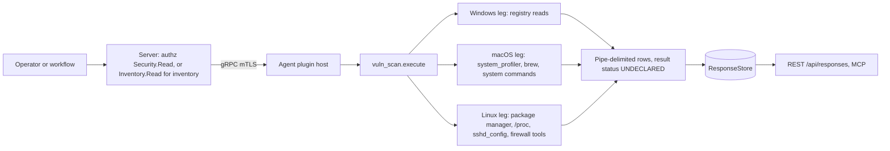
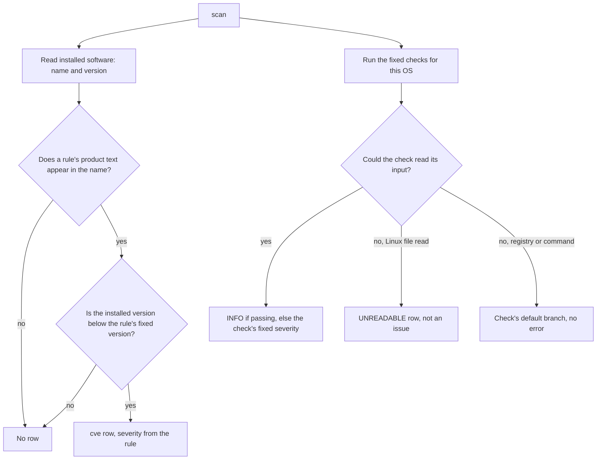
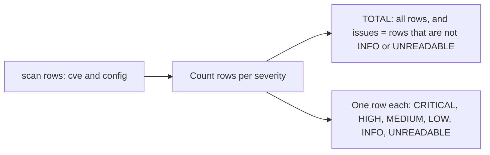

# vuln_scan

<!-- BEGIN GENERATED: plugin-doc-gen header -->
| | |
|---|---|
| **What it does** | Host vulnerability scanning — CVE matching and configuration compliance checks |
| **Version** | 1.0.0 |
| **Kind** | Collector · read-only · gathered (security.vuln_scan.scan, security.vuln_scan.cve_scan, security.vuln_scan.config_scan, security.vuln_scan.summary, security.vuln_scan.inventory) |
| **Platforms** | Windows ✅ · macOS ✅ · Linux ✅ |
| **Actions** | `config_scan` (definition `security.vuln_scan.config_scan`) · `cve_scan` (definition `security.vuln_scan.cve_scan`) · `inventory` (definition `security.vuln_scan.inventory`) · `scan` (definition `security.vuln_scan.scan`) · `summary` (definition `security.vuln_scan.summary`) |
| **Security** | `scan`: securable `Security` · operation Read · risk Low · dispatch ReadOnly · approval gate None; `cve_scan`: securable `Security` · operation Read · risk Low · dispatch ReadOnly · approval gate None; `config_scan`: securable `Security` · operation Read · risk Low · dispatch ReadOnly · approval gate None; `summary`: securable `Security` · operation Read · risk Low · dispatch ReadOnly · approval gate None; `inventory`: securable `Inventory` · operation Read · risk Low · dispatch ReadOnly · approval gate None |
| **Roles** | execute: endpoint-admin, endpoint-operator, security-admin · author: content-author |
<!-- END GENERATED -->

## How it works

Every action is a read; nothing on the host is changed. `scan` first reads the installed-software list and matches it against a fixed table of 41 built-in CVE rules, then runs the fixed list of configuration checks for the operating system, and returns the CVE rows followed by the configuration rows (progress is reported at 0, 50, 90 and 100). `cve_scan` and `config_scan` are those two halves on their own. `summary` runs the same combined scan, throws the individual rows away and returns only a count per severity. `inventory` runs neither scan: it returns the raw installed-software `name|version` pairs and nothing else.

The CVE half is deliberately small and local. It is not a vulnerability feed: the rule table ships inside the plugin, each rule names a product by a short text (for example `openssl` or `git`), and a rule fires when an installed product's name contains that text, ignoring case, and its version compares lower than the rule's fixed version. The configuration half reads a handful of well-known hardening settings (registry values on Windows, command output and a few files on macOS and Linux) and reports every check it ran, passing ones as `INFO`. `inventory` exists so a caller can hand the raw software list to the server for a fuller match instead of relying on the built-in table.



### What you can decide with it

| Question | Action | What you get |
|---|---|---|
| Which known-bad versions of a short list of common products are installed? | `cve_scan` | Windows: from the registry Uninstall lists (machine-wide, 32-bit, and the agent account's own). macOS: apps from `system_profiler` plus the packages `brew list --versions` reports (formulae, and casks if present). Linux: packages from the first package manager found (`dpkg-query`, else `rpm`, else `pacman`, else `apk`). |
| Is this host's basic hardening in place? | `config_scan` | A fixed per-OS list of checks, listed below. Every check that ran is reported, passing ones as `INFO`. |
| Both of the above in one call | `scan` | CVE rows, then configuration rows. |
| How bad is it at a glance? | `summary` | `TOTAL` first, then a count for each of `CRITICAL`, `HIGH`, `MEDIUM`, `LOW`, `INFO`, `UNREADABLE`. `UNREADABLE` and `INFO` are not issues. |
| What software is installed, for matching elsewhere? | `inventory` | Raw `name\|version` pairs. No CVE or configuration logic. |

**What a clean result means.** A scan with no `cve` rows says only that none of the 41 built-in rules matched the installed software. It does not say the host is patched. The table covers 21 product names (OpenSSL, curl, sudo, polkit, Log4j, Apache, OpenSSH, Python, Node.js, Chrome, Firefox, .NET, OpenJDK, Windows, nginx, PostgreSQL, Git, 7-Zip, WinRAR, PuTTY, PHP) with one to four rules each, and no rule is for a CVE newer than 2024. Software that is not in the software list the leg reads (per-user installs of other accounts on Windows, anything on Linux when none of the four package managers is present) is never examined. Operating-system patch level, kernel, firmware and distribution back-ports are not assessed at all. For a real patch-compliance answer use a patch-state source, not this plugin.

**What a `cve` row means.** It is a lead to check, not a confirmed exposure. Matching is by substring of the product name and by a simple dotted-number version comparison, so some rows are false positives (see Caveat 2). The two Windows Print Spooler rules in particular compare an application's own version against a Windows build number and never read the real OS build or installed hotfixes, so they cannot tell you whether PrintNightmare is fixed; in the Windows sample every Print Spooler row names a .NET runtime, a Windows update package or a Windows utility, not the spooler itself.

**Configuration checks by OS** (severity is fixed per check; a passing check is `INFO`):

| OS | Checks that always report | Checks that report only in some cases | Known ways the answer can be wrong |
|---|---|---|---|
| Windows | UAC (`EnableLUA`), SMBv1 (`SMB1`), Auto-Logon, Defender real-time flag (`DisableRealtimeMonitoring`), Firewall for the Domain, Private and Public profiles | RDP Network Level Authentication, only when Remote Desktop is enabled | A missing SMBv1 value is read as enabled (`CRITICAL`); a missing Defender flag is read as enabled protection; the Defender row is one registry flag, not the live service state; an unreadable UAC or firewall value reads as disabled. |
| macOS | Gatekeeper (`spctl`), FileVault (`fdesetup`), SIP (`csrutil`), Application Firewall (`socketfilterfw`), Remote Login (`systemsetup`), Automatic Software Updates (`defaults`) | none | `systemsetup` needs administrator rights; without them its error text lacks the word `Off`, so Remote Login reads `Enabled`. The updates row treats any `1` in the `defaults` output as enabled, including inside an error message. The risky-port check is not expected to produce rows: the plugin runs `ss -tlnH || netstat -tlnp` and discards errors, and `ss` is not present on macOS and `netstat -tlnp` is believed not to be valid there (inferred, not captured). |
| Linux | ASLR (`randomize_va_space`), SUID core dumps (`suid_dumpable`), SSH Root Login, Firewall | SSH Password Authentication, only if `sshd_config` sets it (it also reports `INFO` "not applicable" when the file is absent and `UNREADABLE` when it cannot be read); `/tmp noexec`, only if `/tmp` is a separate mount; World-Writable PATH, only if the agent's own `PATH` has such a directory; Open Port rows for FTP 21, Telnet 23, SMB 445, RDP 3389, VNC 5900 bound on all interfaces | Only `/etc/ssh/sshd_config` is read (no `Include`d files, no `Match` blocks, no effective-config query); a plain `PermitRootLogin prohibit-password` reads as "not explicitly set". The firewall check reads `iptables`, `nft` and `ufw` output, which normally need root, so an unprivileged agent reports `No firewall rules detected` (`HIGH`) even on a protected host. |

A Linux file the agent cannot read (SSH config, ASLR, `suid_dumpable`, the mount table) is reported as `UNREADABLE`, never as a weak setting. An absent `sshd_config` is `INFO`, "not applicable".

### Diagrams



The CVE branch and the configuration branch are independent: neither can suppress the other, and `scan` simply concatenates them. A software entry with no version is skipped, so it can never match. The last two configuration branches are the important difference: a failed Linux file read is surfaced as `UNREADABLE`, while a failed registry or command read silently falls through to that check's default result.



`summary` counts rows, not distinct problems. One installed product that matches two rules, or several installed products that match one rule, each add to the issue count, so the number is an upper bound on real exposures and is inflated by false-positive `cve` rows.

## OS capability

<!-- BEGIN GENERATED: plugin-doc-gen capability -->
| Action | Windows | macOS | Linux |
|---|---|---|---|
| `config_scan` | ✅ supported · rung 1 · win32_registry | ✅ supported · rung 3 · popen(spctl/fdesetup/csrutil/socketfilterfw) | ✅ supported · rung 3 · popen(iptables/nft/ufw)+procfs |
| `cve_scan` | ✅ supported · rung 1 · win32_registry | ✅ supported · rung 3 · popen(system_profiler/brew) | ✅ supported · rung 3 · popen(dpkg-query/rpm/pacman/apk) |
| `inventory` | ✅ supported · rung 1 · win32_registry | ✅ supported · rung 3 · popen(system_profiler/brew) | ✅ supported · rung 3 · popen(dpkg-query/rpm/pacman/apk) |
| `scan` | ✅ supported · rung 1 · win32_registry | ✅ supported · rung 3 · popen(system_profiler/brew+security-checks) | ✅ supported · rung 3 · popen(pkg-manager+iptables/nft/ufw) |
| `summary` | ✅ supported · rung 1 · win32_registry | ✅ supported · rung 3 · popen(system_profiler/brew+security-checks) | ✅ supported · rung 3 · popen(pkg-manager+iptables/nft/ufw) |
<!-- END GENERATED -->

## Privileges and prerequisites

| OS | Runs as | Extra grant needed | Measured | If the read is refused |
|---|---|---|---|---|
| Windows | agent daemon identity (captured as `SYSTEM`) | None established; the plugin reads `HKLM` Uninstall and policy values and the agent account's own `HKCU` Uninstall list. No row in `docs/agent-privilege-model.md` | 2026-09-07, bare metal, as SYSTEM | not observed; a denied `RegOpenKeyExW` or `RegQueryValueExW` returns an empty string or the check's default, so a blocked read shows up as that check's default result, not an error |
| macOS | agent daemon; the shipped LaunchDaemon runs as root today (`docs/agent-privilege-model.md`) | `systemsetup -getremotelogin` needs administrator rights (root has them). No other grant. No row for this plugin | 2026-09-07, bare metal, as an unprivileged user (euid 501), not as root | not observed for a denial; a failed command returns empty or error text, which each check parses as its negative or disabled branch (Remote Login reads `Enabled` when `systemsetup` is refused) |
| Linux | agent daemon, dedicated unprivileged account by design (`docs/agent-privilege-model.md`) | None for the package list, `/proc` or world-readable files. `iptables`, `nft` and `ufw status` normally need root or `CAP_NET_ADMIN`; a mode-0600 `sshd_config` (the RHEL-family default) needs read access. No row for this plugin | 2026-09-06, container, euid 0 | a failed file read is `UNREADABLE` (both SSH checks on a 0600 `sshd_config`); a failed firewall command returns empty output, read as "no firewall rules detected" |

Windows uses no subprocess: software enumeration and every Windows check are in-process registry calls. Linux and macOS run commands through `popen` and `system()` with fixed strings and no caller input: Linux `dpkg-query`, `rpm`, `pacman`, `apk` (the first one present), `iptables`, `nft`, `ufw`, `ss` or `netstat`; macOS `system_profiler`, `brew` when installed, `spctl`, `fdesetup`, `csrutil`, `socketfilterfw`, `systemsetup`, `defaults`. There is no network access; the firewall and listener commands read local state only.

## Data contract

### Inputs

<!-- BEGIN GENERATED: plugin-doc-gen inputs -->
No action takes parameters.
<!-- END GENERATED -->

### Outputs

Pipe-delimited rows, one per finding (or per installed package for `inventory`). `scan`, `cve_scan` and `config_scan` share the 4-field row shape `severity|category|title|detail`. An action that finds nothing still emits one placeholder row, `INFO|scan|No vulnerabilities|No issues detected`; in practice only `cve_scan` reaches it, because `config_scan` and `scan` always report at least one configuration check. `summary` emits a different, 3-field shape: a literal `summary` discriminator, then a severity name (or the literal `TOTAL`), then a count, which is one field more than the two result columns (`severity`, `count`) the definition declares. `inventory` emits raw `name|version` pairs with no discriminator, and `version` is empty when the source gives none.

A Linux config check whose file read fails (EACCES, EIO, ...) emits `UNREADABLE|config|<title>|<path>: <cause>` (for example `eacces`) rather than a finding about an empty value. `UNREADABLE` means the check could not run; it is not an issue, so `summary` leaves it out of the `TOTAL` row's issue count and reports it on its own `summary|UNREADABLE|<n>` row after `summary|INFO|<n>`. An absent `/etc/ssh/sshd_config` is not a weak setting: both SSH checks emit `INFO` with "/etc/ssh/sshd_config not present; check not applicable".

<!-- BEGIN GENERATED: plugin-doc-gen outputs -->
**`security.vuln_scan.config_scan` — `severity|category|title|detail`**

| Field | Type | Values | Available | Example | Description |
|---|---|---|---|---|---|
| `severity` | string | `CRITICAL` `HIGH` `MEDIUM` `LOW` `INFO` `UNREADABLE` | Windows, Linux, macOS | `HIGH` | Finding severity assigned by the compliance check that produced this row. UNREADABLE means the check could not run; not an issue. |
| `category` | string | `config` `scan` | Windows, Linux, macOS | `config` | Always "config" for this action; "scan" only on the placeholder row emitted when there is nothing to report. |
| `title` | string | - | Windows, Linux, macOS | `SMBv1 Protocol` | The name of the compliance check, e.g. the setting it inspects. Values: free text. |
| `detail` | string | - | Windows, Linux, macOS | `Enabled - vulnerable to EternalBlue/WannaCry (MS17-010)` | The check's human-readable result text, including why a failing check failed. Values: free text. |

**`security.vuln_scan.cve_scan` — `severity|category|title|detail`**

| Field | Type | Values | Available | Example | Description |
|---|---|---|---|---|---|
| `severity` | string | `CRITICAL` `HIGH` `MEDIUM` `LOW` `INFO` | Windows, Linux, macOS | `HIGH` | Finding severity assigned by the CVE rule that matched. |
| `category` | string | `cve` `scan` | Windows, Linux, macOS | `cve` | Always "cve" for a match; "scan" on the single placeholder row emitted when nothing matches. |
| `title` | string | - | Windows, Linux, macOS | `CVE-2023-24329: urllib.parse URL parsing bypass via leading whitespace` | "<CVE-ID>: <description>" from the matched rule, or "No vulnerabilities" on the placeholder row. Values: free text. |
| `detail` | string | - | Windows, Linux, macOS | `Python 3.9.6 (fixed in 3.11.4)` | <installed product> <version> (fixed in <fixed_ver>). Values: free text. |

**`security.vuln_scan.inventory` — `name|version`**

| Field | Type | Values | Available | Example | Description |
|---|---|---|---|---|---|
| `name` | string | - | Windows, Linux, macOS | `curl` | Installed application or package name, as reported by the OS's own inventory source. Values: free text. |
| `version` | string | - | Windows, Linux, macOS | `8.14.1-2+deb13u4` | Installed version string, or empty when the source reports none (e.g. a Windows uninstall entry with no DisplayVersion). Values: free text, or empty. |

**`security.vuln_scan.scan` — `severity|category|title|detail`**

| Field | Type | Values | Available | Example | Description |
|---|---|---|---|---|---|
| `severity` | string | `CRITICAL` `HIGH` `MEDIUM` `LOW` `INFO` `UNREADABLE` | Windows, Linux, macOS | `CRITICAL` | Finding severity assigned by the check that produced this row. UNREADABLE means the check could not run; not an issue. |
| `category` | string | `cve` `config` `scan` | Windows, Linux, macOS | `cve` | Which half of the scan produced this row. |
| `title` | string | - | Windows, Linux, macOS | `CVE-2021-34527: PrintNightmare: RCE via Windows Print Spooler` | For a cve row, "<CVE-ID>: <description>" from the matched rule; for a config row, the name of the compliance check; "No vulnerabilities" on the single placeholder row emitted when a run finds nothing. Values: free text. |
| `detail` | string | - | Windows, Linux, macOS | `Microsoft Windows Desktop Runtime - 6.0.11 (x64) 6.0.11.31823 (fixed in KB5004945)` | For a cve row, "<installed product> <version> (fixed in <fixed_ver>)"; for a config row, the check's human-readable result text. Values: free text. |

**`security.vuln_scan.summary` — `severity|count`**

| Field | Type | Values | Available | Example | Description |
|---|---|---|---|---|---|
| `severity` | string | `TOTAL` `CRITICAL` `HIGH` `MEDIUM` `LOW` `INFO` `UNREADABLE` | Windows, Linux, macOS | `CRITICAL` | The severity this row counts, or the literal "TOTAL" for the first row emitted by every run. |
| `count` | int32 | - | Windows, Linux, macOS | `17` | The number of findings at this severity. The TOTAL row is an exception: despite the declared int32 type, that row's cell holds the formatted string "<n> findings (<n> issues)", not an integer. Values: integer, except a formatted string on the TOTAL row. |
<!-- END GENERATED -->

### Result status

| Status | Completeness | Provenance | When |
|---|---|---|---|
| `UNDECLARED` | `UNKNOWN` | (empty) | every action on every OS: the plugin does not set a typed result status, so a consumer must read the rows. A failed read is therefore never visible in the status; it shows only as an `UNREADABLE` row (Linux file checks) or as a default-branch finding |

### Where the data goes

- **Instruction result only.** Rows travel over the agent's mTLS gRPC channel as the command response and land in the ResponseStore, rendered by the dashboard and REST with the plugin's default column schema (`Agent, Severity, Category, Title, Detail`) or, when the request carries a definition id, that definition's own result-column schema.
- **Server-side NVD matching.** The `inventory` definition says its rows are for server-side NVD matching and centralized correlation; this README does not describe that server feature. The server's version comparison notes that it duplicates the algorithm in `cve_rules.hpp`.
- **Not consumed by** daily-sync inventory, Echo, DEX or metrics; nothing runs on a schedule and every action is on-demand.
- **Sensitivity.** `cve` rows embed installed application names and versions in `detail`, and `inventory` returns that list directly: an installed-software inventory by another route. Configuration rows reveal the host's security posture (for example a disabled firewall or SMBv1 enabled), which is useful to an attacker as well as an administrator. Nothing in either row shape names a person.
- **Siblings:** `installed_apps` is a separate installed-software collector with overlapping data (it shares the "installed, held" package-presence convention on Linux); a caller working from software identity may have two plugins to reconcile.
- **MCP / REST.** Discover: `discover_plugins` (summary) then `yuzu://plugin-docs` (this page as data) then `discover_instructions` or `get_definition("security.vuln_scan.scan")`. Run: `execute_instruction {definition_id, parameters}`. Read: `/api/responses/{id}`.

## Sample output

<!-- BEGIN GENERATED: plugin-doc-gen samples -->
**Windows** — captured: windows Microsoft Windows NT 10.0.26200.0 x64 · bare-metal · 2026-09-07 · SYSTEM · leg-hash 20c66f1c0618

```
== action=scan
CRITICAL|cve|CVE-2021-34527: PrintNightmare: RCE via Windows Print Spooler|Microsoft Windows Desktop Runtime - 6.0.11 (x64) 6.0.11.31823 (fixed in KB5004945)
CRITICAL|cve|CVE-2021-34527: PrintNightmare: RCE via Windows Print Spooler|Microsoft Windows Desktop Runtime - 6.0.20 (x86) 6.0.20.32621 (fixed in KB5004945)
CRITICAL|cve|CVE-2021-34527: PrintNightmare: RCE via Windows Print Spooler|Microsoft Windows Desktop Runtime - 8.0.28 (x64) 8.0.28.36119 (fixed in KB5004945)
CRITICAL|cve|CVE-2021-34527: PrintNightmare: RCE via Windows Print Spooler|Microsoft Windows Desktop Runtime - 8.0.28 (x86) 8.0.28.36119 (fixed in KB5004945)
CRITICAL|cve|CVE-2021-34527: PrintNightmare: RCE via Windows Print Spooler|Update for x64-based Windows Systems (KB5001716) 8.94.0.0 (fixed in KB5004945)
CRITICAL|cve|CVE-2021-34527: PrintNightmare: RCE via Windows Print Spooler|Windows 11 Installation Assistant 1.4.19041.5003 (fixed in KB5004945)
CRITICAL|cve|CVE-2021-34527: PrintNightmare: RCE via Windows Print Spooler|Windows PC Health Check 3.6.2204.08001 (fixed in KB5004945)
CRITICAL|cve|CVE-2021-34527: PrintNightmare: RCE via Windows Print Spooler|Windows Subsystem for Linux 2.6.3.0 (fixed in KB5004945)
CRITICAL|cve|CVE-2021-1675: Print Spooler privilege escalation|Microsoft Windows Desktop Runtime - 6.0.11 (x64) 6.0.11.31823 (fixed in KB5003637)
CRITICAL|cve|CVE-2021-1675: Print Spooler privilege escalation|Microsoft Windows Desktop Runtime - 6.0.20 (x86) 6.0.20.32621 (fixed in KB5003637)
CRITICAL|cve|CVE-2021-1675: Print Spooler privilege escalation|Microsoft Windows Desktop Runtime - 8.0.28 (x64) 8.0.28.36119 (fixed in KB5003637)
CRITICAL|cve|CVE-2021-1675: Print Spooler privilege escalation|Microsoft Windows Desktop Runtime - 8.0.28 (x86) 8.0.28.36119 (fixed in KB5003637)
… 12 of 24 rows shown
[result_status] UNDECLARED / UNKNOWN

== action=cve_scan
CRITICAL|cve|CVE-2021-34527: PrintNightmare: RCE via Windows Print Spooler|Microsoft Windows Desktop Runtime - 6.0.11 (x64) 6.0.11.31823 (fixed in KB5004945)
CRITICAL|cve|CVE-2021-34527: PrintNightmare: RCE via Windows Print Spooler|Microsoft Windows Desktop Runtime - 6.0.20 (x86) 6.0.20.32621 (fixed in KB5004945)
CRITICAL|cve|CVE-2021-34527: PrintNightmare: RCE via Windows Print Spooler|Microsoft Windows Desktop Runtime - 8.0.28 (x64) 8.0.28.36119 (fixed in KB5004945)
CRITICAL|cve|CVE-2021-34527: PrintNightmare: RCE via Windows Print Spooler|Microsoft Windows Desktop Runtime - 8.0.28 (x86) 8.0.28.36119 (fixed in KB5004945)
CRITICAL|cve|CVE-2021-34527: PrintNightmare: RCE via Windows Print Spooler|Update for x64-based Windows Systems (KB5001716) 8.94.0.0 (fixed in KB5004945)
CRITICAL|cve|CVE-2021-34527: PrintNightmare: RCE via Windows Print Spooler|Windows 11 Installation Assistant 1.4.19041.5003 (fixed in KB5004945)
CRITICAL|cve|CVE-2021-34527: PrintNightmare: RCE via Windows Print Spooler|Windows PC Health Check 3.6.2204.08001 (fixed in KB5004945)
CRITICAL|cve|CVE-2021-34527: PrintNightmare: RCE via Windows Print Spooler|Windows Subsystem for Linux 2.6.3.0 (fixed in KB5004945)
CRITICAL|cve|CVE-2021-1675: Print Spooler privilege escalation|Microsoft Windows Desktop Runtime - 6.0.11 (x64) 6.0.11.31823 (fixed in KB5003637)
CRITICAL|cve|CVE-2021-1675: Print Spooler privilege escalation|Microsoft Windows Desktop Runtime - 6.0.20 (x86) 6.0.20.32621 (fixed in KB5003637)
CRITICAL|cve|CVE-2021-1675: Print Spooler privilege escalation|Microsoft Windows Desktop Runtime - 8.0.28 (x64) 8.0.28.36119 (fixed in KB5003637)
CRITICAL|cve|CVE-2021-1675: Print Spooler privilege escalation|Microsoft Windows Desktop Runtime - 8.0.28 (x86) 8.0.28.36119 (fixed in KB5003637)
… 12 of 16 rows shown
[result_status] UNDECLARED / UNKNOWN

== action=config_scan
INFO|config|UAC (User Account Control)|Enabled
CRITICAL|config|SMBv1 Protocol|Enabled - vulnerable to EternalBlue/WannaCry (MS17-010)
INFO|config|Auto-Logon|Disabled
INFO|config|RDP Network Level Authentication|Enabled
INFO|config|Windows Defender Real-Time Protection|Enabled
INFO|config|Windows Firewall|Domain profile: Enabled
INFO|config|Windows Firewall|Private profile: Enabled
INFO|config|Windows Firewall|Public profile: Enabled
[result_status] UNDECLARED / UNKNOWN

== action=summary
summary|TOTAL|24 findings (17 issues)
summary|CRITICAL|17
summary|HIGH|0
summary|MEDIUM|0
summary|LOW|0
summary|INFO|7
[result_status] UNDECLARED / UNKNOWN

== action=inventory
7-Zip 26.02 (x64)|26.02
Age of Empires II: Definitive Edition|
Application Verifier x64 External Package (DesktopEditions)|10.1.26100.7705
Application Verifier x64 External Package (OnecoreUAP)|10.1.26100.7705
Baldur's Gate 3|
Battle.net|
CCleaner 7|7.10.1464.1889
CMake|4.3.3
Cities: Skylines II|
Crusader Kings III|
DayZ|
Defraggler|2.22
… 12 of 226 rows shown
[result_status] UNDECLARED / UNKNOWN
```

**macOS** — captured: macos macOS 26.6.2 arm64 · bare-metal · 2026-09-07 · euid 501 (jsmith) · leg-hash 20c66f1c0618

```
== action=scan
HIGH|cve|CVE-2023-24329: urllib.parse URL parsing bypass via leading whitespace|Python 3.9.6 (fixed in 3.11.4)
MEDIUM|cve|CVE-2024-0450: zipfile quoted-overlap zipbomb protection bypass|Python 3.9.6 (fixed in 3.12.2)
INFO|config|Gatekeeper|Enabled - only verified apps can run
INFO|config|FileVault Disk Encryption|Enabled
INFO|config|System Integrity Protection (SIP)|Enabled
MEDIUM|config|Application Firewall|Disabled
MEDIUM|config|Remote Login (SSH)|Enabled - SSH access is open
INFO|config|Automatic Software Updates|Enabled
[result_status] UNDECLARED / UNKNOWN

== action=cve_scan
HIGH|cve|CVE-2023-24329: urllib.parse URL parsing bypass via leading whitespace|Python 3.9.6 (fixed in 3.11.4)
MEDIUM|cve|CVE-2024-0450: zipfile quoted-overlap zipbomb protection bypass|Python 3.9.6 (fixed in 3.12.2)
[result_status] UNDECLARED / UNKNOWN

== action=config_scan
INFO|config|Gatekeeper|Enabled - only verified apps can run
INFO|config|FileVault Disk Encryption|Enabled
INFO|config|System Integrity Protection (SIP)|Enabled
MEDIUM|config|Application Firewall|Disabled
MEDIUM|config|Remote Login (SSH)|Enabled - SSH access is open
INFO|config|Automatic Software Updates|Enabled
[result_status] UNDECLARED / UNKNOWN

== action=summary
summary|TOTAL|8 findings (4 issues)
summary|CRITICAL|0
summary|HIGH|1
summary|MEDIUM|3
summary|LOW|0
summary|INFO|4
[result_status] UNDECLARED / UNKNOWN

== action=inventory
App Store|3.0
Apps|1.0
Automator|2.10
Books|8.5
Calculator|12.0
Calendar|16.0
Chess|3.18
Clock|1.1
Contacts|14.0
Dictionary|2.3.0
FaceTime|36
Find My|4.0
… 12 of 387 rows shown
[result_status] UNDECLARED / UNKNOWN
```

**Linux** — captured: linux Debian GNU/Linux 13 (trixie) aarch64 · container · 2026-09-06 · euid 0 · leg-hash 20c66f1c0618

```
== action=scan
HIGH|cve|CVE-2023-24329: urllib.parse URL parsing bypass via leading whitespace|python3-wheel 0.46.1-2 (fixed in 3.11.4)
MEDIUM|cve|CVE-2024-0450: zipfile quoted-overlap zipbomb protection bypass|python3-wheel 0.46.1-2 (fixed in 3.12.2)
CRITICAL|cve|CVE-2024-32002: RCE via crafted repositories with submodules|git 1:2.47.3-0+deb13u1 (fixed in 2.45.1)
CRITICAL|cve|CVE-2024-32002: RCE via crafted repositories with submodules|git-man 1:2.47.3-0+deb13u1 (fixed in 2.45.1)
HIGH|cve|CVE-2023-25652: git apply --reject writes outside worktree|git 1:2.47.3-0+deb13u1 (fixed in 2.40.1)
HIGH|cve|CVE-2023-25652: git apply --reject writes outside worktree|git-man 1:2.47.3-0+deb13u1 (fixed in 2.40.1)
MEDIUM|config|SSH Root Login|PermitRootLogin not explicitly set - may default to prohibit-password
INFO|config|ASLR (Address Space Layout Randomization)|Full randomization enabled (value=2)
INFO|config|SUID Core Dumps|Restricted (suid_dumpable=0)
HIGH|config|Firewall|No firewall rules detected - host may be unprotected
[result_status] UNDECLARED / UNKNOWN

== action=cve_scan
HIGH|cve|CVE-2023-24329: urllib.parse URL parsing bypass via leading whitespace|python3-wheel 0.46.1-2 (fixed in 3.11.4)
MEDIUM|cve|CVE-2024-0450: zipfile quoted-overlap zipbomb protection bypass|python3-wheel 0.46.1-2 (fixed in 3.12.2)
CRITICAL|cve|CVE-2024-32002: RCE via crafted repositories with submodules|git 1:2.47.3-0+deb13u1 (fixed in 2.45.1)
CRITICAL|cve|CVE-2024-32002: RCE via crafted repositories with submodules|git-man 1:2.47.3-0+deb13u1 (fixed in 2.45.1)
HIGH|cve|CVE-2023-25652: git apply --reject writes outside worktree|git 1:2.47.3-0+deb13u1 (fixed in 2.40.1)
HIGH|cve|CVE-2023-25652: git apply --reject writes outside worktree|git-man 1:2.47.3-0+deb13u1 (fixed in 2.40.1)
[result_status] UNDECLARED / UNKNOWN

== action=config_scan
MEDIUM|config|SSH Root Login|PermitRootLogin not explicitly set - may default to prohibit-password
INFO|config|ASLR (Address Space Layout Randomization)|Full randomization enabled (value=2)
INFO|config|SUID Core Dumps|Restricted (suid_dumpable=0)
HIGH|config|Firewall|No firewall rules detected - host may be unprotected
[result_status] UNDECLARED / UNKNOWN

== action=summary
summary|TOTAL|10 findings (8 issues)
summary|CRITICAL|2
summary|HIGH|4
summary|MEDIUM|2
summary|LOW|0
summary|INFO|2
[result_status] UNDECLARED / UNKNOWN

== action=inventory
apt|3.0.3
autoconf|2.72-3.1
automake|1:1.17-4
autotools-dev|20240727.1
base-files|13.8+deb13u6
base-passwd|3.6.7
bash|5.2.37-2+b9
binutils|2.44-3
binutils-aarch64-linux-gnu|2.44-3
binutils-common|2.44-3
bison|2:3.8.2+dfsg-1+b2
bsdutils|1:2.41.5-0+deb13u1
… 12 of 206 rows shown
[result_status] UNDECLARED / UNKNOWN
```
<!-- END GENERATED -->

## Caveats and known gaps

1. **A clean scan is not "patched".** CVE matching uses a fixed, built-in table of 41 rules over 21 product names, and nothing outside it is reported: other products, CVEs after 2024, operating-system patches, kernels and distribution back-ports. Software the leg cannot list (other accounts' per-user installs on Windows, any host with none of the four Linux package managers) is not examined.
2. **Substring matching produces false positives, and the version test is naive.** A rule fires on any installed name that contains its product text, so `python` matches `python3-wheel`, `git` matches `git-man`, and `windows` matches .NET runtimes and Windows utilities; the version is compared as dotted numbers, and a Debian epoch such as `1:2.47.3` is compared as text and reads as lower than `2.45.1`. The samples show all three, so some `cve` rows are not exposures, and the issue count in `summary` is inflated by them.
3. **A failed read usually becomes the check's default result, not an error.** Windows registry reads fall back to a default (a missing SMBv1 value reads as enabled; an unreadable UAC or firewall value reads as disabled), a failed `popen` command returns empty output, and only the Linux file checks surface `UNREADABLE`. No capture observed a real permission denial, so this is read from the code, not measured; the World-Writable PATH walk also skips an entry whose `stat()` fails (#5515).
4. **`summary` does not match its declared result columns.** It emits three pipe fields per row (`summary|<severity or TOTAL>|<count>`) against two declared columns, `severity` and `count`, and the `TOTAL` row's `count` cell is the string `<n> findings (<n> issues)` rather than the declared `int32`.
5. **Configuration checks are single-signal heuristics, not effective policy.** Each reads one registry value, one command's text or one file, so a setting applied another way (an `Include`d SSH file, a managed firewall, a third-party antivirus) can read differently from the host's real state. There is no `docs/agent-privilege-model.md` row for this plugin, so the Privileges table records only what each capture measured.

## Source and tests

<!-- BEGIN GENERATED: plugin-doc-gen source -->
- Plugin: `agents/plugins/vuln_scan/src/config_checks.hpp` · `agents/plugins/vuln_scan/src/cve_rules.hpp` · `agents/plugins/vuln_scan/src/vuln_scan_plugin.cpp`
- Definitions: `content/definitions/vuln_scan.yaml`
- Capability rows: `server/core/src/capability_decls/plugin_action_catalogue_a.hpp`
- Tests: none found by name
- Privilege row: `docs/agent-privilege-model.md` (no row yet)
<!-- END GENERATED -->
