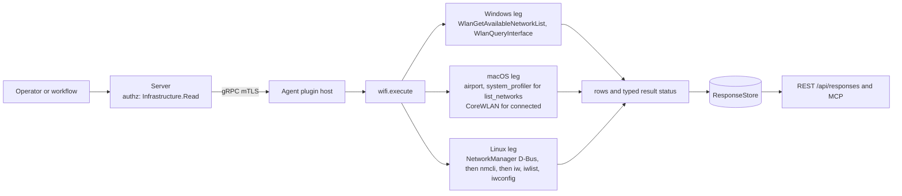
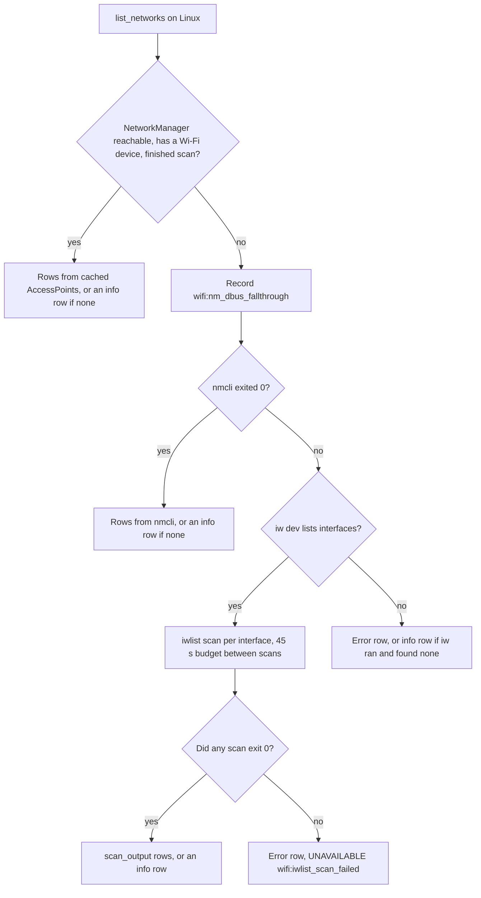

# wifi

<!-- BEGIN GENERATED: plugin-doc-gen header -->
| | |
|---|---|
| **What it does** | Scans visible WiFi networks and reports current connection status |
| **Version** | 1.1.0 |
| **Kind** | Collector · read-only · gathered (device.wifi.list_networks, device.wifi.connected) |
| **Platforms** | Windows ✅ · macOS 🟡 constrained · Linux 🟡 constrained |
| **Actions** | `connected` (definition `device.wifi.connected`) · `list_networks` (definition `device.wifi.list_networks`) |
| **Security** | securable `Infrastructure` · operation Read · risk Low · dispatch ReadOnly · approval gate None |
| **Roles** | execute: endpoint-admin, endpoint-operator · author: content-author |
<!-- END GENERATED -->

## How it works

Both actions are read-only: the plugin never joins, leaves or reconfigures a network. `list_networks` returns one row per visible access point; `connected` returns the network the radio is currently associated with. Each OS answers from its own Wi-Fi stack, and the Linux and macOS legs fall back down a ladder of tools when the preferred source does not answer.

- **Windows.** The WLAN API (`wlanapi`) is called in process. `list_networks` walks every wireless interface and reads the list of networks Windows already holds for it (`WlanGetAvailableNetworkList`); the plugin never asks Windows to scan. `connected` queries each interface that is in the connected state (`WlanQueryInterface`) and emits one row per connected interface.
- **Linux.** The first rung reads NetworkManager over the system D-Bus (not the session bus): its device list, then each Wi-Fi device's `LastScan` and cached `AccessPoints`. That read never triggers a scan, so it is trusted only if some device reports a finished scan. The D-Bus rung exists only in builds with libsystemd; other builds start at nmcli. Otherwise the plugin runs `nmcli device wifi list` (the plugin passes no rescan option; whether nmcli rescans a stale cache is nmcli's own behaviour), then `iw dev` plus `iwlist <interface> scan` per interface for `list_networks`, or `iwconfig` for `connected`. Every subprocess is a direct argv, never a shell.
- **macOS.** `connected` reads CoreWLAN in process. `list_networks` runs the legacy `airport -s` (removed in macOS 14) and then `system_profiler SPAirPortDataType`, which needs a Location Services grant a background daemon normally does not have.

A tool counts as having answered only if it exited with status zero. A spawn failure or a non-zero exit is therefore reported as an unavailable or constrained result, never as "Not connected" or an empty airspace. The plugin does not tell WEP from Open on the Linux D-Bus leg.



### What you can decide with it

| Question | Action | Windows | macOS | Linux |
|---|---|---|---|---|
| Is this device on the corporate network name? | `connected` | SSID, signal percent, authentication type, BSSID and adapter description, one row per connected adapter | Association, signal in dBm, channel and security are reliable; SSID and BSSID are usually the `<ssid-withheld>` marker on macOS 14 and later | SSID, signal percent, security, BSSID and the interface name, when NetworkManager (or nmcli or iwconfig) can see the radio |
| Is any open or unexpected network visible? | `list_networks` | The networks Windows has cached for each adapter (no BSSID or channel), with an `Open` authentication label for unsecured ones | Normally one `wifi\|info` row saying the scan is unavailable on macOS 14 and later | SSID, signal percent, security, channel and BSSID for each AP NetworkManager or nmcli reports |
| Does this device have a Wi-Fi radio at all? | either | `list_networks` writes a `No wireless interfaces found` error row; `connected` cannot tell you | Neither action says so; `connected` reports "Not connected" for a host with no Wi-Fi interface | `list_networks` writes an info row naming the missing interface or tools |

How to read a negative: `Not connected` on Windows and macOS also appears when the host has no wireless adapter, so it does not prove a radio exists. `connected|unknown|...` means nothing answered, which is different from not connected. A `wifi|info|...no networks visible` row means a source answered and found none; a `wifi|error|...` row means the scan did not happen. This is a per-device snapshot, not a site survey: signal units differ by OS (percent on Windows and Linux, dBm on macOS) and are not comparable across a mixed fleet.

### Diagrams



The ladder stops at the first rung that answers. A fallthrough from D-Bus is recorded as provenance but is not a failure, because the next rung answers in full. The 45 second budget is checked between `iwlist` runs, so it bounds the slowest rung, not the whole action. `connected` descends the same way: D-Bus, then the active row of `nmcli device wifi list`, then an `iwconfig` ESSID blob, then a `connected|unknown` row when none of them answered.

## OS capability

<!-- BEGIN GENERATED: plugin-doc-gen capability -->
| Action | Windows | macOS | Linux |
|---|---|---|---|
| `connected` | ✅ supported · rung 1 · WlanQueryInterface | 🟡 constrained · rung 1 · CoreWLAN | 🟡 constrained · rung 1 · NetworkManager D-Bus (sd-bus) |
| `list_networks` | ✅ supported · rung 1 · WlanGetAvailableNetworkList | 🟡 constrained · rung 2 · airport -s / system_profiler via argv runner | 🟡 constrained · rung 1 · NetworkManager D-Bus (sd-bus) |

**Declared limits per leg** (descriptor fallback text, verbatim):

- **`connected` / macOS** — Location Services (macOS 14+) may withhold SSID/BSSID from a background daemon
- **`connected` / Linux** — reports the device interface (e.g. wlan0) in the connection column rather than the NetworkManager profile name; falls back to nmcli via the argv runner (rung 2), then an iwconfig ESSID/Signal blob. Not yet exercised against a real Wi-Fi radio
- **`list_networks` / macOS** — airport was removed in macOS 14 (Sonoma); the system_profiler SPAirPortDataType fallback needs Location Services authorisation a background daemon may lack, so an unauthorised modern host yields no networks and an honest wifi|info sentinel
- **`list_networks` / Linux** — reads NetworkManager's cached AccessPoints and does not itself initiate a scan (falls through to nmcli, which rescans, when NM reports no finished scan); then falls back to nmcli via the argv runner (rung 2), then an iw/iwlist text dump. Not yet exercised against a real Wi-Fi radio
<!-- END GENERATED -->

## Privileges and prerequisites

| OS | Runs as | Extra grant needed | Measured | If the read is refused |
|---|---|---|---|---|
| Windows | agent service account (LocalSystem today, #1442) | None: the WLAN API calls need no elevation (`docs/agent-privilege-model.md`, `wifi.*` row) | 2026-09-07, bare-metal, as `SYSTEM` | A WLAN API failure is not privilege-specific. `connected` reports `UNAVAILABLE`/`PARTIAL` with a named `wifi:wlan_*` token; `list_networks` writes a `wifi\|error\|Cannot open WLAN handle` row (and sets no status). A single interface whose list call fails is skipped silently (caveat 1). |
| macOS | agent LaunchDaemon, root by default (no `UserName` key; `docs/agent-privilege-model.md` "macOS is the current exception"); the plugin itself needs no elevation | None for `connected` (CoreWLAN reads are unprivileged). The `system_profiler` fallback of `list_networks` needs a Location Services grant a background daemon cannot obtain. | 2026-09-07, bare-metal, as an unprivileged interactive user, not the production root LaunchDaemon identity | `list_networks`: `CONSTRAINED`/`PARTIAL` with `wifi:macos_scan_requires_location_services` and a `wifi\|info\|...` sentinel row. `connected`: SSID and BSSID become `<ssid-withheld>`/`-` on an otherwise live connection, never a false "Not connected". |
| Linux | agent unprivileged account (`yuzu-agent` on the packaged unit; `docs/agent-privilege-model.md` TL;DR) | None for the NetworkManager read or the `nmcli` fallback. The last rung, `iwlist <interface> scan`, is expected to need root for an active scan (inferred from the tool, not shown by the plugin code), which the agent neither holds nor requests. | 2026-09-06, container, as root (`euid 0`), with no wireless tools installed | Under the least-privilege agent `iwlist` is expected to fail or return nothing (not measured); if no scan exits zero, `list_networks` reports `UNAVAILABLE`/`PARTIAL` with `wifi:iwlist_scan_failed` and a `wifi\|error\|Wi-Fi scan failed on every discovered interface` row rather than an empty airspace. |

Binaries and network: Linux opens a connection to the system D-Bus for NetworkManager (local IPC, not a subprocess) and spawns `nmcli`, `iw`, `iwlist` and `iwconfig` through the bounded argv runner (20 second deadline per call, 5 second budget for the D-Bus calls). macOS spawns `airport` (absent on macOS 14 and later) and `system_profiler` the same way. Windows spawns nothing and links `wlanapi` directly. No leg makes a network call of its own.

## Data contract

### Inputs

<!-- BEGIN GENERATED: plugin-doc-gen inputs -->
Neither action takes parameters.
<!-- END GENERATED -->

### Outputs

Rows are pipe-delimited. `list_networks` emits zero or more `wifi|...` rows, or a single `wifi|info|...`, `wifi|error|...` or `wifi|scan_output|...` row when the scan could not enumerate real access points; `connected` emits one `connected|...` row (Windows emits one per connected adapter). The fourth and fifth `list_networks` columns mean different things per OS (see the table below), and the `wifi|scan_output|<blob>` fallback, the raw `iwlist` text after ESSID, Quality and Encryption filtering, fills none of the declared columns and is one opaque field. Every free-text field (SSID, security, BSSID, raw scan text) is escaped through `safe_output_field` at the emission site, because `wifi` is not a key-value plugin on the server and an unescaped `|` or newline in an attacker-controlled SSID would shift columns or fabricate a row.

<!-- BEGIN GENERATED: plugin-doc-gen outputs -->
**`device.wifi.connected` — `ssid|signal|security|bssid|interface_or_channel`**

| Field | Type | Values | Available | Example | Description |
|---|---|---|---|---|---|
| `ssid` | string | - | Windows, Linux, macOS | `none` | The connected network's SSID; sentinel none/unknown when disconnected or undetermined; <ssid-withheld> on macOS when Location Services blocks the read on an otherwise-live association; <hex:...> on the Linux D-Bus leg for a non-UTF-8 SSID. Values: SSID text, none, unknown, <ssid-withheld>, or <hex:...>. |
| `signal` | string | - | Windows, Linux, macOS | `Not connected` | Signal strength using the same per-OS units as list_networks' signal field; on a disconnected/undetermined sentinel row this carries the free-text message instead (e.g. "Not connected"). Values: integer, or a free-text sentinel message. |
| `security` | string | - | Windows, Linux, macOS | `0` | Security type of the connected access point; "unknown" on the Linux iwconfig blob fallback; "0" on the disconnected/undetermined sentinel. Values: free text, unknown, or 0. |
| `bssid` | string | - | Windows, Linux, macOS | `none` | Connected access point's MAC address; - or none when not associated or unknown. Values: MAC address, -, or none. |
| `interface_or_channel` | string | - | Windows, Linux, macOS | `none` | Wireless interface name on Linux/Windows (e.g. wlan0, an adapter description); 802.11 channel number on macOS; none when undetermined. Values: interface name string, channel number, or none. |

**`device.wifi.list_networks` — `ssid|signal|security|channel_or_type|bssid_or_connected`**

| Field | Type | Values | Available | Example | Description |
|---|---|---|---|---|---|
| `ssid` | string | - | Windows, Linux, macOS | `info` | The network's SSID, or a sentinel discriminator (info/error/ scan_output) when the row is a status line rather than an access point. Values: SSID text, <hidden> (empty SSID), <hex:...> (Linux D-Bus non-UTF-8 SSID), or info/error/scan_output. |
| `signal` | string | - | Windows, Linux, macOS | `wi-fi scan unavailable; airport removed in macOS 14+ and system_profiler requires Location Services` | Signal strength: 0-100 quality/percent on Windows and Linux, RSSI in dBm on macOS; on a sentinel row this field carries the free-text message instead. Values: integer 0-100 (Windows/Linux), a dBm integer (macOS), or free text on a sentinel row. |
| `security` | string | - | Windows, Linux, macOS | `0` | The access point's security type in the emitting leg's own vocabulary (e.g. Open, WPA2-Personal, WPA3, 802.1X); "0" on a sentinel row. Values: free text, or 0 on a sentinel row. |
| `channel_or_type` | string | - | Windows, Linux, macOS | `0` | 802.11 channel number on Linux/macOS; BSS type (Infrastructure/Ad-hoc/Unknown) on Windows -- the two OS families populate genuinely different data in this column. Values: channel number as a string, 0 when unknown, or Infrastructure/Ad-hoc/Unknown. |
| `bssid_or_connected` | string | - | Windows, Linux, macOS | `none` | Access point MAC address on Linux/macOS; the literal true/false for whether this network is the one currently connected on Windows -- again a different meaning per OS. Values: MAC address, - when unknown, or true/false. |
<!-- END GENERATED -->

### Result status

| Status | Completeness | Provenance | When |
|---|---|---|---|
| `UNDECLARED` (default) | UNKNOWN | (empty) | Windows `list_networks` (every path, including the error rows), Windows `connected` when no interface is connected, macOS `connected`, and every Linux or macOS result that completed without a degrade. The plugin sets no status on these paths. |
| `OK` | FULL | `wifi:nm_dbus_fallthrough` | Linux, both actions: the NetworkManager D-Bus rung did not answer and the action fell through to nmcli. This is provenance, not a failure, because the next rung answers in full. |
| `CONSTRAINED` | PARTIAL | `wifi:action_budget_exhausted` | Linux `list_networks`: the 45 second budget ran out between `iwlist` scans with interfaces still unscanned |
| `CONSTRAINED` | PARTIAL | `wifi:macos_scan_requires_location_services` | macOS `list_networks`: neither `airport` nor `system_profiler` produced rows |
| `UNAVAILABLE` | PARTIAL | `wifi:iwlist_scan_failed` | Linux `list_networks`: interfaces were discovered but no `iwlist scan` exited zero |
| `UNAVAILABLE` | PARTIAL | `wifi:no_wireless_tools` | Linux `list_networks`: neither nmcli nor `iw` answered and no runner-level failure was already forwarded |
| `UNAVAILABLE` | PARTIAL | `wifi:wlan_open_handle_failed` / `wifi:wlan_enum_interfaces_failed` / `wifi:wlan_query_interface_failed` | Windows `connected`: the WLAN API call itself failed |
| `UNAVAILABLE` | PARTIAL | `wifi:nmcli_and_iwconfig_failed` | Linux `connected`: neither nmcli nor iwconfig answered and no runner-level failure was already forwarded |
| `UNAVAILABLE` | PARTIAL | `subprocess_runner:spawn_error` | A tool could not be spawned at all; this is what `docs/samples/linux.txt` shows for both actions |
| `CONSTRAINED` | PARTIAL | `subprocess_runner:deadline` | The 20 second runner deadline elapsed and the child was killed |
| `CONSTRAINED` | PARTIAL | `subprocess_runner:cancelled` | The run was cancelled before it finished |
| `CONSTRAINED` | PARTIAL | `subprocess_runner:signaled` | The child was killed by a signal rather than exiting cleanly |
| `OK` | PARTIAL | `subprocess_runner:line_limit` | Defined by the shared runner for a capped line count. This plugin sets no line limit, so it does not occur here. |

### Where the data goes

- **Instruction result only.** Rows travel over the agent's mTLS gRPC channel as the command response and land in the ResponseStore at the DSL default 90-day retention (`spec.response.retentionDays` is unset in `wifi.yaml`), queryable at `/api/responses/{id}`.
- **Not consumed by** daily-sync inventory, the Echo warehouse, DEX, or metrics. Nothing runs on a schedule: `gather.ttlSeconds: 30` bounds the agent's response deadline, not a recurring interval, and the plugin executes only when an operator or workflow dispatches one of its two definitions.
- **Sensitivity.** `bssid`/`bssid_or_connected` rows carry access-point MAC addresses (device identifiers, not the managed host's own) on Linux and macOS `list_networks` and on `connected` across all three OSes; `ssid` free text can itself identify a person or a specific device (for example a personal hotspot named after its owner, or the `<hex:...>` form of a non-UTF-8 SSID). No column carries the host's own hostname, IP address, or a logged-in username.
- **Siblings:** none of this plugin's definitions feed Echo. Echo ships its own independent `netconn` capture source (`agents/plugins/echo/src/echo_netconn.hpp`, Windows-only, on by default) that records Wi-Fi connect, fail and disconnect transitions from the OS event log with a stricter allow-list than this plugin; it never extracts SSID, BSSID or profile names.
- **MCP / REST.** Discover: `discover_plugins` (summary), then `yuzu://plugin-docs` (this page as data), then `discover_instructions` / `get_definition("device.wifi.connected")`. Run: `execute_instruction {definition_id, parameters}`. Read: `/api/responses/{id}`.
## Sample output

<!-- BEGIN GENERATED: plugin-doc-gen samples -->
**Windows** — captured: windows Microsoft Windows NT 10.0.26200.0 x64 · bare-metal · 2026-09-07 · SYSTEM · leg-hash 08531a51b9d2

```
== action=list_networks
[result_status] UNDECLARED / UNKNOWN

== action=connected
connected|none|Not connected|0|none|none
[result_status] UNDECLARED / UNKNOWN
```

**macOS** — captured: macos macOS 26.6.2 arm64 · bare-metal · 2026-09-07 · euid 501 (jsmith) · leg-hash 08531a51b9d2

```
== action=list_networks
wifi|info|wi-fi scan unavailable; airport removed in macOS 14+ and system_profiler requires Location Services|0|0|none
[result_status] CONSTRAINED / PARTIAL / wifi:macos_scan_requires_location_services

== action=connected
connected|none|Not connected|0|none|none
[result_status] UNDECLARED / UNKNOWN
```

**Linux** — captured: linux Debian GNU/Linux 13 (trixie) aarch64 · container · 2026-09-06 · euid 0 · leg-hash 08531a51b9d2

```
== action=list_networks
wifi|error|No wireless tools available (nmcli/iw)|0|0|none
[result_status] UNAVAILABLE / PARTIAL / subprocess_runner:spawn_error

== action=connected
connected|unknown|Wi-Fi connection state could not be determined (NetworkManager unreachable; nmcli and iwconfig both failed)|0|none|none
[result_status] UNAVAILABLE / PARTIAL / subprocess_runner:spawn_error
```
<!-- END GENERATED -->

## Caveats and known gaps

1. **Windows `list_networks` can return nothing without saying why.** A failed WLAN handle and a host with no wireless interface are reported as `wifi|error|...` rows, but once an interface exists, a failed `WlanGetAvailableNetworkList` call is skipped silently, and a successful call that returns zero networks writes no row. The Windows capture shows exactly this: an adapter was present and no networks were listed, with no status and no sentinel.
2. **Windows reports a narrower, cached view.** The plugin never asks Windows to scan, so `list_networks` is whatever the WLAN service already knows, with no BSSID or channel. Its security label comes from the authentication algorithm alone (Open, WEP-Shared, WPA-Enterprise, WPA-PSK, WPA-None, WPA2-Enterprise, WPA2-PSK), so WPA3 and Enhanced Open networks read `Unknown` and a WEP network using open authentication reads `Open`.
3. **The Linux D-Bus rung has never met a real access point.** The signatures were checked against introspection and a running NetworkManager in a container with no radio, so both Linux legs are declared constrained, and no sample on any OS shows a real access-point row. Promoting a leg needs one real-radio run that returns an AP through D-Bus and one that forces the nmcli fallback.
4. **WEP reads as Open on the Linux D-Bus leg.** The plugin reads only the WPA and RSN flag words, never the access point's privacy bit, so a WEP-only network reports `Open` the same as a genuinely unsecured one.
5. **On macOS 14 and later `list_networks` is normally the sentinel.** Without Location Services the scan returns the `wifi|info` row with `wifi:macos_scan_requires_location_services`, and the 2026-09-07 sample shows it. Neither non-Windows sample used the production identity (the macOS capture ran unprivileged and the Linux capture ran as root with no wireless tools), so the least-privilege `iwlist` degrade is neither captured nor shown by the code (the plugin only reports what the tool's exit status says).

## Source and tests

<!-- BEGIN GENERATED: plugin-doc-gen source -->
- Plugin: `agents/plugins/wifi/src/wifi_corewlan.hpp` · `agents/plugins/wifi/src/wifi_corewlan.mm` · `agents/plugins/wifi/src/wifi_parsers.hpp` · `agents/plugins/wifi/src/wifi_plugin.cpp`
- Definitions: `content/definitions/wifi.yaml`
- Capability rows: `server/core/src/capability_decls/plugin_action_catalogue_c.hpp`
- Tests: `tests/unit/test_wifi_corewlan.cpp` · `tests/unit/test_wifi_local_dispatcher.cpp` · `tests/unit/test_wifi_parsers.cpp`
- Privilege row: `docs/agent-privilege-model.md`
<!-- END GENERATED -->
