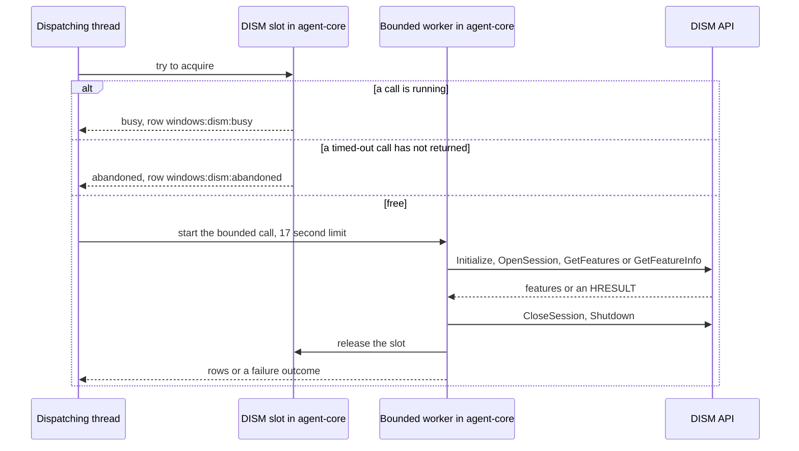
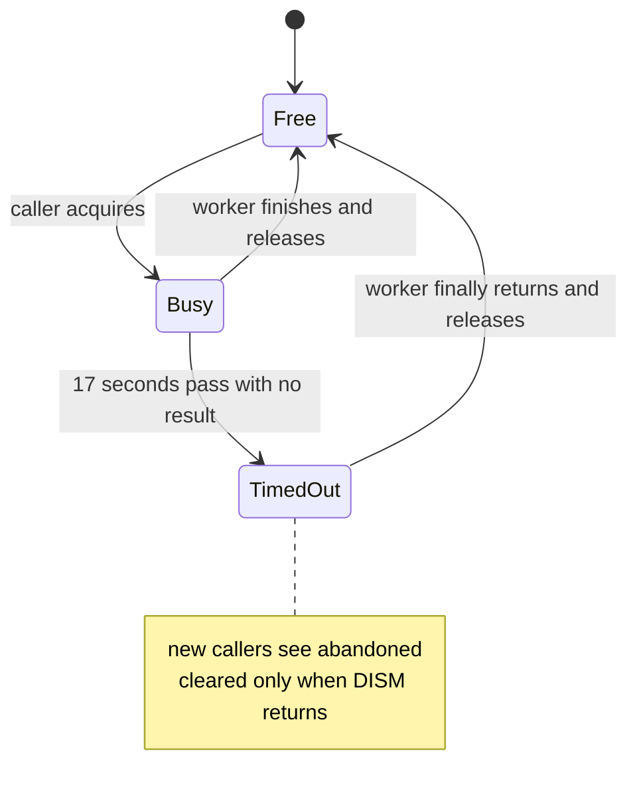

# windows_optional_features

<!-- BEGIN GENERATED: plugin-doc-gen header -->
| | |
|---|---|
| **What it does** | Windows optional OS feature state (enabled/disabled/pending) via the DISM API |
| **Version** | 1.0.0 |
| **Kind** | Collector · read-only · gathered (windows.features.list, windows.features.info) |
| **Platforms** | Windows ✅ · macOS ⛔ unsupported · Linux ⛔ unsupported |
| **Actions** | `info` (definition `windows.features.info`) · `list` (definition `windows.features.list`) |
| **Security** | securable `Inventory` · operation Read · risk Low · dispatch ReadOnly · approval gate None |
| **Roles** | execute: endpoint-admin, endpoint-operator · author: content-author |
<!-- END GENERATED -->

## How it works

The plugin reads which optional Windows features (Telnet client, TFTP, the IIS web server role, Virtual Machine Platform, .NET 3.5 and so on) are enabled, disabled or waiting on a restart, and changes nothing. `list` returns every feature with its state, optionally narrowed by a `state` filter; `info` returns one named feature with its display name, description and restart requirement. Both go through the Windows servicing API (DISM) in-process: no `dism.exe`, no WMI, no PowerShell.

Each call takes the agent's single DISM slot on the dispatching thread, then runs the same lifecycle on a worker thread: `DismInitialize`, `DismOpenSession` on the running OS, `DismGetFeatures` (`list`) or `DismGetFeatureInfo` (`info`), map each state number to a name, `DismCloseSession`, `DismShutdown`, release the slot. The whole call is bounded to 17 seconds. `DismApi.dll` is never linked; its eight exports are resolved from `System32` on first use. The slot, the session and the timeout all live in agent-core, which is never unloaded, so a worker that outlives a timeout never runs code belonging to a plugin that has been unloaded. Only one DISM call can be in flight in the agent at a time.

What it is not: no enable, disable, add, remove or commit (the eight resolved exports are the plugin's whole DISM surface and none of them mutates), no `dism.exe` subprocess, and no use of `Win32_OptionalFeature`.

### What you can decide with it

| Question | Action | How to read it |
|---|---|---|
| Is a risky legacy feature switched on (for example `SMB1Protocol` or `TelnetClient`)? | `list`, or `info` with `feature=<name>` | `state` is `enabled` |
| How many feature rows are in each state across the fleet? | `list`, grouped by `state` | `list` aggregates by `state` and counts feature rows. To count devices that have one named feature enabled, filter the `name` column (for example `SMB1Protocol`) and `state=enabled` |
| Is a feature change waiting for a restart? | `list` with `state=pending`, or `info` | `pending_enable` or `pending_disable`, and `restart_required` is 1 on `list` |
| What is this feature, and will changing it need a restart? | `info` | `display_name`, `description`, and `restart_type` of `no`, `possible`, `required` or `unknown` |

On Windows you get the answer from the running OS's own servicing store. On macOS and Linux you get a single `unsupported` row and nothing else (a malformed `feature` on `info` is still refused first, with an `invalid` row). A clean read proves what DISM reports as the configured state; it does not prove the feature's binaries are running, healthy or in use. `disabled` does not distinguish a feature whose payload is staged on disk from one that is removed (see caveat 4), and `list` says nothing about installed applications, MSI packages or patches (see the sibling plugins below).

### Diagrams

The behaviour that matters operationally is the slot: what a second caller, or a call after a timeout, sees.



A caller that finds the slot taken never touches DISM; it reports `busy` or `abandoned` and returns. The slot is released by the worker after DISM teardown, so the next caller never overlaps a half-closed session. The only exception is a call the agent-wide bounded-call ceiling refuses before it starts (64 outstanding calls): it never reaches DISM, the dispatching thread releases the slot, and the row is `windows:dism:busy`.



After a timeout the dispatching thread reports `windows:dism:timeout` and moves the slot to `TimedOut`; every later call reports `abandoned` until the original worker returns. If DISM never returns, only an agent service restart clears it.

## OS capability

<!-- BEGIN GENERATED: plugin-doc-gen capability -->
| Action | Windows | macOS | Linux |
|---|---|---|---|
| `info` | ✅ supported · rung 1 · DISM API DismOpenSession(DISM_ONLINE_IMAGE) + DismGetFeatures/DismGetFeatureInfo | ⛔ unsupported | ⛔ unsupported |
| `list` | ✅ supported · rung 1 · DISM API DismOpenSession(DISM_ONLINE_IMAGE) + DismGetFeatures/DismGetFeatureInfo | ⛔ unsupported | ⛔ unsupported |

**Declared limits per leg** (descriptor fallback text, verbatim):

- **`info` / Windows** — verified live on the-rig under NT AUTHORITY\\SYSTEM, 2026-09-08
- **`info` / macOS** — Windows-only: DISM has no Linux/macOS equivalent
- **`info` / Linux** — Windows-only: DISM has no Linux/macOS equivalent
- **`list` / Windows** — verified live on the-rig under NT AUTHORITY\\SYSTEM, 2026-09-08
- **`list` / macOS** — Windows-only: DISM has no Linux/macOS equivalent
- **`list` / Linux** — Windows-only: DISM has no Linux/macOS equivalent
<!-- END GENERATED -->

## Privileges and prerequisites

| OS | Runs as | Extra grant needed | Measured | If the read is refused |
|---|---|---|---|---|
| Windows | agent service account (LocalSystem today, #1442) | **Elevated token.** The DISM API refuses an unprivileged caller (`E_ACCESSDENIED`); LocalSystem already satisfies it, so no new grant is needed under the current deployment model. | 2026-09-08, bare-metal, `NT AUTHORITY\SYSTEM` (S4U scheduled task) | rows report `feature\|unavailable\|windows:dism:access_denied` / `feature_info\|unavailable\|windows:dism:access_denied`; result status `PERMISSION_DENIED` |
| macOS | agent daemon, root today (the LaunchDaemon carries no `UserName` key, see `docs/agent-privilege-model.md`) | n/a — action returns the honest-unsupported sentinel unconditionally | not applicable (Windows-only plugin) | n/a — no DISM call is attempted |
| Linux | agent daemon, unprivileged | n/a — action returns the honest-unsupported sentinel unconditionally | not applicable (Windows-only plugin) | n/a — no DISM call is attempted |

No subprocesses and no network access. `DismApi.dll` is resolved once, on first use, via `LoadLibraryExW(..., LOAD_LIBRARY_SEARCH_SYSTEM32)` + `GetProcAddress` against eight exports, never `DismApi.lib`/`#include <dismapi.h>` — no Windows ADK dependency (capture and provenance: `tests/unit/fixtures/wave9/windows_optional_features/dism_features_system.txt.provenance.txt`).

## Data contract

### Inputs

<!-- BEGIN GENERATED: plugin-doc-gen inputs -->
| Definition | Parameter | Type | Required | Default | Constraints | Description |
|---|---|---|---|---|---|---|
| `windows.features.info` | `feature` | string | yes | - | pattern: ^[A-Za-z0-9._-]{1,256}$ | The DISM feature name (FeatureName), e.g. NetFx3. The plugin additionally refuses any value containing a ".." substring (path-traversal guard) even though every individual character in such a value would otherwise match the pattern below. |
| `windows.features.list` | `state` | string | no | - | enum: enabled, disabled, pending | Optional filter narrowing the result to one state bucket. |
<!-- END GENERATED -->

### Outputs

Pipe-delimited rows via `write_output()`. `list` writes one `feature|` row per feature (or per matching feature when `state` filters; an unrecognised filter value is treated as no filter); `info` writes exactly one `feature_info|` row. An invalid `feature` value is refused before any DISM call with `feature_info|invalid|invalid 'feature' parameter: '<value>'` and exit code 1. On `list`, `restart_required` is 1 only for `pending_enable` and `pending_disable`; `info` reports DISM's own restart type. On an unsupported or unavailable leg, both actions instead write a single sentinel row: `feature|unsupported|<os>:dism:unsupported` / `feature|unavailable|windows:dism:<token>` (or the `feature_info` equivalent for `info`) — never a blank or omitted row.

<!-- BEGIN GENERATED: plugin-doc-gen outputs -->
**`windows.features.info` — `name|display_name|state|restart_type|description`**

| Field | Type | Values | Available | Example | Description |
|---|---|---|---|---|---|
| `name` | string | - | Windows | `NetFx3` | DISM feature name (FeatureName), e.g. NetFx3. |
| `display_name` | string | - | Windows | `.NET Framework 3.5 (includes .NET 2.0 and 3.0)` | Operator-visible feature display name (DismFeatureInfo.DisplayName). |
| `state` | string | - | Windows | `enabled` | Feature state. Values: enabled, disabled, pending_enable, pending_disable, superseded, partially_installed, unknown. |
| `restart_type` | string | - | Windows | `possible` | Restart requirement for a pending change (DismFeatureInfo.RestartRequired). Values: no, possible, required, unknown. |
| `description` | string | - | Windows | `.NET Framework 3.5 (includes .NET 2.0 and 3.0)` | Feature description (DismFeatureInfo.Description). |

**`windows.features.list` — `name|state|restart_required`**

| Field | Type | Values | Available | Example | Description |
|---|---|---|---|---|---|
| `name` | string | - | Windows | `NetFx3` | DISM feature name (FeatureName), e.g. NetFx3. |
| `state` | string | - | Windows | `enabled` | Feature state. Values: enabled, disabled, pending_enable, pending_disable, superseded, partially_installed, unknown. |
| `restart_required` | boolean | - | Windows | `0` | Whether a restart is needed to complete a pending enable/disable. Values: 1 (pending state), 0 (not pending) — a digit, never true/false. |
<!-- END GENERATED -->

### Result status

A failed or constrained read still exits 0 (only an invalid parameter or an unhandled exception exits 1), so a consumer must key on the typed status, not the exit code. The `windows:dism:*` tokens below are carried in the sentinel row (`feature|unavailable|<token>`); the status reason is human text, and for a DISM failure it is `hr=0x<code>` plus DISM's last error message.

| Status | Completeness | Provenance | When |
|---|---|---|---|
| `UNDECLARED` (agent-derived `OK`) | — | — | a clean `list`/`info` read — the DISM call succeeded and the feature row(s) were written |
| `UNAVAILABLE` | PARTIAL | `windows:dism:api_unavailable` | `DismApi.dll` or one of its eight required exports could not be resolved from `System32` |
| `UNAVAILABLE` | PARTIAL | `linux:dism:unsupported`, `macos:dism:unsupported` | Linux/macOS: DISM has no equivalent on this platform |
| `UNAVAILABLE` | FULL | `windows:dism:feature_not_found` | `info`: the named feature does not exist (`DismGetFeatureInfo` returns `DISMAPI_E_UNKNOWN_FEATURE`) |
| `CONSTRAINED` | PARTIAL | `windows:dism:busy` | another DISM call already holds the plugin's in-process slot, or the bounded-call outstanding-call ceiling rejected this call before it started |
| `CONSTRAINED` | PARTIAL | `windows:dism:abandoned` | a previous call timed out and its worker has not returned; the DISM API is still held by that worker until it does |
| `CONSTRAINED` | PARTIAL | `windows:dism:timeout` | `DismGetFeatures`/`DismGetFeatureInfo` did not return within the 17s bounded timeout |
| `CONSTRAINED` | PARTIAL | `windows:dism:initialize_failed`, `windows:dism:open_session_failed`, `windows:dism:get_features_failed`, `windows:dism:get_feature_info_failed` | a DISM session-lifecycle call failed with a non-access-denied HRESULT |
| `CONSTRAINED` | PARTIAL | `windows:dism:exception` | an unhandled exception was caught inside the bounded DISM call |
| `PERMISSION_DENIED` | PARTIAL | `windows:dism:access_denied` | a DISM call in the session returned `E_ACCESSDENIED` — the caller's token lacks the elevated privilege the DISM API requires |

### Where the data goes

- **Instruction result AND daily-sync inventory.** Rows travel over the agent's mTLS gRPC channel as the command response and land in the ResponseStore (`response_retention_days`, default 90 days), queryable at `/api/responses/{id}` and aggregatable (`list` groups by `state`, counted).
- **Also consumed by** the `installed_software` daily-sync source (`agents/core/src/sync_source_installed_software.cpp`), which calls `list` in-process on the agent's 24 h schedule: every feature becomes a `feat` row with ecosystem `optional_feature` and its DISM state in `version`. Not consumed by the TAR warehouse, DEX, or metrics. `gather.ttlSeconds: 300` only caps how often a repeat dispatch is served from cache.
- **Sensitivity.** Rows name which built-in Windows OS features are enabled on the device (e.g. `SMB1Protocol`, `TelnetClient`) — a security-relevant configuration signal, but no username, hostname, serial number or file path appears in any field.
- **Siblings:** `msi_packages` (installed third-party/MSI software, not OS features), `windows_updates` (patch history, not feature toggles), `registry`/`wmi` (general-purpose Windows reads this plugin's narrow DISM surface deliberately does not replace) — none join with this plugin's output.
- **MCP / REST.** Discover: `discover_plugins` (summary) → `yuzu://plugin-docs` (this page as data) → `discover_instructions` / `get_definition("windows.features.list")`. Run: `execute_instruction {definition_id, parameters}`. Read: `/api/responses/{id}`.

## Sample output

<!-- BEGIN GENERATED: plugin-doc-gen samples -->
**Windows** — captured: windows Windows 10.0.26200 x86_64 · bare-metal · 2026-09-08 · LocalSystem (elevated) · leg-hash f85a83ef6582

```
== action=list
feature|Printing-XPSServices-Features|enabled|0
feature|TelnetClient|disabled|0
feature|TFTP|disabled|0
feature|TIFFIFilter|disabled|0
feature|VirtualMachinePlatform|enabled|0
feature|Client-ProjFS|disabled|0
feature|SimpleTCP|disabled|0
feature|WorkFolders-Client|enabled|0
feature|NetFx3|enabled|0
feature|WCF-HTTP-Activation|disabled|0
feature|WCF-NonHTTP-Activation|disabled|0
feature|IIS-WebServerRole|disabled|0
… 12 of 137 rows shown
[result_status] UNDECLARED / UNKNOWN

== action=info feature=NetFx3
feature_info|NetFx3|.NET Framework 3.5 (includes .NET 2.0 and 3.0)|enabled|possible|.NET Framework 3.5 (includes .NET 2.0 and 3.0)
[result_status] UNDECLARED / UNKNOWN
```
<!-- END GENERATED -->

## Caveats and known gaps

1. **DISM is process-global and single-session.** The DISM API cannot safely run concurrent sessions from one process, so every `list` or `info` call is serialised through agent-core's `DismSlot`. A second caller receives `windows:dism:busy` rather than risking undefined behaviour, and a call rejected by the bounded-call outstanding-call ceiling is reported the same way.
2. **A timed-out call is `abandoned`, not cleared, until the worker returns.** If `DismGetFeatures` or `DismGetFeatureInfo` exceeds the 17 second limit, the dispatching thread reports `windows:dism:timeout` and marks the slot abandoned. Every later call reports `windows:dism:abandoned` until the original worker finishes, which is permanent if DISM itself never returns and is cleared only by a service restart.
3. **Pending states come from the feature enum, not a reboot-pending registry key.** `pending_enable` and `pending_disable` reflect DISM's `InstallPending` and `UninstallPending` values, and `list` sets `restart_required` to 1 only for those two states. `info` reports DISM's own `restart_type`, so an enabled feature can show `restart_required` 0 on `list` and `possible` on `info`.
4. **Feature names are DISM's internal names, and `disabled` covers three states.** `NetFx3`, `SMB1Protocol` and `TelnetClient` are the `FeatureName` values DISM uses, not Control Panel labels; `info` carries the operator-visible `display_name`. The `disabled` state also covers features whose payload is staged or removed, which the plugin does not tell apart.
5. **The macOS and Linux rows are placeholders by design.** DISM has no equivalent on either platform, so both legs return the `unsupported` row unconditionally, never an empty read or a fabricated value.

## Source and tests

<!-- BEGIN GENERATED: plugin-doc-gen source -->
- Plugin: `agents/plugins/windows_optional_features/src/windows_optional_features_plugin.cpp`
- Definitions: `content/definitions/windows_optional_features.yaml`
- Capability rows: `server/core/src/capability_decls/plugin_action_catalogue_windows_optional_features.hpp`
- Tests: `tests/unit/test_windows_optional_features_local_dispatcher.cpp` · `tests/unit/test_windows_optional_features_parsers.cpp`
- Privilege row: `docs/agent-privilege-model.md`
<!-- END GENERATED -->
